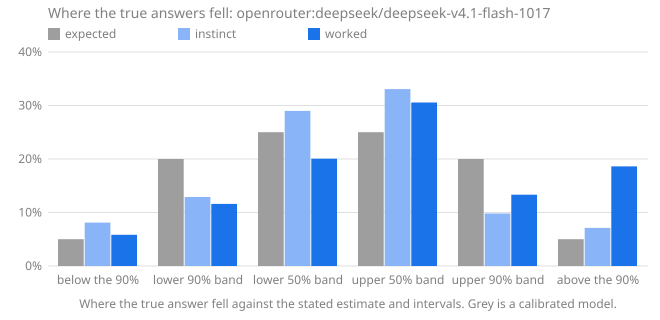

# Calibench report: openrouter:deepseek/deepseek-v4.1-flash-1017

Seed `calibench-v1`, 104 questions, Calibench 2.4.0, Python 3.13.16 (Unicode 15.1.0), started 2026-10-17T11:41:16+00:00. Scored with Calibench 2.5.0 (log-wis-2).

**Standard suite v1.**

Settings: effort low for instinct and medium for worked answers; token caps of 8,000 and 32,000.

Served by: deepseek/deepseek-v4.1-flash-1017 via DeepInfra, deepseek/deepseek-v4.1-flash-1017 via DeepSeek, deepseek/deepseek-v4.1-flash-1017 via InferenceNet.

Tokens: input 44,130, output 1,752,211, reasoning 1,743,511.

Cost reported by the API: 0.9191 (US dollars on OpenRouter).

## Summary

| | Instinct | Worked |
|---|---|---|
| Answered | 101 of 104 (3 truncated) | 88 of 104 (16 truncated) |
| **Score**, mean [90% interval] | **0.164** [0.117, 0.216] | **0.267** [0.193, 0.347] |
| Score, median | 0.039 | 0.007 |
| Score, answered questions only | 0.131 [0.094, 0.174] | 0.081 [0.043, 0.125] |
| Interval score, 50% / 90% intervals | 0.637 / 1.706 | 0.352 / 1.389 |
| 50% intervals containing the answer [90% interval] | 64 of 101 (63%) [55%, 71%] | 54 of 88 (61%) [53%, 69%] |
| … leaving out single numbers | 63 of 100 (63%): too wide (underconfident) | 33 of 57 (58%): consistent with calibrated |
| 90% intervals containing the answer [90% interval] | 86 of 101 (85%) [78%, 90%] | 69 of 88 (78%) [70%, 85%] |
| … leaving out single numbers | 86 of 101 (85%): consistent with calibrated | 55 of 72 (76%): too narrow (overconfident) |
| Answers given as certain (a single number) | 0, 0 exactly right | 16, 14 exactly right |
| Median error of the estimate | 1.9% | 0.5% |
| Output tokens per answer | 1,465 (1,435 reasoning) | 15,384 (15,330 reasoning) |
| Estimate closer to the answer | 19 | 51 |

Working it out lowered the score on 68 of 86 questions answered both ways, from 0.138 to 0.083 on average (improvement [0.016, 0.097]).

The score is the weighted interval score (Bracher et al., 2021) on a log scale: it combines the estimate and both intervals, is lowest when the stated intervals are the ones the model believes, and treats a miss by a factor in either direction alike. Lower is better; 0.1 is roughly a 10% miss. Intervals in brackets are 90% intervals over questions. Coverage verdicts leave out single-number intervals, which say "I know this exactly" and are counted on their own line.

The score counts each unanswered question as 1.289, the score of an answer off by a factor of ten with wide intervals, whatever the size of the true answer; the rows below it use answered questions only.

## Where the true answers fell

The estimate and the two intervals are five quantiles of the model's belief, so they split it into six bins, and a calibrated model's true answers land in each bin in the expected share. Too many in the outer bins means intervals too narrow; too many on one side of the estimate means a lean in that direction. Single-number answers are left out, and an answer on a boundary is shared between the bins it touches.

| The true answer was | Expected | Instinct | Worked |
|---|---|---|---|
| below the 90% interval | 5% | 8% (8.2) | 6% (4.2) |
| in the 90% interval, below the 50% | 20% | 13% (13.02) | 12% (8.356) |
| in the 50% interval, below the estimate | 25% | 29% (29.28) | 20% (14.44) |
| in the 50% interval, above the estimate | 25% | 33% (33.39) | 31% (22) |
| in the 90% interval, above the 50% | 20% | 10% (9.911) | 13% (9.6) |
| above the 90% interval | 5% | 7% (7.2) | 19% (13.4) |
| **above the estimate**, with 90% interval | 50% | 50% [41%, 58%] | 62% [53%, 71%] |

## Where the score comes from

A few large misses can carry a mean. This shows how much of each score its largest questions carry, and the worked answers whose 90% interval missed, costliest first.

| | Instinct | Worked |
|---|---|---|
| Share of the score from the largest question | 8% | 5% |
| Share from the five largest | 37% | 23% |
| Mean score without the largest question | 0.152 | 0.257 |

**Worked answers outside their 90% interval.** *Outside by* is the factor between the true answer and the nearer end of the interval; *width* is the ratio of the interval's ends, so a narrow interval that misses by a wide factor is a confident miss.

| # | Question | True answer | Estimate [90% interval] | Width | Outside by | Score | Share of score |
|---|---|---|---|---|---|---|---|
| 76 | function definitions in `operator` | 67 | 17 [14, 21] | ×1.47 | ×3.09 above | 1.246 | 4% |
| 38 | names in `locale.__all__` | 23 | 82 [81, 83] | ×1.02 | ×3.42 below | 1.236 | 4% |
| 16 | Unicode names with the word FRACTION | 98 | 31 [30, 33] | ×1.1 | ×2.91 above | 1.107 | 4% |
| 80 | names in `tabnanny.__all__` | 3 | 1 [1, 1] | ×1 | ×2 above | 0.693 | 2% |
| 18 | function definitions in `traceback` | 70 | 45 [38, 54] | ×1.41 | ×1.29 above | 0.361 | 1% |
| 10 | function definitions in `optparse` | 122 | 93 [88, 99] | ×1.12 | ×1.23 above | 0.242 | 1% |
| 27 | function definitions in `hmac` | 11 | 15 [13, 17] | ×1.29 | ×1.17 below | 0.239 | 1% |
| 54 | function definitions in `webbrowser` | 25 | 19 [17, 21] | ×1.22 | ×1.18 above | 0.228 | 1% |
| 77 | names in `difflib.__all__` | 12 | 9 [8, 10] | ×1.22 | ×1.18 above | 0.228 | 1% |
| 83 | function definitions in `weakref` | 65 | 50 [46, 54] | ×1.17 | ×1.2 above | 0.227 | 1% |
| | 9 more | | | | | | |

## By kind of question

Knowledge questions ask what is known (the Python standard library, the Unicode database); statistical ones need noise or irregularity modelled; exact ones have a closed-form answer that must be evaluated; calculation ones have an exact answer that takes long, careful arithmetic.

| Kind | Phase | Questions | Score | 50% hits | 90% hits |
|---|---|---|---|---|---|
| exact | instinct | 8 | 0.061 | 8 of 8 (100%) | 8 of 8 (100%) |
| exact | worked | 6 | 0.000 | 6 of 6 (100%) | 6 of 6 (100%) |
| knowledge | instinct | 48 | 0.186 | 28 of 48 (58%) | 38 of 48 (79%) |
| knowledge | worked | 46 | 0.151 | 21 of 46 (46%) | 30 of 46 (65%) |
| statistical | instinct | 45 | 0.084 | 28 of 45 (62%) | 40 of 45 (89%) |
| statistical | worked | 36 | 0.005 | 27 of 36 (75%) | 33 of 36 (92%) |

## By family

| Family | Kind | Questions | Score, worked | Score, instinct | Worked 90% hits | Worked answers above the estimate |
|---|---|---|---|---|---|---|
| `birthday` | exact | 6 | 0.000 | 0.061 | 6 of 6 (100%) | 50% |
| `collatz_steps` | statistical | 8 | 0.000 | 0.366 | 8 of 8 (100%) | 50% |
| `digit_sum_pow2` | statistical | 4 | 0.010 | 0.013 | 4 of 4 (100%) | 50% |
| `lis` | statistical | 4 | 0.013 | 0.062 | 2 of 4 (50%) | 50% |
| `module_all` | knowledge | 8 | 0.291 | 0.303 | 4 of 8 (50%) | 50% |
| `primes_in_range` | statistical | 4 | 0.007 | 0.009 | 4 of 4 (100%) | 75% |
| `rect_distance` | statistical | 8 | 0.000 | 0.007 | 7 of 8 (88%) | 62% |
| `stdlib_defs` | knowledge | 8 | 0.332 | 0.259 | 1 of 8 (12%) | 81% |
| `stdlib_lines` | knowledge | 7 | 0.074 | 0.263 | 6 of 7 (86%) | 57% |
| `unicode_block` | knowledge | 8 | 0.001 | 0.013 | 8 of 8 (100%) | 62% |
| `unicode_category` | knowledge | 8 | 0.013 | 0.041 | 7 of 8 (88%) | 43% |
| `unicode_word` | knowledge | 7 | 0.192 | 0.240 | 4 of 7 (57%) | 93% |
| `walk_max` | statistical | 8 | 0.005 | 0.026 | 8 of 8 (100%) | 62% |

## Questions

Each answer is shown as estimate [90% interval], ✓ or ✗ for whether the 50% and 90% intervals contain the true answer, and its score.

| # | Question | True answer | Instinct | Worked |
|---|---|---|---|---|
| 1 | Unicode names with the word MUSICAL | 518 | 550 [250, 800] 50✓ 90✓ · 0.072 | 481 [478, 484] 50✗ 90✗ · 0.071 |
| 2 | lines in `smtplib` | 1,123 | 1,100 [750, 1,450] 50✓ 90✓ · 0.045 | 1,195 [1,080, 1,310] 50✗ 90✓ · 0.036 |
| 3 | highest point of a 426-step walk | 15.8 | 16.5 [14, 19] 50✓ 90✓ · 0.027 | 15.98 [15.65, 16.3] 50✗ 90✓ · 0.006 |
| 4 | draws until a repeat, d = 35,930 | 238.2 | 238.2 [237.7, 238.8] 50✓ 90✓ · 0.000 | 238.2 [238.2, 238.2] 50✓ 90✓ · 0.000 |
| 5 | digit sum of 2^1269 | 1,736 | 1,720 [1,628, 1,812] 50✓ 90✓ · 0.008 | 1,723 [1,628, 1,817] 50✓ 90✓ · 0.008 |
| 6 | names in `timeit.__all__` | 4 | 4 [3, 5] 50✓ 90✓ · 0.008 | 4 [4, 4] 50✓ 90✓ · 0.000 |
| 7 | mean distance in a 1 × 2.52 rectangle | 0.9621 | 0.93 [0.84, 1.02] 50✗ 90✓ · 0.018 | 0.9625 [0.9609, 0.964] 50✓ 90✓ · 0.000 |
| 8 | code points in category Po | 628 | 650 [400, 900] 50✓ 90✓ · 0.054 | 642 [636, 648] 50✗ 90✗ · 0.018 |
| 9 | assigned in the Thaana block | 50 | 50 [45, 55] 50✓ 90✓ · 0.012 | 50 [49, 51] 50✓ 90✓ · 0.001 |
| 10 | function definitions in `optparse` | 122 | 96 [58, 145] 50✗ 90✓ · 0.135 | 93 [88, 99] 50✗ 90✗ · 0.242 |
| 11 | primes in [3,164,661, 3,229,443] | 4,399 | 4,325 [4,220, 4,430] 50✗ 90✓ · 0.009 | truncated · 1.289 |
| 12 | Collatz steps from 87,974,385,043 | 246 | 350 [150, 700] 50✗ 90✓ · 0.166 | 246 [246, 246] 50✓ 90✓ · 0.000 |
| 13 | longest increasing subsequence, n = 112 | 17.81 | 21.2 [20.7, 21.7] 50✗ 90✗ · 0.164 | 17.84 [17.65, 18.02] 50✓ 90✓ · 0.001 |
| 14 | mean distance in a 1 × 9.91 rectangle | 3.359 | truncated · 1.289 | 3.356 [3.354, 3.357] 50✗ 90✗ · 0.001 |
| 15 | assigned in the Thai block | 87 | 87 [70, 105] 50✓ 90✓ · 0.025 | 87 [87, 87] 50✓ 90✓ · 0.000 |
| 16 | Unicode names with the word FRACTION | 98 | 21 [16, 28] 50✗ 90✗ · 1.396 | 31 [30, 33] 50✗ 90✗ · 1.107 |
| 17 | code points in category Pc | 10 | 10 [8, 12] 50✓ 90✓ · 0.026 | 10 [10, 10] 50✓ 90✓ · 0.000 |
| 18 | function definitions in `traceback` | 70 | 45 [25, 70] 50✗ 90✓ · 0.246 | 45 [38, 54] 50✗ 90✗ · 0.361 |
| 19 | lines in `shutil` | 1,569 | 1,500 [900, 2,200] 50✓ 90✓ · 0.067 | 1,520 [1,380, 1,660] 50✓ 90✓ · 0.018 |
| 20 | longest increasing subsequence, n = 1,643 | 75.54 | 75 [73.5, 76.5] 50✓ 90✓ · 0.004 | 75.2 [74.9, 75.5] 50✗ 90✗ · 0.003 |
| 21 | highest point of a 1,512-step walk | 31.04 | 30.5 [28.8, 32.2] 50✗ 90✓ · 0.009 | 30.53 [29.92, 31.14] 50✗ 90✓ · 0.009 |
| 22 | primes in [8,284,359, 8,296,430] | 753 | 750 [690, 810] 50✓ 90✓ · 0.011 | 758 [704, 812] 50✓ 90✓ · 0.009 |
| 23 | Collatz steps from 337,264,368,477 | 248 | 198 [80, 500] 50✓ 90✓ · 0.157 | 248 [248, 248] 50✓ 90✓ · 0.000 |
| 24 | names in `weakref.__all__` | 13 | 13 [10, 16] 50✓ 90✓ · 0.023 | 14 [13, 15] 50✗ 90✓ · 0.044 |
| 25 | draws until a repeat, d = 6,620,093 | 3,225 | 3,225 [3,224, 3,227] 50✓ 90✓ · 0.000 | 3,225 [3,225, 3,225] 50✓ 90✓ · 0.000 |
| 26 | digit sum of 2^1219 | 1,550 | 1,650 [1,500, 1,800] 50✗ 90✓ · 0.035 | truncated · 1.289 |
| 27 | function definitions in `hmac` | 11 | 18 [8, 35] 50✗ 90✓ · 0.239 | 15 [13, 17] 50✗ 90✗ · 0.239 |
| 28 | assigned in the Playing Cards block | 82 | 82 [78, 86] 50✓ 90✓ · 0.004 | 82 [82, 82] 50✓ 90✓ · 0.000 |
| 29 | longest increasing subsequence, n = 4,365 | 125.4 | 125 [114, 136] 50✓ 90✓ · 0.011 | truncated · 1.289 |
| 30 | mean distance in a 1 × 4.45 rectangle | 1.572 | truncated · 1.289 | 1.572 [1.569, 1.574] 50✓ 90✓ · 0.000 |
| 31 | Unicode names with the word CAPITAL | 2,032 | 2,000 [1,200, 3,000] 50✓ 90✓ · 0.052 | 2,010 [1,300, 3,000] 50✓ 90✓ · 0.051 |
| 32 | Collatz steps from 904,534,976,486 | 239 | 180 [60, 800] 50✓ 90✓ · 0.199 | 239 [239, 239] 50✓ 90✓ · 0.000 |
| 33 | code points in category So | 6,639 | 7,000 [3,500, 12,000] 50✓ 90✓ · 0.079 | 7,000 [6,100, 7,900] 50✓ 90✓ · 0.027 |
| 34 | digit sum of 2^2531 | 3,353 | 3,420 [3,300, 3,550] 50✗ 90✓ · 0.010 | truncated · 1.289 |
| 35 | lines in `functools` | 1,036 | 550 [350, 800] 50✗ 90✗ · 0.472 | 1,080 [930, 1,280] 50✓ 90✓ · 0.026 |
| 36 | draws until a repeat, d = 46,781 | 271.7 | 271.8 [271.3, 272.2] 50✓ 90✓ · 0.000 | truncated · 1.289 |
| 37 | highest point of a 869-step walk | 22.92 | 23 [21.5, 24.5] 50✓ 90✓ · 0.008 | 23.03 [22.56, 23.49] 50✓ 90✓ · 0.003 |
| 38 | names in `locale.__all__` | 23 | 72 [65, 80] 50✗ 90✗ · 1.072 | 82 [81, 83] 50✗ 90✗ · 1.236 |
| 39 | primes in [591,475, 604,946] | 1,020 | 1,000 [940, 1,060] 50✓ 90✓ · 0.010 | 1,013 [953, 1,073] 50✓ 90✓ · 0.008 |
| 40 | longest increasing subsequence, n = 2,201 | 87.91 | 87.6 [87, 88.4] 50✗ 90✓ · 0.002 | truncated · 1.289 |
| 41 | code points in category Me | 13 | 13 [10, 16] 50✓ 90✓ · 0.023 | 12 [11, 13] 50✗ 90✓ · 0.048 |
| 42 | lines in `tabnanny` | 340 | 200 [100, 320] 50✗ 90✗ · 0.332 | 314 [285, 350] 50✗ 90✓ · 0.047 |
| 43 | primes in [310,586, 338,601] | 2,242 | 2,200 [1,900, 2,500] 50✓ 90✓ · 0.018 | 2,230 [2,170, 2,290] 50✓ 90✓ · 0.004 |
| 44 | mean distance in a 1 × 4.51 rectangle | 1.59 | 1.58 [1.35, 1.85] 50✓ 90✓ · 0.019 | 1.591 [1.588, 1.594] 50✓ 90✓ · 0.000 |
| 45 | function definitions in `csv` | 17 | 35 [20, 60] 50✗ 90✗ · 0.459 | 17 [16, 18] 50✓ 90✓ · 0.002 |
| 46 | digit sum of 2^7366 | 10,060 | 9,980 [9,760, 10,200] 50✓ 90✓ · 0.004 | 9,979 [9,757, 10,203] 50✓ 90✓ · 0.004 |
| 47 | Collatz steps from 189,630,655,112 | 291 | 350 [90, 850] 50✓ 90✓ · 0.163 | 291 [291, 291] 50✓ 90✓ · 0.000 |
| 48 | draws until a repeat, d = 2,138 | 58.62 | 59 [15, 113] 50✓ 90✓ · 0.118 | 58.62 [58.62, 58.62] 50✓ 90✓ · 0.000 |
| 49 | names in `base64.__all__` | 22 | 22 [18, 26] 50✓ 90✓ · 0.024 | 20 [20, 20] 50✗ 90✗ · 0.091 |
| 50 | Unicode names with the word GREEK | 531 | 570 [480, 660] 50✗ 90✓ · 0.038 | 519 [505, 535] 50✗ 90✓ · 0.014 |
| 51 | assigned in the General Punctuation block | 111 | 111 [108, 112] 50✓ 90✓ · 0.003 | 111 [110, 112] 50✓ 90✓ · 0.000 |
| 52 | highest point of a 707-step walk | 20.72 | 20.72 [20.3, 21.15] 50✓ 90✓ · 0.002 | 20.72 [20.31, 21.14] 50✓ 90✓ · 0.002 |
| 53 | lines in `glob` | 572 | 220 [130, 320] 50✗ 90✗ · 0.791 | truncated · 1.289 |
| 54 | function definitions in `webbrowser` | 25 | 55 [35, 80] 50✗ 90✗ · 0.564 | 19 [17, 21] 50✗ 90✗ · 0.228 |
| 55 | assigned in the Lao block | 83 | 80 [67, 96] 50✓ 90✓ · 0.027 | 82 [79, 85] 50✓ 90✓ · 0.006 |
| 56 | longest increasing subsequence, n = 452 | 38.19 | truncated · 1.289 | truncated · 1.289 |
| 57 | highest point of a 1,229-step walk | 27.5 | 28 [12, 50] 50✓ 90✓ · 0.083 | 27.48 [26.93, 28.03] 50✓ 90✓ · 0.003 |
| 58 | digit sum of 2^8596 | 11,455 | 11,646 [11,406, 11,886] 50✗ 90✓ · 0.009 | 11,644 [11,410, 11,887] 50✗ 90✓ · 0.009 |
| 59 | draws until a repeat, d = 6,016 | 97.88 | 98 [25, 195] 50✓ 90✓ · 0.119 | truncated · 1.289 |
| 60 | names in `gzip.__all__` | 5 | 3 [2, 6] 50✓ 90✓ · 0.139 | 5 [5, 5] 50✓ 90✓ · 0.000 |
| 61 | code points in category Pf | 10 | 10 [5, 15] 50✓ 90✓ · 0.056 | 10 [9, 11] 50✓ 90✓ · 0.004 |
| 62 | primes in [335,112, 371,030] | 2,787 | 2,800 [2,640, 2,970] 50✓ 90✓ · 0.008 | truncated · 1.289 |
| 63 | Unicode names with the word HEBREW | 134 | 150 [70, 260] 50✓ 90✓ · 0.103 | 134 [125, 143] 50✓ 90✓ · 0.006 |
| 64 | mean distance in a 1 × 2.07 rectangle | 0.826 | 0.826 [0.806, 0.846] 50✓ 90✓ · 0.003 | 0.8258 [0.8235, 0.8285] 50✓ 90✓ · 0.000 |
| 65 | Collatz steps from 23,010,656,711 | 195 | 250 [130, 500] 50✗ 90✓ · 0.133 | 195 [195, 195] 50✓ 90✓ · 0.000 |
| 66 | code points in category Sk | 125 | 125 [80, 180] 50✓ 90✓ · 0.040 | 125 [124, 126] 50✓ 90✓ · 0.000 |
| 67 | draws until a repeat, d = 131,706 | 455.5 | 455 [116, 889] 50✓ 90✓ · 0.118 | 455.5 [455.5, 455.5] 50✓ 90✓ · 0.000 |
| 68 | Unicode names with the word FACE | 179 | 200 [50, 500] 50✓ 90✓ · 0.159 | truncated · 1.289 |
| 69 | longest increasing subsequence, n = 827 | 52.6 | 57.6 [56, 59.2] 50✗ 90✗ · 0.078 | 52.35 [51.55, 53.15] 50✓ 90✓ · 0.003 |
| 70 | digit sum of 2^3289 | 4,430 | 4,460 [4,310, 4,610] 50✓ 90✓ · 0.005 | truncated · 1.289 |
| 71 | assigned in the Georgian block | 88 | 88 [82, 94] 50✓ 90✓ · 0.007 | 88 [88, 88] 50✓ 90✓ · 0.000 |
| 72 | mean distance in a 1 × 3.1 rectangle | 1.142 | 1.143 [1.139, 1.147] 50✓ 90✓ · 0.000 | 1.143 [1.141, 1.145] 50✓ 90✓ · 0.000 |
| 73 | highest point of a 1,415-step walk | 29.89 | 30 [12, 46] 50✓ 90✓ · 0.068 | 29.52 [28.93, 30.11] 50✗ 90✓ · 0.007 |
| 74 | primes in [188,978, 218,173] | 2,379 | 2,380 [2,280, 2,480] 50✓ 90✓ · 0.004 | truncated · 1.289 |
| 75 | lines in `statistics` | 1,817 | 2,200 [1,500, 3,000] 50✗ 90✓ · 0.097 | 2,450 [1,800, 3,200] 50✗ 90✓ · 0.168 |
| 76 | function definitions in `operator` | 67 | 95 [60, 140] 50✗ 90✓ · 0.187 | 17 [14, 21] 50✗ 90✗ · 1.246 |
| 77 | names in `difflib.__all__` | 12 | 9 [7, 11] 50✗ 90✗ · 0.179 | 9 [8, 10] 50✗ 90✗ · 0.228 |
| 78 | Collatz steps from 360,172,167,088 | 160 | 600 [350, 1,000] 50✗ 90✗ · 1.091 | 160 [160, 160] 50✓ 90✓ · 0.000 |
| 79 | Collatz steps from 905,376,815,232 | 177 | 550 [100, 1,500] 50✗ 90✓ · 0.588 | 177 [177, 177] 50✓ 90✓ · 0.000 |
| 80 | names in `tabnanny.__all__` | 3 | 5 [3, 7] 50✗ 90✓ · 0.218 | 1 [1, 1] 50✗ 90✗ · 0.693 |
| 81 | digit sum of 2^706 | 925 | 960 [890, 1,030] 50✗ 90✓ · 0.019 | 956.5 [889, 1,033] 50✗ 90✓ · 0.019 |
| 82 | draws until a repeat, d = 944,525 | 1,219 | 1,219 [1,100, 1,350] 50✓ 90✓ · 0.010 | 1,219 [1,219, 1,219] 50✓ 90✓ · 0.000 |
| 83 | function definitions in `weakref` | 65 | 60 [30, 110] 50✓ 90✓ · 0.098 | 50 [46, 54] 50✗ 90✗ · 0.227 |
| 84 | primes in [865,988, 892,619] | 1,952 | 1,950 [1,850, 2,050] 50✓ 90✓ · 0.005 | truncated · 1.289 |
| 85 | code points in category Nd | 680 | 660 [630, 690] 50✗ 90✓ · 0.017 | 680 [660, 700] 50✓ 90✓ · 0.004 |
| 86 | longest increasing subsequence, n = 121 | 18.59 | 18.5 [18, 19] 50✓ 90✓ · 0.004 | 19.9 [18.9, 20.9] 50✗ 90✗ · 0.046 |
| 87 | highest point of a 853-step walk | 22.61 | 22.8 [21.4, 24.2] 50✓ 90✓ · 0.009 | 22.81 [22.35, 23.27] 50✗ 90✓ · 0.005 |
| 88 | mean distance in a 1 × 7.13 rectangle | 2.442 | 2.442 [2.437, 2.447] 50✓ 90✓ · 0.000 | 2.442 [2.438, 2.446] 50✓ 90✓ · 0.000 |
| 89 | Unicode names with the word DIGIT | 898 | 920 [650, 1,300] 50✓ 90✓ · 0.043 | 808 [788, 828] 50✗ 90✗ · 0.095 |
| 90 | assigned in the Gothic block | 27 | 27 [24, 30] 50✓ 90✓ · 0.011 | 27 [27, 27] 50✓ 90✓ · 0.000 |
| 91 | lines in `string` | 314 | 230 [120, 400] 50✗ 90✓ · 0.176 | 300 [270, 340] 50✗ 90✓ · 0.024 |
| 92 | draws until a repeat, d = 4,022 | 80.15 | 80 [20, 156] 50✓ 90✓ · 0.121 | 80.15 [80.15, 80.15] 50✓ 90✓ · 0.000 |
| 93 | primes in [1,135,630, 1,167,274] | 2,277 | 2,265 [2,140, 2,390] 50✓ 90✓ · 0.007 | 2,267 [2,180, 2,354] 50✓ 90✓ · 0.005 |
| 94 | assigned in the Greek and Coptic block | 135 | 135 [120, 150] 50✓ 90✓ · 0.012 | 135 [134, 136] 50✓ 90✓ · 0.000 |
| 95 | names in `mailbox.__all__` | 17 | 6 [3, 10] 50✗ 90✗ · 0.759 | 16 [15, 17] 50✗ 90✓ · 0.037 |
| 96 | mean distance in a 1 × 1.09 rectangle | 0.5454 | 0.545 [0.538, 0.552] 50✓ 90✓ · 0.001 | 0.5451 [0.5444, 0.5458] 50✓ 90✓ · 0.000 |
| 97 | code points in category Cf | 170 | 170 [120, 220] 50✓ 90✓ · 0.036 | 170 [168, 172] 50✓ 90✓ · 0.002 |
| 98 | Collatz steps from 70,587,310,865 | 194 | 380 [220, 560] 50✗ 90✗ · 0.434 | 194 [193, 195] 50✓ 90✓ · 0.000 |
| 99 | digit sum of 2^5606 | 7,438 | 7,596 [7,402, 7,790] 50✗ 90✓ · 0.012 | truncated · 1.289 |
| 100 | Unicode names with the word CYRILLIC | 507 | 550 [380, 750] 50✓ 90✓ · 0.055 | 504 [499, 509] 50✗ 90✓ · 0.004 |
| 101 | longest increasing subsequence, n = 104 | 17.15 | 21.5 [19, 24] 50✗ 90✗ · 0.172 | truncated · 1.289 |
| 102 | lines in `reprlib` | 230 | 180 [100, 300] 50✗ 90✓ · 0.126 | 181 [168, 198] 50✗ 90✗ · 0.201 |
| 103 | function definitions in `base64` | 28 | 22 [17, 27] 50✗ 90✗ · 0.146 | 24 [22, 26] 50✗ 90✗ · 0.113 |
| 104 | highest point of a 996-step walk | 24.79 | 24.7 [23.8, 25.6] 50✓ 90✓ · 0.005 | 24.69 [24.19, 25.18] 50✓ 90✓ · 0.003 |
