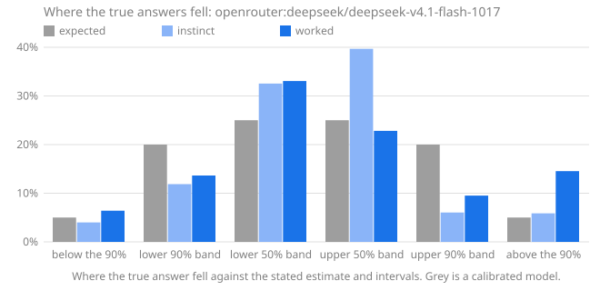

# Calibench report: openrouter:deepseek/deepseek-v4.1-flash-1017

Seed `calibench-v2`, 108 questions, Calibench 2.4.0, Python 3.13.16 (Unicode 15.1.0), started 2026-10-17T11:41:16+00:00. Scored with Calibench 2.5.0 (log-wis-2).

**Standard suite v2.**

Settings: effort low for instinct and medium for worked answers; token caps of 8,000 and 32,000.

Served by: deepseek/deepseek-v4.1-flash-1017 via DeepInfra, deepseek/deepseek-v4.1-flash-1017 via DeepSeek, deepseek/deepseek-v4.1-flash-1017 via InferenceNet.

Tokens: input 45,116, output 1,712,211, reasoning 1,703,308.

Cost reported by the API: 0.9104 (US dollars on OpenRouter).

## Summary

| | Instinct | Worked |
|---|---|---|
| Answered | 106 of 108 (2 truncated) | 86 of 108 (1 error, 21 truncated) |
| **Score**, mean [90% interval] | **0.113** [0.080, 0.148] | **0.292** [0.210, 0.374] |
| Score, median | 0.017 | 0.002 |
| Score, answered questions only | 0.091 [0.068, 0.115] | 0.036 [0.015, 0.063] |
| Interval score, 50% / 90% intervals | 0.463 / 1.084 | 0.161 / 0.576 |
| 50% intervals containing the answer [90% interval] | 79 of 106 (75%) [67%, 81%] | 63 of 86 (73%) [65%, 80%] |
| … leaving out single numbers | 77 of 103 (75%): too wide (underconfident) | 28 of 45 (62%): consistent with calibrated |
| 90% intervals containing the answer [90% interval] | 96 of 106 (91%) [85%, 94%] | 71 of 86 (83%) [75%, 88%] |
| … leaving out single numbers | 95 of 105 (90%): consistent with calibrated | 51 of 64 (80%): too narrow (overconfident) |
| Answers given as certain (a single number) | 1, 1 exactly right | 22, 20 exactly right |
| Median error of the estimate | 0.7% | 0.0% |
| Output tokens per answer | 1,290 (1,259 reasoning) | 14,700 (14,648 reasoning) |
| Estimate closer to the answer | 16 | 45 |

Working it out lowered the score on 67 of 84 questions answered both ways, from 0.084 to 0.037 on average (improvement [0.024, 0.074]).

The score is the weighted interval score (Bracher et al., 2021) on a log scale: it combines the estimate and both intervals, is lowest when the stated intervals are the ones the model believes, and treats a miss by a factor in either direction alike. Lower is better; 0.1 is roughly a 10% miss. Intervals in brackets are 90% intervals over questions. Coverage verdicts leave out single-number intervals, which say "I know this exactly" and are counted on their own line.

The score counts each unanswered question as 1.289, the score of an answer off by a factor of ten with wide intervals, whatever the size of the true answer; the rows below it use answered questions only.

## Where the true answers fell

The estimate and the two intervals are five quantiles of the model's belief, so they split it into six bins, and a calibrated model's true answers land in each bin in the expected share. Too many in the outer bins means intervals too narrow; too many on one side of the estimate means a lean in that direction. Single-number answers are left out, and an answer on a boundary is shared between the bins it touches.

| The true answer was | Expected | Instinct | Worked |
|---|---|---|---|
| below the 90% interval | 5% | 4% (4.2) | 6% (4.105) |
| in the 90% interval, below the 50% | 20% | 12% (12.47) | 14% (8.731) |
| in the 50% interval, below the estimate | 25% | 33% (34.17) | 33% (21.16) |
| in the 50% interval, above the estimate | 25% | 40% (41.67) | 23% (14.61) |
| in the 90% interval, above the 50% | 20% | 6% (6.333) | 10% (6.087) |
| above the 90% interval | 5% | 6% (6.167) | 15% (9.305) |
| **above the estimate**, with 90% interval | 50% | 51% [43%, 59%] | 47% [37%, 57%] |

## Where the score comes from

A few large misses can carry a mean. This shows how much of each score its largest questions carry, and the worked answers whose 90% interval missed, costliest first.

| | Instinct | Worked |
|---|---|---|
| Share of the score from the largest question | 11% | 4% |
| Share from the five largest | 37% | 20% |
| Mean score without the largest question | 0.102 | 0.282 |

**Worked answers outside their 90% interval.** *Outside by* is the factor between the true answer and the nearer end of the interval; *width* is the ratio of the interval's ends, so a narrow interval that misses by a wide factor is a confident miss.

| # | Question | True answer | Estimate [90% interval] | Width | Outside by | Score | Share of score |
|---|---|---|---|---|---|---|---|
| 4 | function definitions in `tabnanny` | 17 | 5 [4, 6] | ×1.4 | ×2.57 above | 1.044 | 3% |
| 29 | Unicode names with the word SIGN | 3,393 | 1,450 [700, 2,600] | ×3.71 | ×1.3 above | 0.589 | 2% |
| 26 | code points in category Lm | 397 | 291 [285, 297] | ×1.04 | ×1.34 above | 0.301 | 1% |
| 56 | names in `zipapp.__all__` | 3 | 2 [2, 2] | ×1 | ×1.33 above | 0.288 | 1% |
| 83 | function definitions in `shlex` | 15 | 12 [10, 14] | ×1.36 | ×1.07 above | 0.142 | 0% |
| 3 | lines in `statistics` | 1,817 | 2,250 [1,850, 2,650] | ×1.43 | ×1.02 below | 0.128 | 0% |
| 28 | lines in `base64` | 628 | 736 [680, 790] | ×1.16 | ×1.08 below | 0.125 | 0% |
| 107 | Unicode names with the word DIGIT | 898 | 798 [790, 806] | ×1.02 | ×1.11 above | 0.114 | 0% |
| 54 | function definitions in `uuid` | 47 | 42 [39, 45] | ×1.15 | ×1.04 above | 0.081 | 0% |
| 42 | code points in category Ps | 79 | 83 [82, 84] | ×1.02 | ×1.04 below | 0.044 | 0% |
| | 5 more | | | | | | |

## By kind of question

Knowledge questions ask what is known (the Python standard library, the Unicode database); statistical ones need noise or irregularity modelled; exact ones have a closed-form answer that must be evaluated; calculation ones have an exact answer that takes long, careful arithmetic.

| Kind | Phase | Questions | Score | 50% hits | 90% hits |
|---|---|---|---|---|---|
| calculation | instinct | 30 | 0.034 | 30 of 30 (100%) | 30 of 30 (100%) |
| calculation | worked | 26 | 0.000 | 25 of 26 (96%) | 25 of 26 (96%) |
| exact | instinct | 5 | 0.005 | 5 of 5 (100%) | 5 of 5 (100%) |
| exact | worked | 6 | 0.000 | 6 of 6 (100%) | 6 of 6 (100%) |
| knowledge | instinct | 36 | 0.172 | 21 of 36 (58%) | 28 of 36 (78%) |
| knowledge | worked | 29 | 0.103 | 15 of 29 (52%) | 18 of 29 (62%) |
| statistical | instinct | 35 | 0.069 | 23 of 35 (66%) | 33 of 35 (94%) |
| statistical | worked | 25 | 0.004 | 17 of 25 (68%) | 22 of 25 (88%) |

## By family

| Family | Kind | Questions | Score, worked | Score, instinct | Worked 90% hits | Worked answers above the estimate |
|---|---|---|---|---|---|---|
| `birthday` | exact | 6 | 0.000 | 0.005 | 6 of 6 (100%) | 33% |
| `collatz_steps` | statistical | 6 | 0.000 | 0.260 | 6 of 6 (100%) | 50% |
| `days_between` | calculation | 6 | 0.000 | 0.003 | 6 of 6 (100%) | 50% |
| `digit_sum_pow2` | statistical | 2 | 0.005 | 0.008 | 2 of 2 (100%) | 50% |
| `factorial_digits` | calculation | 6 | 0.000 | 0.001 | 5 of 6 (83%) | 50% |
| `friday13` | calculation | 6 | 0.001 | 0.017 | 6 of 6 (100%) | 50% |
| `lis` | statistical | 2 | 0.005 | 0.022 | 1 of 2 (50%) | 50% |
| `module_all` | knowledge | 6 | 0.054 | 0.242 | 5 of 6 (83%) | 62% |
| `multiply` | calculation | 6 | 0.000 | 0.007 | 6 of 6 (100%) | 50% |
| `partitions` | calculation | 2 | 0.001 | 0.140 | 2 of 2 (100%) | 50% |
| `primes_in_range` | statistical | 3 | 0.014 | 0.020 | 3 of 3 (100%) | 67% |
| `rect_distance` | statistical | 6 | 0.000 | 0.043 | 5 of 6 (83%) | 33% |
| `stdlib_defs` | knowledge | 4 | 0.324 | 0.407 | 0 of 4 (0%) | 75% |
| `stdlib_lines` | knowledge | 5 | 0.065 | 0.067 | 3 of 5 (60%) | 0% |
| `unicode_block` | knowledge | 6 | 0.001 | 0.004 | 6 of 6 (100%) | 50% |
| `unicode_category` | knowledge | 6 | 0.058 | 0.079 | 4 of 6 (67%) | 58% |
| `unicode_word` | knowledge | 2 | 0.352 | 0.234 | 0 of 2 (0%) | 100% |
| `walk_max` | statistical | 6 | 0.007 | 0.056 | 5 of 6 (83%) | 33% |

## Questions

Each answer is shown as estimate [90% interval], ✓ or ✗ for whether the 50% and 90% intervals contain the true answer, and its score.

| # | Question | True answer | Instinct | Worked |
|---|---|---|---|---|
| 1 | Friday the 13ths in 1607–1713 | 185 | 183 [160, 205] 50✓ 90✓ · 0.016 | 185 [185, 185] 50✓ 90✓ · 0.000 |
| 2 | primes in [3,218,046, 3,219,109] | 68 | 71 [59, 83] 50✓ 90✓ · 0.026 | truncated · 1.289 |
| 3 | lines in `statistics` | 1,817 | 1,500 [800, 2,300] 50✗ 90✓ · 0.104 | 2,250 [1,850, 2,650] 50✗ 90✗ · 0.128 |
| 4 | function definitions in `tabnanny` | 17 | 6 [3, 10] 50✗ 90✗ · 0.759 | 5 [4, 6] 50✗ 90✗ · 1.044 |
| 5 | digits of 246! | 483 | 483 [480, 486] 50✓ 90✓ · 0.001 | 483 [483, 483] 50✓ 90✓ · 0.000 |
| 6 | mean distance in a 1 × 1.33 rectangle | 0.6103 | 0.611 [0.551, 0.671] 50✓ 90✓ · 0.011 | 0.6106 [0.6098, 0.6114] 50✓ 90✓ · 0.000 |
| 7 | Unicode names with the word LATIN | 1,567 | 2,400 [900, 6,000] 50✗ 90✓ · 0.236 | truncated · 1.289 |
| 8 | draws until a repeat, d = 303 | 22.49 | 22.49 [22.43, 22.55] 50✓ 90✓ · 0.000 | 22.49 [22.44, 22.54] 50✓ 90✓ · 0.000 |
| 9 | names in `random.__all__` | 26 | 13 [9, 18] 50✗ 90✗ · 0.523 | 26 [25, 27] 50✓ 90✓ · 0.001 |
| 10 | assigned in the Cherokee block | 92 | 92 [86, 96] 50✓ 90✓ · 0.006 | 92 [92, 92] 50✓ 90✓ · 0.000 |
| 11 | Collatz steps from 611,221,186,107 | 378 | 600 [250, 1,400] 50✗ 90✓ · 0.254 | 378 [377, 379] 50✓ 90✓ · 0.000 |
| 12 | longest increasing subsequence, n = 600 | 44.3 | 44 [42.5, 45.7] 50✓ 90✓ · 0.006 | 43.85 [43.65, 44.05] 50✗ 90✗ · 0.008 |
| 13 | highest point of a 901-step walk | 23.33 | 23.46 [23.16, 23.75] 50✗ 90✓ · 0.003 | 23.46 [22.98, 23.94] 50✓ 90✓ · 0.004 |
| 14 | 6,787 × 2,142 | 14,537,754 | 14,540,000 [14,250,000, 14,850,000] 50✓ 90✓ · 0.002 | 14,537,754 [14,537,754, 14,537,754] 50✓ 90✓ · 0.000 |
| 15 | days from 2381-11-09 to 2400-03-01 | 6,687 | 6,687 [6,500, 6,850] 50✓ 90✓ · 0.002 | 6,687 [6,687, 6,687] 50✓ 90✓ · 0.000 |
| 16 | code points in category Nd | 680 | 660 [620, 700] 50✗ 90✓ · 0.017 | 680 [660, 680] 50✓ 90✓ · 0.001 |
| 17 | digit sum of 2^2579 | 3,479 | 3,500 [3,365, 3,630] 50✓ 90✓ · 0.006 | truncated · 1.289 |
| 18 | partitions of 246 | 169,296,722,391,554 | 170,000,000,000,000 [100,000,000,000,000, 280,000,000,000,000] 50✓ 90✓ · 0.057 | truncated · 1.289 |
| 19 | Collatz steps from 273,342,000,302 | 201 | 300 [150, 700] 50✗ 90✓ · 0.229 | 201 [199, 203] 50✓ 90✓ · 0.000 |
| 20 | days from 2367-07-04 to 2367-08-26 | 53 | 53 [50, 56] 50✓ 90✓ · 0.006 | 53 [53, 53] 50✓ 90✓ · 0.000 |
| 21 | longest increasing subsequence, n = 880 | 54.39 | 54 [52.5, 55.5] 50✓ 90✓ · 0.004 | truncated · 1.289 |
| 22 | digits of 10,938! | 39,431 | 39,431 [39,320, 39,540] 50✓ 90✓ · 0.000 | 39,433 [39,433, 39,433] 50✗ 90✗ · 0.000 |
| 23 | draws until a repeat, d = 3,428 | 74.05 | 74 [62, 86] 50✓ 90✓ · 0.017 | 74.05 [74.05, 74.05] 50✓ 90✓ · 0.000 |
| 24 | assigned in the Arabic Presentation Forms-B block | 141 | 141 [139, 144] 50✓ 90✓ · 0.002 | 142 [140, 143] 50✓ 90✓ · 0.003 |
| 25 | 21,339 × 2,935 | 62,629,965 | 62,600,000 [60,000,000, 65,000,000] 50✓ 90✓ · 0.004 | 62,629,965 [62,625,000, 62,635,000] 50✓ 90✓ · 0.000 |
| 26 | code points in category Lm | 397 | 260 [180, 340] 50✗ 90✗ · 0.307 | 291 [285, 297] 50✗ 90✗ · 0.301 |
| 27 | mean distance in a 1 × 6.93 rectangle | 2.377 | truncated · 1.289 | 2.377 [2.375, 2.378] 50✓ 90✓ · 0.000 |
| 28 | lines in `base64` | 628 | 650 [400, 900] 50✓ 90✓ · 0.054 | 736 [680, 790] 50✗ 90✗ · 0.125 |
| 29 | Unicode names with the word SIGN | 3,393 | 1,800 [600, 4,000] 50✗ 90✓ · 0.360 | 1,450 [700, 2,600] 50✗ 90✗ · 0.589 |
| 30 | partitions of 256 | 365,749,566,870,782 | 360,000,000,000,000 [20,000,000,000,000, 8,000,000,000,000,000] 50✓ 90✓ · 0.290 | truncated · 1.289 |
| 31 | primes in [3,705,675, 3,741,104] | 2,356 | 2,350 [2,268, 2,432] 50✓ 90✓ · 0.005 | 2,341 [2,258, 2,424] 50✓ 90✓ · 0.005 |
| 32 | Friday the 13ths in 2120–2204 | 147 | 146 [134, 158] 50✓ 90✓ · 0.011 | 147 [147, 147] 50✓ 90✓ · 0.000 |
| 33 | names in `fractions.__all__` | 1 | 2 [2, 3] 50✗ 90✗ · 0.411 | 1 [1, 2] 50✓ 90✓ · 0.008 |
| 34 | highest point of a 608-step walk | 19.36 | 19.2 [18.4, 20] 50✓ 90✓ · 0.006 | 19.18 [18.8, 19.57] 50✗ 90✓ · 0.005 |
| 35 | function definitions in `inspect` | 148 | 90 [55, 140] 50✗ 90✗ · 0.295 | truncated · 1.289 |
| 36 | digit sum of 2^4112 | 5,575 | 5,570 [5,410, 5,730] 50✓ 90✓ · 0.003 | 5,566 [5,395, 5,737] 50✓ 90✓ · 0.004 |
| 37 | Unicode names with the word STAR | 61 | 110 [30, 300] 50✗ 90✓ · 0.298 | truncated · 1.289 |
| 38 | highest point of a 400-step walk | 15.36 | 16 [1, 39] 50✓ 90✓ · 0.200 | 15.47 [15.13, 15.81] 50✓ 90✓ · 0.004 |
| 39 | digit sum of 2^4557 | 6,011 | 6,174 [6,000, 6,350] 50✗ 90✓ · 0.015 | truncated · 1.289 |
| 40 | names in `bdb.__all__` | 3 | 5 [3, 8] 50✗ 90✓ · 0.220 | 3 [3, 4] 50✓ 90✓ · 0.004 |
| 41 | days from 2360-02-08 to 2360-03-27 | 48 | 48 [48, 48] 50✓ 90✓ · 0.000 | 48 [48, 48] 50✓ 90✓ · 0.000 |
| 42 | code points in category Ps | 79 | 75 [40, 120] 50✓ 90✓ · 0.072 | 83 [82, 84] 50✗ 90✗ · 0.044 |
| 43 | digits of 395! | 856 | 856 [851, 861] 50✓ 90✓ · 0.001 | 856 [855, 857] 50✓ 90✓ · 0.000 |
| 44 | Collatz steps from 257,793,746,753 | 170 | 350 [150, 700] 50✗ 90✓ · 0.387 | 170 [170, 170] 50✓ 90✓ · 0.000 |
| 45 | lines in `subprocess` | 2,259 | 2,100 [1,500, 2,800] 50✓ 90✓ · 0.046 | 2,265 [2,000, 2,520] 50✓ 90✓ · 0.011 |
| 46 | assigned in the Georgian block | 88 | 88 [80, 94] 50✓ 90✓ · 0.008 | 88 [87, 89] 50✓ 90✓ · 0.000 |
| 47 | partitions of 229 | 44,132,934,884,255 | 44,000,000,000,000 [10,000,000,000,000, 150,000,000,000,000] 50✓ 90✓ · 0.132 | truncated · 1.289 |
| 48 | longest increasing subsequence, n = 156 | 21.48 | 21.2 [19.7, 22.7] 50✓ 90✓ · 0.010 | truncated · 1.289 |
| 49 | primes in [203,866, 205,144] | 103 | 104 [89, 120] 50✓ 90✓ · 0.018 | 108 [91, 125] 50✓ 90✓ · 0.027 |
| 50 | 156,899 × 30,667 | 4,811,621,633 | 4,800,000,000 [4,500,000,000, 5,000,000,000] 50✓ 90✓ · 0.005 | 4,811,621,633 [4,811,621,633, 4,811,621,633] 50✓ 90✓ · 0.000 |
| 51 | Friday the 13ths in 2295–2567 | 469 | 468 [440, 495] 50✓ 90✓ · 0.008 | 469 [466, 472] 50✓ 90✓ · 0.001 |
| 52 | mean distance in a 1 × 2.74 rectangle | 1.029 | 1.03 [1.028, 1.032] 50✗ 90✓ · 0.001 | 1.03 [1.028, 1.032] 50✗ 90✓ · 0.001 |
| 53 | draws until a repeat, d = 9,424 | 122.3 | 122.3 [121.7, 123.1] 50✓ 90✓ · 0.001 | 122.3 [122.3, 122.3] 50✓ 90✓ · 0.000 |
| 54 | function definitions in `uuid` | 47 | 35 [20, 60] 50✗ 90✓ · 0.142 | 42 [39, 45] 50✗ 90✗ · 0.081 |
| 55 | draws until a repeat, d = 1,449,835 | 1,510 | truncated · 1.289 | 1,510 [1,510, 1,510] 50✓ 90✓ · 0.000 |
| 56 | names in `zipapp.__all__` | 3 | 3 [2, 4] 50✓ 90✓ · 0.010 | 2 [2, 2] 50✗ 90✗ · 0.288 |
| 57 | digit sum of 2^2312 | 3,136 | 3,132 [3,007, 3,257] 50✓ 90✓ · 0.005 | 3,154 [3,032, 3,278] 50✓ 90✓ · 0.006 |
| 58 | primes in [2,973,871, 2,977,273] | 227 | 230 [200, 260] 50✓ 90✓ · 0.018 | truncated · 1.289 |
| 59 | Friday the 13ths in 2041–2047 | 13 | 12 [9, 15] 50✓ 90✓ · 0.040 | 13 [12, 14] 50✓ 90✓ · 0.003 |
| 60 | 34,718 × 1,419 | 49,264,842 | 49,264,842 [48,000,000, 50,500,000] 50✓ 90✓ · 0.002 | 49,264,842 [49,264,842, 49,264,842] 50✓ 90✓ · 0.000 |
| 61 | mean distance in a 1 × 3.73 rectangle | 1.34 | 1.34 [1.2, 1.5] 50✓ 90✓ · 0.010 | 1.341 [1.339, 1.344] 50✗ 90✓ · 0.000 |
| 62 | Collatz steps from 720,780,470,611 | 249 | 240 [90, 600] 50✓ 90✓ · 0.108 | 249 [249, 249] 50✓ 90✓ · 0.000 |
| 63 | digits of 206! | 389 | 389 [386, 392] 50✓ 90✓ · 0.001 | 389 [389, 389] 50✓ 90✓ · 0.000 |
| 64 | highest point of a 1,243-step walk | 27.4 | 28 [10, 50] 50✓ 90✓ · 0.095 | 27.64 [27.08, 28.19] 50✗ 90✓ · 0.004 |
| 65 | lines in `configparser` | 1,398 | 1,200 [700, 1,800] 50✓ 90✓ · 0.083 | 1,460 [1,300, 1,650] 50✗ 90✓ · 0.024 |
| 66 | days from 1748-02-09 to 1752-09-26 | 1,691 | 1,691 [1,670, 1,712] 50✓ 90✓ · 0.001 | 1,691 [1,691, 1,691] 50✓ 90✓ · 0.000 |
| 67 | function definitions in `mailbox` | 191 | 92 [50, 150] 50✗ 90✗ · 0.514 | truncated · 1.289 |
| 68 | code points in category Lt | 31 | 31 [20, 45] 50✓ 90✓ · 0.034 | 31 [30, 32] 50✓ 90✓ · 0.001 |
| 69 | longest increasing subsequence, n = 406 | 36.11 | 35.5 [34.9, 36.1] 50✗ 90✗ · 0.010 | error · 1.289 |
| 70 | partitions of 387 | 2,998,964,447,736,452,194 | 3e+18 [5e+17, 1e+19] 50✓ 90✓ · 0.129 | truncated · 1.289 |
| 71 | Unicode names with the word FRACTION | 98 | 150 [30, 500] 50✓ 90✓ · 0.253 | truncated · 1.289 |
| 72 | assigned in the Egyptian Hieroglyphs block | 1,072 | 1,071 [1,000, 1,072] 50✓ 90✓ · 0.002 | 1,071 [1,070, 1,072] 50✗ 90✓ · 0.001 |
| 73 | Unicode names with the word SMALL | 3,296 | 4,000 [800, 8,000] 50✓ 90✓ · 0.176 | truncated · 1.289 |
| 74 | mean distance in a 1 × 7.69 rectangle | 2.63 | 2.6 [0.35, 5.2] 50✓ 90✓ · 0.176 | 2.625 [2.621, 2.63] 50✗ 90✗ · 0.001 |
| 75 | digits of 86,588! | 389,923 | 389,923 [389,910, 389,936] 50✓ 90✓ · 0.000 | 389,923 [389,923, 389,923] 50✓ 90✓ · 0.000 |
| 76 | partitions of 134 | 8,149,040,695 | 8,500,000,000 [1,000,000,000, 50,000,000,000] 50✓ 90✓ · 0.225 | 8,149,041,000 [8,147,000,000, 8,151,000,000] 50✓ 90✓ · 0.000 |
| 77 | code points in category Ll | 2,233 | 2,200 [1,700, 2,800] 50✓ 90✓ · 0.031 | 2,231 [2,226, 2,236] 50✗ 90✓ · 0.001 |
| 78 | days from 1735-03-13 to 1738-03-23 | 1,106 | 1,106 [1,090, 1,122] 50✓ 90✓ · 0.002 | 1,106 [1,105, 1,107] 50✓ 90✓ · 0.000 |
| 79 | names in `fnmatch.__all__` | 4 | 4 [2, 7] 50✓ 90✓ · 0.060 | 4 [4, 4] 50✓ 90✓ · 0.000 |
| 80 | highest point of a 1,783-step walk | 34.21 | 33 [31.5, 34.8] 50✗ 90✓ · 0.018 | 33.2 [32.53, 33.86] 50✗ 90✗ · 0.021 |
| 81 | lines in `timeit` | 381 | 401 [300, 520] 50✓ 90✓ · 0.041 | truncated · 1.289 |
| 82 | draws until a repeat, d = 6,507,924 | 3,198 | 3,198 [3,196, 3,200] 50✓ 90✓ · 0.000 | 3,198 [3,198, 3,198] 50✓ 90✓ · 0.000 |
| 83 | function definitions in `shlex` | 15 | 16 [12, 20] 50✓ 90✓ · 0.033 | 12 [10, 14] 50✗ 90✗ · 0.142 |
| 84 | Friday the 13ths in 2246–2329 | 145 | 144 [132, 156] 50✓ 90✓ · 0.010 | 145 [144, 146] 50✓ 90✓ · 0.000 |
| 85 | primes in [2,647,606, 2,665,661] | 1,242 | 1,220 [1,050, 1,390] 50✓ 90✓ · 0.019 | 1,221 [1,164, 1,278] 50✓ 90✓ · 0.009 |
| 86 | Collatz steps from 823,122,992,864 | 195 | 150 [65, 400] 50✓ 90✓ · 0.162 | 195 [192, 198] 50✓ 90✓ · 0.002 |
| 87 | assigned in the Thai block | 87 | 87 [80, 90] 50✓ 90✓ · 0.006 | 87 [86, 88] 50✓ 90✓ · 0.000 |
| 88 | 2,025 × 311,373 | 630,530,325 | 630,530,325 [590,000,000, 670,000,000] 50✓ 90✓ · 0.007 | 630,530,325 [630,530,325, 630,530,325] 50✓ 90✓ · 0.000 |
| 89 | longest increasing subsequence, n = 803 | 51.71 | 52 [49.5, 54.5] 50✓ 90✓ · 0.007 | truncated · 1.289 |
| 90 | digit sum of 2^9436 | 12,832 | 12,785 [12,530, 13,040] 50✓ 90✓ · 0.003 | truncated · 1.289 |
| 91 | function definitions in `numbers` | 56 | 150 [80, 240] 50✗ 90✗ · 0.699 | 58 [57, 59] 50✗ 90✗ · 0.028 |
| 92 | 61,640 × 5,178 | 319,171,920 | 319,000,000 [260,000,000, 380,000,000] 50✓ 90✓ · 0.020 | 319,171,920 [318,800,000, 319,500,000] 50✓ 90✓ · 0.000 |
| 93 | longest increasing subsequence, n = 105 | 17.17 | 20.5 [17, 24] 50✗ 90✓ · 0.098 | 17.2 [16.95, 17.45] 50✓ 90✓ · 0.002 |
| 94 | lines in `warnings` | 735 | 650 [400, 900] 50✓ 90✓ · 0.072 | 760 [550, 980] 50✓ 90✓ · 0.037 |
| 95 | partitions of 507 | 3,384,893,356,244,349,844,341 | 3.385e+21 [3.1e+21, 3.7e+21] 50✓ 90✓ · 0.009 | 3.385e+21 [3.27e+21, 3.5e+21] 50✓ 90✓ · 0.003 |
| 96 | days from 2193-08-10 to 2194-03-25 | 227 | 227 [210, 245] 50✓ 90✓ · 0.009 | 227 [227, 227] 50✓ 90✓ · 0.000 |
| 97 | primes in [730,012, 731,622] | 112 | 119 [100, 138] 50✗ 90✓ · 0.032 | truncated · 1.289 |
| 98 | assigned in the Latin Extended-B block | 208 | 208 [200, 208] 50✓ 90✓ · 0.001 | 208 [207, 208] 50✓ 90✓ · 0.000 |
| 99 | digit sum of 2^8194 | 10,843 | 11,100 [10,850, 11,350] 50✗ 90✗ · 0.014 | truncated · 1.289 |
| 100 | Collatz steps from 142,916,784,243 | 164 | 350 [150, 700] 50✗ 90✓ · 0.419 | 164 [164, 164] 50✓ 90✓ · 0.000 |
| 101 | highest point of a 1,174-step walk | 26.55 | 27 [24, 30] 50✓ 90✓ · 0.015 | 26.84 [26.31, 27.38] 50✗ 90✓ · 0.006 |
| 102 | mean distance in a 1 × 1.22 rectangle | 0.58 | 0.584 [0.51, 0.66] 50✓ 90✓ · 0.015 | 0.5802 [0.5795, 0.581] 50✓ 90✓ · 0.000 |
| 103 | names in `typing.__all__` | 104 | 144 [115, 175] 50✗ 90✗ · 0.230 | 101 [88, 114] 50✓ 90✓ · 0.023 |
| 104 | draws until a repeat, d = 528 | 29.47 | 29.5 [28, 31] 50✓ 90✓ · 0.006 | 29.47 [29.46, 29.48] 50✓ 90✓ · 0.000 |
| 105 | Friday the 13ths in 1810–1860 | 87 | 87 [75, 100] 50✓ 90✓ · 0.016 | 87 [86, 88] 50✓ 90✓ · 0.000 |
| 106 | digits of 133! | 227 | 227 [222, 232] 50✓ 90✓ · 0.003 | 227 [227, 227] 50✓ 90✓ · 0.000 |
| 107 | Unicode names with the word DIGIT | 898 | 800 [450, 1,300] 50✓ 90✓ · 0.082 | 798 [790, 806] 50✗ 90✗ · 0.114 |
| 108 | code points in category Mn | 1,985 | 1,990 [1,750, 2,250] 50✓ 90✓ · 0.015 | 1,985 [1,970, 2,000] 50✓ 90✓ · 0.000 |
