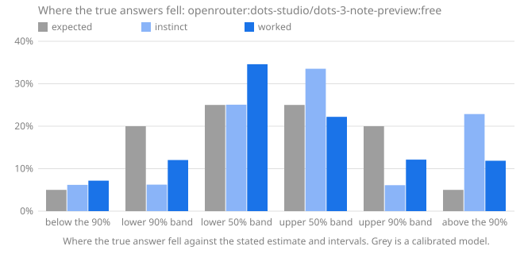

# Calibench report: openrouter:dots-studio/dots-3-note-preview:free

Seed `calibench-v2`, 108 questions, Calibench 2.6.2, Python 3.13.16 (Unicode 15.1.0), started 2026-10-17T16:53:25+00:00.

**Standard suite v2.**

Settings: effort low for instinct and high for worked answers; token caps of 8,000 and 128,000.

Served by: dots-studio/dots-3-note-preview:free via AtlasCloud.

Tokens: input 43,103, output 4,109,044, reasoning 2,940,683.

Cost reported by the API: 0.0000 (US dollars on OpenRouter).

## Summary

| | Instinct | Worked |
|---|---|---|
| Answered | 87 of 108 (21 truncated) | 91 of 108 (1 refused, 16 truncated) |
| **Score**, mean [90% interval] | **0.415** [0.334, 0.501] | **0.273** [0.201, 0.351] |
| Score, median | 0.118 | 0.012 |
| Score, answered questions only | 0.204 [0.145, 0.268] | 0.083 [0.050, 0.120] |
| Interval score, 50% / 90% intervals | 0.941 / 3.075 | 0.379 / 1.274 |
| 50% intervals containing the answer [90% interval] | 53 of 87 (61%) [52%, 69%] | 60 of 91 (66%) [57%, 74%] |
| … leaving out single numbers | 51 of 82 (62%): too wide (underconfident) | 44 of 72 (61%): consistent with calibrated |
| 90% intervals containing the answer [90% interval] | 62 of 87 (71%) [63%, 79%] | 77 of 91 (85%) [77%, 90%] |
| … leaving out single numbers | 60 of 84 (71%): too narrow (overconfident) | 64 of 78 (82%): too narrow (overconfident) |
| Answers given as certain (a single number) | 3, 2 exactly right | 13, 13 exactly right |
| Median error of the estimate | 3.2% | 0.4% |
| Output tokens per answer | 4,263 (2,955 reasoning) | 33,784 (24,274 reasoning) |
| Estimate closer to the answer | 18 | 38 |

Working it out lowered the score on 49 of 75 questions answered both ways, from 0.153 to 0.100 on average (improvement [0.014, 0.095]).

The score is the weighted interval score (Bracher et al., 2021) on a log scale: it combines the estimate and both intervals, is lowest when the stated intervals are the ones the model believes, and treats a miss by a factor in either direction alike. Lower is better; 0.1 is roughly a 10% miss. Intervals in brackets are 90% intervals over questions. Coverage verdicts leave out single-number intervals, which say "I know this exactly" and are counted on their own line.

The score counts each unanswered question as 1.289, the score of an answer off by a factor of ten with wide intervals, whatever the size of the true answer; the rows below it use answered questions only.

## Where the true answers fell

The estimate and the two intervals are five quantiles of the model's belief, so they split it into six bins, and a calibrated model's true answers land in each bin in the expected share. Too many in the outer bins means intervals too narrow; too many on one side of the estimate means a lean in that direction. Single-number answers are left out, and an answer on a boundary is shared between the bins it touches.

| The true answer was | Expected | Instinct | Worked |
|---|---|---|---|
| below the 90% interval | 5% | 6% (5.2) | 7% (5.6) |
| in the 90% interval, below the 50% | 20% | 6% (5.244) | 12% (9.388) |
| in the 50% interval, below the estimate | 25% | 25% (21.06) | 35% (26.99) |
| in the 50% interval, above the estimate | 25% | 34% (28.17) | 22% (17.32) |
| in the 90% interval, above the 50% | 20% | 6% (5.133) | 12% (9.455) |
| above the 90% interval | 5% | 23% (19.2) | 12% (9.253) |
| **above the estimate**, with 90% interval | 50% | 62% [53%, 70%] | 46% [37%, 55%] |

## Where the score comes from

A few large misses can carry a mean. This shows how much of each score its largest questions carry, and the worked answers whose 90% interval missed, costliest first.

| | Instinct | Worked |
|---|---|---|
| Share of the score from the largest question | 4% | 4% |
| Share from the five largest | 16% | 22% |
| Mean score without the largest question | 0.401 | 0.264 |

**Worked answers outside their 90% interval.** *Outside by* is the factor between the true answer and the nearer end of the interval; *width* is the ratio of the interval's ends, so a narrow interval that misses by a wide factor is a confident miss.

| # | Question | True answer | Estimate [90% interval] | Width | Outside by | Score | Share of score |
|---|---|---|---|---|---|---|---|
| 67 | function definitions in `mailbox` | 191 | 60 [40, 80] | ×1.98 | ×2.37 above | 1.019 | 3% |
| 28 | lines in `base64` | 628 | 220 [190, 250] | ×1.31 | ×2.51 above | 0.992 | 3% |
| 26 | code points in category Lm | 397 | 141 [120, 160] | ×1.33 | ×2.47 above | 0.978 | 3% |
| 73 | Unicode names with the word SMALL | 3,296 | 1,450 [1,350, 1,550] | ×1.15 | ×2.13 above | 0.793 | 3% |
| 65 | lines in `configparser` | 1,398 | 2,600 [2,000, 3,200] | ×1.6 | ×1.43 below | 0.508 | 2% |
| 107 | Unicode names with the word DIGIT | 898 | 500 [300, 700] | ×2.33 | ×1.28 above | 0.435 | 1% |
| 86 | Collatz steps from 823,122,992,864 | 195 | 275 [260, 291] | ×1.12 | ×1.33 below | 0.318 | 1% |
| 94 | lines in `warnings` | 735 | 570 [540, 600] | ×1.11 | ×1.22 above | 0.232 | 1% |
| 62 | Collatz steps from 720,780,470,611 | 249 | 190 [160, 220] | ×1.37 | ×1.13 above | 0.207 | 1% |
| 7 | Unicode names with the word LATIN | 1,567 | 1,250 [1,100, 1,400] | ×1.27 | ×1.12 above | 0.181 | 1% |
| | 4 more | | | | | | |

## By kind of question

Knowledge questions ask what is known (the Python standard library, the Unicode database); statistical ones need noise or irregularity modelled; exact ones have a closed-form answer that must be evaluated; calculation ones have an exact answer that takes long, careful arithmetic.

| Kind | Phase | Questions | Score | 50% hits | 90% hits |
|---|---|---|---|---|---|
| calculation | instinct | 23 | 0.017 | 22 of 23 (96%) | 23 of 23 (100%) |
| calculation | worked | 30 | 0.006 | 30 of 30 (100%) | 30 of 30 (100%) |
| exact | instinct | 4 | 0.099 | 4 of 4 (100%) | 4 of 4 (100%) |
| exact | worked | 6 | 0.000 | 6 of 6 (100%) | 6 of 6 (100%) |
| knowledge | instinct | 34 | 0.371 | 10 of 34 (29%) | 13 of 34 (38%) |
| knowledge | worked | 23 | 0.261 | 6 of 23 (26%) | 13 of 23 (57%) |
| statistical | instinct | 26 | 0.168 | 17 of 26 (65%) | 22 of 26 (85%) |
| statistical | worked | 32 | 0.043 | 18 of 32 (56%) | 28 of 32 (88%) |

## By family

| Family | Kind | Questions | Score, worked | Score, instinct | Worked 90% hits | Worked answers above the estimate |
|---|---|---|---|---|---|---|
| `birthday` | exact | 6 | 0.000 | 0.099 | 6 of 6 (100%) | 67% |
| `collatz_steps` | statistical | 6 | 0.194 | 0.634 | 3 of 6 (50%) | 33% |
| `days_between` | calculation | 6 | 0.000 | 0.005 | 6 of 6 (100%) | 50% |
| `digit_sum_pow2` | statistical | 6 | 0.008 | 0.007 | 6 of 6 (100%) | 42% |
| `factorial_digits` | calculation | 6 | 0.000 | 0.001 | 6 of 6 (100%) | 50% |
| `friday13` | calculation | 6 | 0.005 | 0.014 | 6 of 6 (100%) | 38% |
| `lis` | statistical | 2 | 0.002 | 0.032 | 2 of 2 (100%) | 50% |
| `module_all` | knowledge | 4 | 0.097 | 0.165 | 4 of 4 (100%) | 38% |
| `multiply` | calculation | 6 | 0.000 | 0.004 | 6 of 6 (100%) | 50% |
| `partitions` | calculation | 6 | 0.026 | 0.086 | 6 of 6 (100%) | 17% |
| `primes_in_range` | statistical | 6 | 0.020 | 0.019 | 6 of 6 (100%) | 33% |
| `rect_distance` | statistical | 6 | 0.001 | 0.008 | 6 of 6 (100%) | 33% |
| `stdlib_defs` | knowledge | 2 | 0.534 | 0.577 | 1 of 2 (50%) | 50% |
| `stdlib_lines` | knowledge | 6 | 0.311 | 0.411 | 3 of 6 (50%) | 67% |
| `unicode_block` | knowledge | 5 | 0.017 | 0.029 | 4 of 5 (80%) | 60% |
| `unicode_category` | knowledge | 3 | 0.397 | 0.318 | 1 of 3 (33%) | 67% |
| `unicode_word` | knowledge | 3 | 0.469 | 0.755 | 0 of 3 (0%) | 100% |
| `walk_max` | statistical | 6 | 0.007 | 0.057 | 5 of 6 (83%) | 33% |

## Questions

Each answer is shown as estimate [90% interval], ✓ or ✗ for whether the 50% and 90% intervals contain the true answer, and its score.

| # | Question | True answer | Instinct | Worked |
|---|---|---|---|---|
| 1 | Friday the 13ths in 1607–1713 | 185 | 183 [170, 196] 50✓ 90✓ · 0.010 | 186 [180, 192] 50✓ 90✓ · 0.003 |
| 2 | primes in [3,218,046, 3,219,109] | 68 | 71 [57, 85] 50✓ 90✓ · 0.030 | 71 [57, 85] 50✓ 90✓ · 0.033 |
| 3 | lines in `statistics` | 1,817 | 1,900 [1,500, 2,300] 50✓ 90✓ · 0.028 | 2,000 [1,500, 2,500] 50✓ 90✓ · 0.049 |
| 4 | function definitions in `tabnanny` | 17 | 7 [3, 13] 50✗ 90✗ · 0.574 | truncated · 1.289 |
| 5 | digits of 246! | 483 | 483 [480, 486] 50✓ 90✓ · 0.001 | 483 [480, 486] 50✓ 90✓ · 0.001 |
| 6 | mean distance in a 1 × 1.33 rectangle | 0.6103 | truncated · 1.289 | 0.612 [0.607, 0.617] 50✓ 90✓ · 0.002 |
| 7 | Unicode names with the word LATIN | 1,567 | 1,200 [900, 1,500] 50✗ 90✗ · 0.172 | 1,250 [1,100, 1,400] 50✗ 90✗ · 0.181 |
| 8 | draws until a repeat, d = 303 | 22.49 | 22 [6, 45] 50✓ 90✓ · 0.121 | 22.49 [22.45, 22.55] 50✓ 90✓ · 0.000 |
| 9 | names in `random.__all__` | 26 | 25 [20, 30] 50✓ 90✓ · 0.031 | 24 [20, 30] 50✗ 90✓ · 0.046 |
| 10 | assigned in the Cherokee block | 92 | 92 [90, 95] 50✓ 90✓ · 0.003 | 92 [85, 95] 50✓ 90✓ · 0.004 |
| 11 | Collatz steps from 611,221,186,107 | 378 | 650 [300, 1,200] 50✗ 90✓ · 0.294 | 270 [120, 480] 50✗ 90✓ · 0.194 |
| 12 | longest increasing subsequence, n = 600 | 44.3 | truncated · 1.289 | 44.4 [43.9, 44.9] 50✓ 90✓ · 0.002 |
| 13 | highest point of a 901-step walk | 23.33 | 24 [17, 33] 50✓ 90✓ · 0.036 | 23.46 [22.99, 23.93] 50✓ 90✓ · 0.004 |
| 14 | 6,787 × 2,142 | 14,537,754 | 14,500,000 [14,000,000, 15,000,000] 50✓ 90✓ · 0.005 | 14,537,754 [14,537,754, 14,537,754] 50✓ 90✓ · 0.000 |
| 15 | days from 2381-11-09 to 2400-03-01 | 6,687 | truncated · 1.289 | 6,687 [6,687, 6,687] 50✓ 90✓ · 0.000 |
| 16 | code points in category Nd | 680 | 600 [500, 700] 50✗ 90✓ · 0.066 | truncated · 1.289 |
| 17 | digit sum of 2^2579 | 3,479 | 3,497 [3,365, 3,629] 50✓ 90✓ · 0.006 | 3,500 [3,365, 3,628] 50✓ 90✓ · 0.006 |
| 18 | partitions of 246 | 169,296,722,391,554 | 174,000,000,000,000 [160,000,000,000,000, 190,000,000,000,000] 50✗ 90✓ · 0.016 | 169,000,000,000,000 [120,000,000,000,000, 230,000,000,000,000] 50✓ 90✓ · 0.031 |
| 19 | Collatz steps from 273,342,000,302 | 201 | 550 [400, 700] 50✗ 90✗ · 0.868 | 264 [205, 323] 50✗ 90✗ · 0.160 |
| 20 | days from 2367-07-04 to 2367-08-26 | 53 | 53 [50, 56] 50✓ 90✓ · 0.006 | 53 [53, 53] 50✓ 90✓ · 0.000 |
| 21 | longest increasing subsequence, n = 880 | 54.39 | truncated · 1.289 | truncated · 1.289 |
| 22 | digits of 10,938! | 39,431 | truncated · 1.289 | 39,431 [39,430, 39,432] 50✓ 90✓ · 0.000 |
| 23 | draws until a repeat, d = 3,428 | 74.05 | 69 [19, 143] 50✓ 90✓ · 0.134 | 74.05 [74.04, 74.06] 50✓ 90✓ · 0.000 |
| 24 | assigned in the Arabic Presentation Forms-B block | 141 | 141 [138, 144] 50✓ 90✓ · 0.002 | 141 [138, 144] 50✓ 90✓ · 0.002 |
| 25 | 21,339 × 2,935 | 62,629,965 | 62,500,000 [58,000,000, 67,000,000] 50✓ 90✓ · 0.008 | 62,629,965 [62,629,965, 62,629,965] 50✓ 90✓ · 0.000 |
| 26 | code points in category Lm | 397 | 250 [150, 350] 50✗ 90✗ · 0.311 | 141 [120, 160] 50✗ 90✗ · 0.978 |
| 27 | mean distance in a 1 × 6.93 rectangle | 2.377 | 2.4 [2.2, 2.6] 50✓ 90✓ · 0.014 | 2.38 [2.35, 2.41] 50✓ 90✓ · 0.002 |
| 28 | lines in `base64` | 628 | 250 [180, 320] 50✗ 90✗ · 0.811 | 220 [190, 250] 50✗ 90✗ · 0.992 |
| 29 | Unicode names with the word SIGN | 3,393 | 400 [200, 600] 50✗ 90✗ · 1.974 | refused · 1.289 |
| 30 | partitions of 256 | 365,749,566,870,782 | truncated · 1.289 | 368,000,000,000,000 [340,000,000,000,000, 400,000,000,000,000] 50✓ 90✓ · 0.009 |
| 31 | primes in [3,705,675, 3,741,104] | 2,356 | 2,350 [2,220, 2,480] 50✓ 90✓ · 0.006 | 2,340 [2,260, 2,420] 50✓ 90✓ · 0.006 |
| 32 | Friday the 13ths in 2120–2204 | 147 | 146 [135, 157] 50✓ 90✓ · 0.010 | 147 [145, 149] 50✓ 90✓ · 0.002 |
| 33 | names in `fractions.__all__` | 1 | truncated · 1.289 | truncated · 1.289 |
| 34 | highest point of a 608-step walk | 19.36 | 16.6 [1.5, 48.3] 50✓ 90✓ · 0.228 | 19.18 [18.8, 19.57] 50✗ 90✓ · 0.005 |
| 35 | function definitions in `inspect` | 148 | 97 [60, 130] 50✗ 90✗ · 0.294 | 150 [100, 220] 50✓ 90✓ · 0.048 |
| 36 | digit sum of 2^4112 | 5,575 | 5,570 [5,400, 5,740] 50✓ 90✓ · 0.004 | 5,566 [5,400, 5,732] 50✓ 90✓ · 0.004 |
| 37 | Unicode names with the word STAR | 61 | 20 [10, 40] 50✗ 90✗ · 0.804 | truncated · 1.289 |
| 38 | highest point of a 400-step walk | 15.36 | 16 [14, 18] 50✗ 90✓ · 0.023 | 15.47 [15.15, 15.78] 50✓ 90✓ · 0.004 |
| 39 | digit sum of 2^4557 | 6,011 | 6,174 [5,999, 6,349] 50✗ 90✓ · 0.015 | 6,174 [5,999, 6,349] 50✗ 90✓ · 0.015 |
| 40 | names in `bdb.__all__` | 3 | 4 [3, 5] 50✗ 90✓ · 0.142 | 4 [3, 5] 50✗ 90✓ · 0.142 |
| 41 | days from 2360-02-08 to 2360-03-27 | 48 | 48 [45, 51] 50✓ 90✓ · 0.007 | 48 [48, 48] 50✓ 90✓ · 0.000 |
| 42 | code points in category Ps | 79 | 26 [24, 28] 50✗ 90✗ · 1.053 | truncated · 1.289 |
| 43 | digits of 395! | 856 | 856 [856, 856] 50✓ 90✓ · 0.000 | 856 [856, 856] 50✓ 90✓ · 0.000 |
| 44 | Collatz steps from 257,793,746,753 | 170 | 120 [80, 180] 50✗ 90✓ · 0.196 | 183 [170, 196] 50✗ 90✓ · 0.041 |
| 45 | lines in `subprocess` | 2,259 | 1,400 [1,000, 1,800] 50✗ 90✗ · 0.376 | 2,100 [1,800, 2,400] 50✗ 90✓ · 0.040 |
| 46 | assigned in the Georgian block | 88 | 72 [70, 80] 50✗ 90✗ · 0.157 | truncated · 1.289 |
| 47 | partitions of 229 | 44,132,934,884,255 | 45,000,000,000,000 [10,000,000,000,000, 100,000,000,000,000] 50✓ 90✓ · 0.119 | 45,000,000,000,000 [30,000,000,000,000, 70,000,000,000,000] 50✓ 90✓ · 0.043 |
| 48 | longest increasing subsequence, n = 156 | 21.48 | truncated · 1.289 | truncated · 1.289 |
| 49 | primes in [203,866, 205,144] | 103 | 105 [88, 121] 50✓ 90✓ · 0.022 | 107 [90, 124] 50✓ 90✓ · 0.027 |
| 50 | 156,899 × 30,667 | 4,811,621,633 | 4,810,000,000 [4,750,000,000, 4,870,000,000] 50✓ 90✓ · 0.001 | 4,811,621,633 [4,811,620,633, 4,811,622,633] 50✓ 90✓ · 0.000 |
| 51 | Friday the 13ths in 2295–2567 | 469 | 470 [451, 489] 50✓ 90✓ · 0.005 | 469 [469, 469] 50✓ 90✓ · 0.000 |
| 52 | mean distance in a 1 × 2.74 rectangle | 1.029 | truncated · 1.289 | 1.03 [1, 1.06] 50✓ 90✓ · 0.003 |
| 53 | draws until a repeat, d = 9,424 | 122.3 | 114 [31, 238] 50✓ 90✓ · 0.133 | 122.3 [122.3, 122.3] 50✓ 90✓ · 0.000 |
| 54 | function definitions in `uuid` | 47 | 28 [22, 34] 50✗ 90✗ · 0.424 | truncated · 1.289 |
| 55 | draws until a repeat, d = 1,449,835 | 1,510 | truncated · 1.289 | 1,510 [1,510, 1,510] 50✓ 90✓ · 0.000 |
| 56 | names in `zipapp.__all__` | 3 | 2 [2, 2] 50✗ 90✗ · 0.288 | 4 [3, 5] 50✗ 90✓ · 0.142 |
| 57 | digit sum of 2^2312 | 3,136 | truncated · 1.289 | 3,136 [3,011, 3,261] 50✓ 90✓ · 0.005 |
| 58 | primes in [2,973,871, 2,977,273] | 227 | 230 [200, 260] 50✓ 90✓ · 0.017 | 228 [203, 253] 50✓ 90✓ · 0.014 |
| 59 | Friday the 13ths in 2041–2047 | 13 | 12 [9, 15] 50✓ 90✓ · 0.040 | 13 [10, 16] 50✓ 90✓ · 0.023 |
| 60 | 34,718 × 1,419 | 49,264,842 | 49,300,000 [48,000,000, 50,000,000] 50✓ 90✓ · 0.002 | 49,264,842 [49,264,842, 49,264,842] 50✓ 90✓ · 0.000 |
| 61 | mean distance in a 1 × 3.73 rectangle | 1.34 | truncated · 1.289 | 1.342 [1.34, 1.343] 50✗ 90✓ · 0.000 |
| 62 | Collatz steps from 720,780,470,611 | 249 | 950 [600, 1,400] 50✗ 90✗ · 1.133 | 190 [160, 220] 50✗ 90✗ · 0.207 |
| 63 | digits of 206! | 389 | truncated · 1.289 | 389 [389, 389] 50✓ 90✓ · 0.000 |
| 64 | highest point of a 1,243-step walk | 27.4 | 28 [23, 33] 50✓ 90✓ · 0.019 | 27.64 [27.08, 28.19] 50✗ 90✓ · 0.004 |
| 65 | lines in `configparser` | 1,398 | 2,100 [1,800, 2,400] 50✗ 90✗ · 0.341 | 2,600 [2,000, 3,200] 50✗ 90✗ · 0.508 |
| 66 | days from 1748-02-09 to 1752-09-26 | 1,691 | 1,700 [1,600, 1,800] 50✓ 90✓ · 0.009 | 1,691 [1,685, 1,697] 50✓ 90✓ · 0.000 |
| 67 | function definitions in `mailbox` | 191 | 45 [30, 60] 50✗ 90✗ · 1.310 | 60 [40, 80] 50✗ 90✗ · 1.019 |
| 68 | code points in category Lt | 31 | 30 [15, 45] 50✓ 90✓ · 0.060 | truncated · 1.289 |
| 69 | longest increasing subsequence, n = 406 | 36.11 | 35.5 [34.8, 36.2] 50✗ 90✓ · 0.010 | 36 [35.5, 36.5] 50✓ 90✓ · 0.002 |
| 70 | partitions of 387 | 2,998,964,447,736,452,194 | truncated · 1.289 | 3.045e+18 [2e+18, 5e+18] 50✓ 90✓ · 0.041 |
| 71 | Unicode names with the word FRACTION | 98 | truncated · 1.289 | truncated · 1.289 |
| 72 | assigned in the Egyptian Hieroglyphs block | 1,072 | 1,071 [1,070, 1,072] 50✗ 90✓ · 0.001 | 1,071 [1,070, 1,072] 50✗ 90✓ · 0.001 |
| 73 | Unicode names with the word SMALL | 3,296 | 1,600 [1,000, 2,200] 50✗ 90✗ · 0.589 | 1,450 [1,350, 1,550] 50✗ 90✗ · 0.793 |
| 74 | mean distance in a 1 × 7.69 rectangle | 2.63 | 2.63 [2.58, 2.68] 50✓ 90✓ · 0.002 | 2.627 [2.618, 2.636] 50✗ 90✓ · 0.001 |
| 75 | digits of 86,588! | 389,923 | truncated · 1.289 | 389,923 [389,923, 389,923] 50✓ 90✓ · 0.000 |
| 76 | partitions of 134 | 8,149,040,695 | 8,500,000,000 [3,000,000,000, 30,000,000,000] 50✓ 90✓ · 0.124 | 8,400,000,000 [7,000,000,000, 10,000,000,000] 50✓ 90✓ · 0.023 |
| 77 | code points in category Ll | 2,233 | 1,441 [1,300, 1,600] 50✗ 90✗ · 0.391 | 2,750 [2,500, 3,000] 50✗ 90✗ · 0.170 |
| 78 | days from 1735-03-13 to 1738-03-23 | 1,106 | 1,106 [1,090, 1,120] 50✓ 90✓ · 0.001 | 1,106 [1,105, 1,107] 50✓ 90✓ · 0.000 |
| 79 | names in `fnmatch.__all__` | 4 | 3 [1, 5] 50✓ 90✓ · 0.118 | 4 [2, 6] 50✓ 90✓ · 0.057 |
| 80 | highest point of a 1,783-step walk | 34.21 | 34 [31, 37] 50✓ 90✓ · 0.011 | 33.7 [33, 34.4] 50✗ 90✓ · 0.008 |
| 81 | lines in `timeit` | 381 | 250 [150, 350] 50✗ 90✗ · 0.270 | 350 [300, 400] 50✗ 90✓ · 0.046 |
| 82 | draws until a repeat, d = 6,507,924 | 3,198 | truncated · 1.289 | 3,198 [3,198, 3,198] 50✓ 90✓ · 0.000 |
| 83 | function definitions in `shlex` | 15 | 14 [11, 17] 50✓ 90✓ · 0.034 | truncated · 1.289 |
| 84 | Friday the 13ths in 2246–2329 | 145 | 144 [130, 160] 50✓ 90✓ · 0.011 | 145 [140, 150] 50✓ 90✓ · 0.003 |
| 85 | primes in [2,647,606, 2,665,661] | 1,242 | 1,220 [1,162, 1,278] 50✓ 90✓ · 0.009 | 1,220 [1,164, 1,276] 50✓ 90✓ · 0.009 |
| 86 | Collatz steps from 823,122,992,864 | 195 | 1,000 [400, 1,600] 50✗ 90✗ · 1.244 | 275 [260, 291] 50✗ 90✗ · 0.318 |
| 87 | assigned in the Thai block | 87 | 86 [80, 92] 50✓ 90✓ · 0.010 | 89 [84, 94] 50✓ 90✓ · 0.011 |
| 88 | 2,025 × 311,373 | 630,530,325 | 630,000,000 [600,000,000, 660,000,000] 50✓ 90✓ · 0.004 | 630,530,325 [630,530,325, 630,530,325] 50✓ 90✓ · 0.000 |
| 89 | longest increasing subsequence, n = 803 | 51.71 | 56.7 [52, 61] 50✗ 90✗ · 0.054 | truncated · 1.289 |
| 90 | digit sum of 2^9436 | 12,832 | 12,785 [12,500, 13,070] 50✓ 90✓ · 0.003 | 12,784 [12,532, 13,036] 50✓ 90✓ · 0.003 |
| 91 | function definitions in `numbers` | 56 | 20 [10, 30] 50✗ 90✗ · 0.827 | truncated · 1.289 |
| 92 | 61,640 × 5,178 | 319,171,920 | 319,000,000 [300,000,000, 340,000,000] 50✓ 90✓ · 0.006 | 319,171,920 [319,171,920, 319,171,920] 50✓ 90✓ · 0.000 |
| 93 | longest increasing subsequence, n = 105 | 17.17 | truncated · 1.289 | truncated · 1.289 |
| 94 | lines in `warnings` | 735 | 350 [250, 450] 50✗ 90✗ · 0.641 | 570 [540, 600] 50✗ 90✗ · 0.232 |
| 95 | partitions of 507 | 3,384,893,356,244,349,844,341 | truncated · 1.289 | 3.43e+21 [3.26e+21, 3.6e+21] 50✓ 90✓ · 0.009 |
| 96 | days from 2193-08-10 to 2194-03-25 | 227 | 227 [224, 230] 50✓ 90✓ · 0.001 | 227 [224, 230] 50✓ 90✓ · 0.001 |
| 97 | primes in [730,012, 731,622] | 112 | 119 [101, 137] 50✓ 90✓ · 0.030 | 119 [101, 137] 50✓ 90✓ · 0.030 |
| 98 | assigned in the Latin Extended-B block | 208 | 208 [208, 208] 50✓ 90✓ · 0.000 | 191 [180, 200] 50✗ 90✗ · 0.067 |
| 99 | digit sum of 2^8194 | 10,843 | truncated · 1.289 | 11,101 [10,800, 11,400] 50✗ 90✓ · 0.013 |
| 100 | Collatz steps from 142,916,784,243 | 164 | 180 [100, 260] 50✓ 90✓ · 0.071 | 257 [150, 400] 50✗ 90✓ · 0.246 |
| 101 | highest point of a 1,174-step walk | 26.55 | 27.3 [22, 33] 50✓ 90✓ · 0.025 | 27.3 [26.8, 27.8] 50✗ 90✗ · 0.020 |
| 102 | mean distance in a 1 × 1.22 rectangle | 0.58 | truncated · 1.289 | 0.58 [0.578, 0.582] 50✓ 90✓ · 0.000 |
| 103 | names in `typing.__all__` | 104 | 75 [60, 90] 50✗ 90✗ · 0.247 | truncated · 1.289 |
| 104 | draws until a repeat, d = 528 | 29.47 | 29.5 [27, 32] 50✓ 90✓ · 0.007 | 29.47 [29.47, 29.47] 50✓ 90✓ · 0.000 |
| 105 | Friday the 13ths in 1810–1860 | 87 | 87 [81, 94] 50✓ 90✓ · 0.009 | 87 [87, 87] 50✓ 90✓ · 0.000 |
| 106 | digits of 133! | 227 | 227 [225, 229] 50✓ 90✓ · 0.001 | 227 [226, 227] 50✓ 90✓ · 0.000 |
| 107 | Unicode names with the word DIGIT | 898 | 650 [500, 800] 50✗ 90✗ · 0.235 | 500 [300, 700] 50✗ 90✗ · 0.435 |
| 108 | code points in category Mn | 1,985 | 1,900 [1,600, 2,200] 50✓ 90✓ · 0.026 | 1,850 [1,700, 2,000] 50✗ 90✓ · 0.042 |
