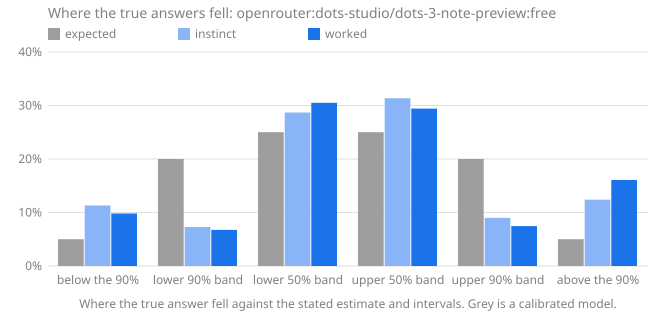

# Calibench report: openrouter:dots-studio/dots-3-note-preview:free

Seed `calibench-v2`, 108 questions, Calibench 2.7.0, Python 3.13.16 (Unicode 15.1.0), started 2026-10-17T22:34:07+00:00.

**Standard suite v2.**

Settings: effort low for instinct and high for worked answers; token caps of 8,000 and 32,000.

Served by: dots-studio/dots-3-note-preview:free via AtlasCloud.

Tokens: input 43,092, output 2,116,780, reasoning 1,452,687.

Cost reported by the API: 0.0000 (US dollars on OpenRouter).

## Summary

| | Instinct | Worked |
|---|---|---|
| Answered | 95 of 108 (13 truncated) | 71 of 108 (1 refused, 36 truncated) |
| **Score**, mean [90% interval] | **0.370** [0.278, 0.472] | **0.291** [0.204, 0.385] |
| Score, median | 0.057 | 0.031 |
| Score, answered questions only | 0.244 [0.159, 0.342] | 0.124 [0.073, 0.181] |
| Interval score, 50% / 90% intervals | 1.115 / 3.807 | 0.555 / 2.035 |
| 50% intervals containing the answer [90% interval] | 60 of 95 (63%) [55%, 71%] | 49 of 71 (69%) [59%, 77%] |
| … leaving out single numbers | 56 of 89 (63%): too wide (underconfident) | 31 of 50 (62%): consistent with calibrated |
| 90% intervals containing the answer [90% interval] | 74 of 95 (78%) [70%, 84%] | 56 of 71 (79%) [70%, 86%] |
| … leaving out single numbers | 71 of 92 (77%): too narrow (overconfident) | 38 of 51 (75%): too narrow (overconfident) |
| Answers given as certain (a single number) | 3, 3 exactly right | 20, 18 exactly right |
| Median error of the estimate | 2.9% | 0.4% |
| Output tokens per answer | 4,045 (2,838 reasoning) | 15,554 (10,612 reasoning) |
| Estimate closer to the answer | 17 | 33 |

Working it out lowered the score on 41 of 68 questions answered both ways, from 0.198 to 0.130 on average (improvement [0.014, 0.127]).

The score is the weighted interval score (Bracher et al., 2021) on a log scale: it combines the estimate and both intervals, is lowest when the stated intervals are the ones the model believes, and treats a miss by a factor in either direction alike. Lower is better; 0.1 is roughly a 10% miss. Intervals in brackets are 90% intervals over questions. Coverage verdicts leave out single-number intervals, which say "I know this exactly" and are counted on their own line.

A worked answer that wasn't given (cut off, refused, unreadable or failed) is scored by the question's instinct answer, as a forecast stands until it is replaced; 27 worked answers were scored so. A question with no answer standing counts as 1.289, the score of an answer off by a factor of ten with wide intervals, whatever the size of the true answer. The rows after the median use answered questions only.

## Where the true answers fell

The estimate and the two intervals are five quantiles of the model's belief, so they split it into six bins, and a calibrated model's true answers land in each bin in the expected share. Too many in the outer bins means intervals too narrow; too many on one side of the estimate means a lean in that direction. Single-number answers are left out, and an answer on a boundary is shared between the bins it touches.

| The true answer was | Expected | Instinct | Worked |
|---|---|---|---|
| below the 90% interval | 5% | 11% (10.4) | 10% (5) |
| in the 90% interval, below the 50% | 20% | 7% (6.711) | 7% (3.444) |
| in the 50% interval, below the estimate | 25% | 29% (26.39) | 31% (15.56) |
| in the 50% interval, above the estimate | 25% | 31% (28.83) | 29% (15) |
| in the 90% interval, above the 50% | 20% | 9% (8.267) | 7% (3.8) |
| above the 90% interval | 5% | 12% (11.4) | 16% (8.2) |
| **above the estimate**, with 90% interval | 50% | 53% [44%, 61%] | 53% [42%, 64%] |

## Where the score comes from

A few large misses can carry a mean. This shows how much of each score its largest questions carry, and the worked answers whose 90% interval missed, costliest first.

| | Instinct | Worked |
|---|---|---|
| Share of the score from the largest question | 10% | 13% |
| Share from the five largest | 25% | 30% |
| Mean score without the largest question | 0.336 | 0.256 |

**Worked answers outside their 90% interval.** *Outside by* is the factor between the true answer and the nearer end of the interval; *width* is the ratio of the interval's ends, so a narrow interval that misses by a wide factor is a confident miss.

| # | Question | True answer | Estimate [90% interval] | Width | Outside by | Score | Share of score |
|---|---|---|---|---|---|---|---|
| 77 | code points in category Ll | 2,233 | 10,000 [9,000, 11,000] | ×1.22 | ×4.03 below | 1.457 | 5% |
| 26 | code points in category Lm | 397 | 122 [90, 160] | ×1.77 | ×2.47 above | 1.058 | 3% |
| 67 | function definitions in `mailbox` | 191 | 65 [55, 75] | ×1.36 | ×2.53 above | 1.009 | 3% |
| 28 | lines in `base64` | 628 | 210 [140, 280] | ×1.99 | ×2.24 above | 0.967 | 3% |
| 86 | Collatz steps from 823,122,992,864 | 195 | 475 [200, 800] | ×3.99 | ×1.03 below | 0.502 | 2% |
| 83 | function definitions in `shlex` | 15 | 25 [23, 27] | ×1.17 | ×1.5 below | 0.449 | 1% |
| 35 | function definitions in `inspect` | 148 | 85 [60, 110] | ×1.82 | ×1.34 above | 0.439 | 1% |
| 44 | Collatz steps from 257,793,746,753 | 170 | 264 [230, 300] | ×1.3 | ×1.35 below | 0.377 | 1% |
| 81 | lines in `timeit` | 381 | 250 [200, 300] | ×1.5 | ×1.27 above | 0.341 | 1% |
| 45 | lines in `subprocess` | 2,259 | 1,500 [1,200, 1,800] | ×1.5 | ×1.25 above | 0.332 | 1% |
| | 5 more | | | | | | |

## By kind of question

Knowledge questions ask what is known (the Python standard library, the Unicode database); statistical ones need noise or irregularity modelled; exact ones have a closed-form answer that must be evaluated; calculation ones have an exact answer that takes long, careful arithmetic.

| Kind | Phase | Questions | Score | 50% hits | 90% hits |
|---|---|---|---|---|---|
| calculation | instinct | 28 | 0.026 | 28 of 28 (100%) | 28 of 28 (100%) |
| calculation | worked | 27 | 0.007 | 26 of 27 (96%) | 27 of 27 (100%) |
| exact | instinct | 5 | 0.106 | 5 of 5 (100%) | 5 of 5 (100%) |
| exact | worked | 6 | 0.041 | 6 of 6 (100%) | 6 of 6 (100%) |
| knowledge | instinct | 33 | 0.454 | 10 of 33 (30%) | 21 of 33 (64%) |
| knowledge | worked | 19 | 0.361 | 5 of 19 (26%) | 7 of 19 (37%) |
| statistical | instinct | 29 | 0.239 | 17 of 29 (59%) | 20 of 29 (69%) |
| statistical | worked | 19 | 0.081 | 12 of 19 (63%) | 16 of 19 (84%) |

## By family

| Family | Kind | Questions | Score, worked | Score, instinct | Worked 90% hits | Worked answers above the estimate |
|---|---|---|---|---|---|---|
| `birthday` | exact | 6 | 0.041 | 0.106 | 6 of 6 (100%) | 67% |
| `collatz_steps` | statistical | 6 | 0.229 | 1.032 | 4 of 6 (67%) | 58% |
| `days_between` | calculation | 6 | 0.000 | 0.014 | 6 of 6 (100%) | 50% |
| `digit_sum_pow2` | statistical | 6 | 0.008 | 0.009 | 5 of 6 (83%) | 50% |
| `factorial_digits` | calculation | 6 | 0.000 | 0.002 | 6 of 6 (100%) | 50% |
| `friday13` | calculation | 5 | 0.006 | 0.020 | 5 of 5 (100%) | 33% |
| `lis` | statistical | 1 | 0.009 | 0.052 | 1 of 1 (100%) | 100% |
| `module_all` | knowledge | 4 | 0.112 | 0.111 | 2 of 4 (50%) | — |
| `multiply` | calculation | 5 | 0.000 | 0.006 | 5 of 5 (100%) | 50% |
| `partitions` | calculation | 5 | 0.031 | 0.084 | 5 of 5 (100%) | 0% |
| `primes_in_range` | statistical | 6 | 0.019 | 0.020 | 6 of 6 (100%) | 33% |
| `rect_distance` | statistical | 0 | — | 0.021 | — | — |
| `stdlib_defs` | knowledge | 3 | 0.632 | 0.565 | 0 of 3 (0%) | 67% |
| `stdlib_lines` | knowledge | 5 | 0.348 | 0.305 | 2 of 5 (40%) | 80% |
| `unicode_block` | knowledge | 4 | 0.017 | 0.089 | 3 of 4 (75%) | 83% |
| `unicode_category` | knowledge | 3 | 0.901 | 0.506 | 0 of 3 (0%) | 67% |
| `unicode_word` | knowledge | 0 | — | 1.843 | — | — |
| `walk_max` | statistical | 0 | — | 0.060 | — | — |

## Questions

Each answer is shown as estimate [90% interval], ✓ or ✗ for whether the 50% and 90% intervals contain the true answer, and its score.

| # | Question | True answer | Instinct | Worked |
|---|---|---|---|---|
| 1 | Friday the 13ths in 1607–1713 | 185 | 184 [175, 195] 50✓ 90✓ · 0.008 | truncated → instinct · 0.008 |
| 2 | primes in [3,218,046, 3,219,109] | 68 | 71 [57, 85] 50✓ 90✓ · 0.033 | 71 [57, 85] 50✓ 90✓ · 0.033 |
| 3 | lines in `statistics` | 1,817 | 1,580 [1,300, 1,900] 50✗ 90✓ · 0.075 | 1,750 [1,500, 2,000] 50✓ 90✓ · 0.025 |
| 4 | function definitions in `tabnanny` | 17 | 4 [1, 8] 50✗ 90✗ · 1.044 | truncated → instinct · 1.044 |
| 5 | digits of 246! | 483 | 483 [483, 483] 50✓ 90✓ · 0.000 | 483 [483, 483] 50✓ 90✓ · 0.000 |
| 6 | mean distance in a 1 × 1.33 rectangle | 0.6103 | 0.61 [0.58, 0.64] 50✓ 90✓ · 0.005 | truncated → instinct · 0.005 |
| 7 | Unicode names with the word LATIN | 1,567 | truncated · 1.289 | truncated · 1.289 |
| 8 | draws until a repeat, d = 303 | 22.49 | 22.5 [21, 24] 50✓ 90✓ · 0.007 | 22.5 [6, 43] 50✓ 90✓ · 0.116 |
| 9 | names in `random.__all__` | 26 | 25 [24, 26] 50✗ 90✓ · 0.024 | truncated → instinct · 0.024 |
| 10 | assigned in the Cherokee block | 92 | 93 [90, 95] 50✓ 90✓ · 0.005 | 92 [89, 96] 50✓ 90✓ · 0.005 |
| 11 | Collatz steps from 611,221,186,107 | 378 | 130 [70, 230] 50✗ 90✗ · 0.805 | 300 [100, 1,000] 50✗ 90✓ · 0.156 |
| 12 | longest increasing subsequence, n = 600 | 44.3 | 49 [45, 53] 50✗ 90✗ · 0.061 | truncated → instinct · 0.061 |
| 13 | highest point of a 901-step walk | 23.33 | 24 [20, 30] 50✓ 90✓ · 0.022 | truncated → instinct · 0.022 |
| 14 | 6,787 × 2,142 | 14,537,754 | 14,500,000 [14,000,000, 15,000,000] 50✓ 90✓ · 0.003 | 14,537,754 [14,537,754, 14,537,754] 50✓ 90✓ · 0.000 |
| 15 | days from 2381-11-09 to 2400-03-01 | 6,687 | 6,686 [6,600, 6,800] 50✓ 90✓ · 0.001 | 6,687 [6,650, 6,700] 50✓ 90✓ · 0.000 |
| 16 | code points in category Nd | 680 | 650 [500, 800] 50✓ 90✓ · 0.034 | truncated → instinct · 0.034 |
| 17 | digit sum of 2^2579 | 3,479 | 3,497 [3,365, 3,628] 50✓ 90✓ · 0.006 | 3,496 [3,365, 3,628] 50✓ 90✓ · 0.006 |
| 18 | partitions of 246 | 169,296,722,391,554 | 172,000,000,000,000 [100,000,000,000,000, 300,000,000,000,000] 50✓ 90✓ · 0.037 | 173,000,000,000,000 [120,000,000,000,000, 240,000,000,000,000] 50✓ 90✓ · 0.035 |
| 19 | Collatz steps from 273,342,000,302 | 201 | 650 [300, 1,100] 50✗ 90✗ · 0.852 | 180 [50, 500] 50✓ 90✓ · 0.177 |
| 20 | days from 2367-07-04 to 2367-08-26 | 53 | 53 [50, 56] 50✓ 90✓ · 0.006 | 53 [53, 53] 50✓ 90✓ · 0.000 |
| 21 | longest increasing subsequence, n = 880 | 54.39 | 59.3 [54.7, 63.9] 50✗ 90✗ · 0.051 | truncated → instinct · 0.051 |
| 22 | digits of 10,938! | 39,431 | 39,431 [39,420, 39,440] 50✓ 90✓ · 0.000 | 39,431 [39,431, 39,431] 50✓ 90✓ · 0.000 |
| 23 | draws until a repeat, d = 3,428 | 74.05 | truncated · 1.289 | 74.05 [73.8, 74.3] 50✓ 90✓ · 0.000 |
| 24 | assigned in the Arabic Presentation Forms-B block | 141 | 110 [95, 125] 50✗ 90✗ · 0.192 | truncated → instinct · 0.192 |
| 25 | 21,339 × 2,935 | 62,629,965 | 62,600,000 [55,000,000, 70,000,000] 50✓ 90✓ · 0.013 | refused → instinct · 0.013 |
| 26 | code points in category Lm | 397 | 140 [120, 160] 50✗ 90✗ · 0.977 | 122 [90, 160] 50✗ 90✗ · 1.058 |
| 27 | mean distance in a 1 × 6.93 rectangle | 2.377 | truncated · 1.289 | truncated · 1.289 |
| 28 | lines in `base64` | 628 | 230 [150, 320] 50✗ 90✗ · 0.862 | 210 [140, 280] 50✗ 90✗ · 0.967 |
| 29 | Unicode names with the word SIGN | 3,393 | 55 [40, 70] 50✗ 90✗ · 4.004 | truncated → instinct · 4.004 |
| 30 | partitions of 256 | 365,749,566,870,782 | 3.7e+14 [2e+14, 6e+14] 50✓ 90✓ · 0.065 | 380,000,000,000,000 [300,000,000,000,000, 500,000,000,000,000] 50✓ 90✓ · 0.034 |
| 31 | primes in [3,705,675, 3,741,104] | 2,356 | 2,342 [2,263, 2,421] 50✓ 90✓ · 0.005 | 2,343 [2,263, 2,423] 50✓ 90✓ · 0.005 |
| 32 | Friday the 13ths in 2120–2204 | 147 | truncated · 1.289 | 147 [144, 150] 50✓ 90✓ · 0.002 |
| 33 | names in `fractions.__all__` | 1 | 1 [1, 1] 50✓ 90✓ · 0.000 | 1 [1, 1] 50✓ 90✓ · 0.000 |
| 34 | highest point of a 608-step walk | 19.36 | truncated · 1.289 | truncated · 1.289 |
| 35 | function definitions in `inspect` | 148 | 130 [80, 200] 50✓ 90✓ · 0.075 | 85 [60, 110] 50✗ 90✗ · 0.439 |
| 36 | digit sum of 2^4112 | 5,575 | 5,600 [5,000, 6,200] 50✓ 90✓ · 0.012 | 5,570 [5,400, 5,740] 50✓ 90✓ · 0.004 |
| 37 | Unicode names with the word STAR | 61 | truncated · 1.289 | truncated · 1.289 |
| 38 | highest point of a 400-step walk | 15.36 | 16 [10, 22] 50✓ 90✓ · 0.049 | truncated → instinct · 0.049 |
| 39 | digit sum of 2^4557 | 6,011 | 6,173 [6,000, 6,350] 50✗ 90✓ · 0.015 | 6,174 [5,999, 6,349] 50✗ 90✓ · 0.015 |
| 40 | names in `bdb.__all__` | 3 | 6 [3, 9] 50✗ 90✓ · 0.321 | 4 [4, 4] 50✗ 90✗ · 0.223 |
| 41 | days from 2360-02-08 to 2360-03-27 | 48 | 50 [30, 70] 50✓ 90✓ · 0.044 | 48 [48, 48] 50✓ 90✓ · 0.000 |
| 42 | code points in category Ps | 79 | 60 [40, 80] 50✗ 90✓ · 0.161 | truncated → instinct · 0.161 |
| 43 | digits of 395! | 856 | 856 [856, 856] 50✓ 90✓ · 0.000 | 856 [856, 856] 50✓ 90✓ · 0.000 |
| 44 | Collatz steps from 257,793,746,753 | 170 | 265 [200, 340] 50✗ 90✗ · 0.320 | 264 [230, 300] 50✗ 90✗ · 0.377 |
| 45 | lines in `subprocess` | 2,259 | 1,800 [1,200, 2,400] 50✗ 90✓ · 0.130 | 1,500 [1,200, 1,800] 50✗ 90✗ · 0.332 |
| 46 | assigned in the Georgian block | 88 | 88 [85, 91] 50✓ 90✓ · 0.004 | 87 [86, 88] 50✗ 90✓ · 0.007 |
| 47 | partitions of 229 | 44,132,934,884,255 | 45,000,000,000,000 [20,000,000,000,000, 80,000,000,000,000] 50✓ 90✓ · 0.077 | 45,500,000,000,000 [40,000,000,000,000, 51,000,000,000,000] 50✓ 90✓ · 0.018 |
| 48 | longest increasing subsequence, n = 156 | 21.48 | 25 [21, 29] 50✗ 90✓ · 0.080 | truncated → instinct · 0.080 |
| 49 | primes in [203,866, 205,144] | 103 | 105 [88, 122] 50✓ 90✓ · 0.024 | 105 [88, 122] 50✓ 90✓ · 0.024 |
| 50 | 156,899 × 30,667 | 4,811,621,633 | 4,810,000,000 [4,500,000,000, 5,100,000,000] 50✓ 90✓ · 0.007 | 4,811,621,633 [4,811,621,633, 4,811,621,633] 50✓ 90✓ · 0.000 |
| 51 | Friday the 13ths in 2295–2567 | 469 | truncated · 1.289 | 470 [462, 478] 50✓ 90✓ · 0.002 |
| 52 | mean distance in a 1 × 2.74 rectangle | 1.029 | 1.06 [0.8, 1.35] 50✓ 90✓ · 0.037 | truncated → instinct · 0.037 |
| 53 | draws until a repeat, d = 9,424 | 122.3 | 115 [31, 238] 50✓ 90✓ · 0.131 | 122.3 [122.3, 122.3] 50✓ 90✓ · 0.000 |
| 54 | function definitions in `uuid` | 47 | 40 [25, 55] 50✗ 90✓ · 0.088 | truncated → instinct · 0.088 |
| 55 | draws until a repeat, d = 1,449,835 | 1,510 | 1,509 [386, 2,946] 50✓ 90✓ · 0.119 | 1,418 [386, 2,948] 50✓ 90✓ · 0.132 |
| 56 | names in `zipapp.__all__` | 3 | 4 [3, 5] 50✗ 90✓ · 0.142 | 3 [3, 3] 50✓ 90✓ · 0.000 |
| 57 | digit sum of 2^2312 | 3,136 | 3,132 [3,007, 3,257] 50✓ 90✓ · 0.005 | 3,132 [3,007, 3,257] 50✓ 90✓ · 0.005 |
| 58 | primes in [2,973,871, 2,977,273] | 227 | 228 [203, 253] 50✓ 90✓ · 0.014 | 228 [203, 253] 50✓ 90✓ · 0.014 |
| 59 | Friday the 13ths in 2041–2047 | 13 | 12 [9, 15] 50✓ 90✓ · 0.040 | 13 [10, 16] 50✓ 90✓ · 0.023 |
| 60 | 34,718 × 1,419 | 49,264,842 | 49,300,000 [48,000,000, 50,000,000] 50✓ 90✓ · 0.002 | 49,264,842 [49,264,842, 49,264,842] 50✓ 90✓ · 0.000 |
| 61 | mean distance in a 1 × 3.73 rectangle | 1.34 | truncated · 1.289 | truncated · 1.289 |
| 62 | Collatz steps from 720,780,470,611 | 249 | 1,000 [500, 1,500] 50✗ 90✗ · 1.084 | 190 [80, 350] 50✗ 90✓ · 0.157 |
| 63 | digits of 206! | 389 | 389 [387, 391] 50✓ 90✓ · 0.001 | 389 [389, 389] 50✓ 90✓ · 0.000 |
| 64 | highest point of a 1,243-step walk | 27.4 | 28 [2, 58] 50✓ 90✓ · 0.203 | truncated → instinct · 0.203 |
| 65 | lines in `configparser` | 1,398 | 1,500 [1,000, 2,000] 50✓ 90✓ · 0.055 | 1,600 [1,300, 1,900] 50✗ 90✓ · 0.075 |
| 66 | days from 1748-02-09 to 1752-09-26 | 1,691 | 1,690 [1,650, 1,730] 50✓ 90✓ · 0.002 | 1,691 [1,691, 1,691] 50✓ 90✓ · 0.000 |
| 67 | function definitions in `mailbox` | 191 | 50 [25, 80] 50✗ 90✗ · 1.131 | 65 [55, 75] 50✗ 90✗ · 1.009 |
| 68 | code points in category Lt | 31 | 33 [20, 50] 50✓ 90✓ · 0.048 | truncated → instinct · 0.048 |
| 69 | longest increasing subsequence, n = 406 | 36.11 | 35.5 [31.5, 39.5] 50✓ 90✓ · 0.017 | 35.5 [34, 37] 50✗ 90✓ · 0.009 |
| 70 | partitions of 387 | 2,998,964,447,736,452,194 | 3e+18 [5e+17, 2e+19] 50✓ 90✓ · 0.253 | 3.05e+18 [1.5e+18, 6e+18] 50✓ 90✓ · 0.054 |
| 71 | Unicode names with the word FRACTION | 98 | truncated · 1.289 | truncated · 1.289 |
| 72 | assigned in the Egyptian Hieroglyphs block | 1,072 | 1,072 [1,070, 1,074] 50✓ 90✓ · 0.000 | 1,072 [1,072, 1,072] 50✓ 90✓ · 0.000 |
| 73 | Unicode names with the word SMALL | 3,296 | 2,500 [2,000, 3,000] 50✗ 90✗ · 0.204 | truncated → instinct · 0.204 |
| 74 | mean distance in a 1 × 7.69 rectangle | 2.63 | truncated · 1.289 | truncated · 1.289 |
| 75 | digits of 86,588! | 389,923 | 390,000 [385,000, 395,000] 50✓ 90✓ · 0.001 | 389,923 [389,918, 389,928] 50✓ 90✓ · 0.000 |
| 76 | partitions of 134 | 8,149,040,695 | 7,500,000,000 [5,000,000,000, 11,000,000,000] 50✓ 90✓ · 0.059 | truncated → instinct · 0.059 |
| 77 | code points in category Ll | 2,233 | 13,000 [10,000, 16,000] 50✗ 90✗ · 1.649 | 10,000 [9,000, 11,000] 50✗ 90✗ · 1.457 |
| 78 | days from 1735-03-13 to 1738-03-23 | 1,106 | 1,100 [800, 1,400] 50✓ 90✓ · 0.030 | 1,106 [1,106, 1,106] 50✓ 90✓ · 0.000 |
| 79 | names in `fnmatch.__all__` | 4 | 5 [3, 7] 50✓ 90✓ · 0.084 | 3 [3, 3] 50✗ 90✗ · 0.223 |
| 80 | highest point of a 1,783-step walk | 34.21 | 34 [31, 37] 50✓ 90✓ · 0.011 | truncated → instinct · 0.011 |
| 81 | lines in `timeit` | 381 | 300 [200, 420] 50✗ 90✓ · 0.135 | 250 [200, 300] 50✗ 90✗ · 0.341 |
| 82 | draws until a repeat, d = 6,507,924 | 3,198 | 3,004 [817, 6,242] 50✓ 90✓ · 0.132 | 3,198 [3,198, 3,198] 50✓ 90✓ · 0.000 |
| 83 | function definitions in `shlex` | 15 | 15 [8, 25] 50✓ 90✓ · 0.059 | 25 [23, 27] 50✗ 90✗ · 0.449 |
| 84 | Friday the 13ths in 2246–2329 | 145 | 144 [124, 164] 50✓ 90✓ · 0.018 | 145 [145, 145] 50✓ 90✓ · 0.000 |
| 85 | primes in [2,647,606, 2,665,661] | 1,242 | 1,221 [1,164, 1,278] 50✓ 90✓ · 0.009 | 1,221 [1,164, 1,279] 50✓ 90✓ · 0.009 |
| 86 | Collatz steps from 823,122,992,864 | 195 | 1,000 [500, 2,000] 50✗ 90✗ · 1.333 | 475 [200, 800] 50✗ 90✗ · 0.502 |
| 87 | assigned in the Thai block | 87 | 122 [115, 127] 50✗ 90✗ · 0.310 | truncated → instinct · 0.310 |
| 88 | 2,025 × 311,373 | 630,530,325 | 630,000,000 [615,000,000, 645,000,000] 50✓ 90✓ · 0.003 | 630,530,325 [630,530,325, 630,530,325] 50✓ 90✓ · 0.000 |
| 89 | longest increasing subsequence, n = 803 | 51.71 | truncated · 1.289 | truncated · 1.289 |
| 90 | digit sum of 2^9436 | 12,832 | 12,785 [12,533, 13,036] 50✓ 90✓ · 0.003 | 12,785 [12,533, 13,036] 50✓ 90✓ · 0.003 |
| 91 | function definitions in `numbers` | 56 | 15 [5, 30] 50✗ 90✗ · 0.995 | truncated → instinct · 0.995 |
| 92 | 61,640 × 5,178 | 319,171,920 | 319,000,000 [300,000,000, 338,000,000] 50✓ 90✓ · 0.008 | 319,171,920 [319,169,920, 319,173,920] 50✓ 90✓ · 0.000 |
| 93 | longest increasing subsequence, n = 105 | 17.17 | truncated · 1.289 | truncated · 1.289 |
| 94 | lines in `warnings` | 735 | 360 [250, 500] 50✗ 90✗ · 0.572 | truncated → instinct · 0.572 |
| 95 | partitions of 507 | 3,384,893,356,244,349,844,341 | 3.4e+21 [3e+21, 3.8e+21] 50✓ 90✓ · 0.012 | 3.46e+21 [3e+21, 4e+21] 50✗ 90✓ · 0.015 |
| 96 | days from 2193-08-10 to 2194-03-25 | 227 | 227 [224, 230] 50✓ 90✓ · 0.001 | 227 [225, 229] 50✓ 90✓ · 0.001 |
| 97 | primes in [730,012, 731,622] | 112 | 119 [100, 140] 50✓ 90✓ · 0.035 | 119 [101, 137] 50✓ 90✓ · 0.030 |
| 98 | assigned in the Latin Extended-B block | 208 | 200 [190, 208] 50✗ 90✓ · 0.023 | 191 [170, 205] 50✗ 90✗ · 0.054 |
| 99 | digit sum of 2^8194 | 10,843 | 11,100 [10,866, 11,337] 50✗ 90✗ · 0.014 | 11,102 [10,867, 11,337] 50✗ 90✗ · 0.014 |
| 100 | Collatz steps from 142,916,784,243 | 164 | 1,200 [800, 1,600] 50✗ 90✗ · 1.798 | 164 [160, 170] 50✓ 90✓ · 0.002 |
| 101 | highest point of a 1,174-step walk | 26.55 | 27.3 [26.5, 28] 50✗ 90✓ · 0.016 | truncated → instinct · 0.016 |
| 102 | mean distance in a 1 × 1.22 rectangle | 0.58 | truncated · 1.289 | truncated · 1.289 |
| 103 | names in `typing.__all__` | 104 | 125 [90, 160] 50✗ 90✓ · 0.094 | truncated → instinct · 0.094 |
| 104 | draws until a repeat, d = 528 | 29.47 | 27 [7, 56] 50✓ 90✓ · 0.140 | 29.47 [29.47, 29.47] 50✓ 90✓ · 0.000 |
| 105 | Friday the 13ths in 1810–1860 | 87 | 88 [78, 98] 50✓ 90✓ · 0.016 | 87 [87, 87] 50✓ 90✓ · 0.000 |
| 106 | digits of 133! | 227 | 225 [210, 240] 50✓ 90✓ · 0.009 | 227 [227, 227] 50✓ 90✓ · 0.000 |
| 107 | Unicode names with the word DIGIT | 898 | 200 [100, 300] 50✗ 90✗ · 1.320 | truncated → instinct · 1.320 |
| 108 | code points in category Mn | 1,985 | 1,500 [1,000, 2,000] 50✗ 90✓ · 0.169 | 1,610 [1,500, 1,700] 50✗ 90✗ · 0.188 |
