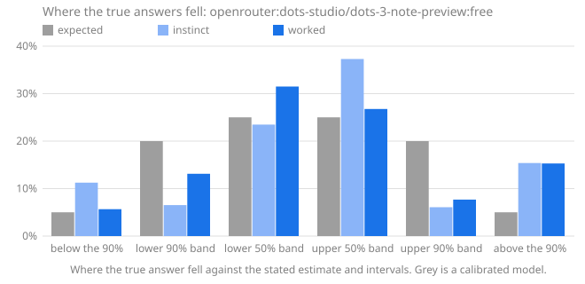

# Calibench report: openrouter:dots-studio/dots-3-note-preview:free

Seed `calibench-v2`, 108 questions, Calibench 2.6.0, Python 3.13.16 (Unicode 15.1.0), started 2026-10-17T14:42:06+00:00. Scored with Calibench 2.6.1 (log-wis-2).

**Standard suite v2.**

Settings: effort low for instinct and high for worked answers; token caps of 8,000 and 32,000.

Served by: dots-studio/dots-3-note-preview:free via AtlasCloud.

Tokens: input 43,107, output 2,173,892, reasoning 1,512,179.

Cost reported by the API: 0.0000 (US dollars on OpenRouter).

## Summary

| | Instinct | Worked |
|---|---|---|
| Answered | 84 of 108 (24 truncated) | 71 of 108 (1 refused, 36 truncated) |
| **Score**, mean [90% interval] | **0.425** [0.337, 0.519] | **0.501** [0.406, 0.597] |
| Score, median | 0.069 | 0.057 |
| Score, answered questions only | 0.179 [0.115, 0.249] | 0.090 [0.054, 0.131] |
| Interval score, 50% / 90% intervals | 0.815 / 2.771 | 0.420 / 1.327 |
| 50% intervals containing the answer [90% interval] | 54 of 84 (64%) [55%, 72%] | 51 of 71 (72%) [62%, 80%] |
| … leaving out single numbers | 49 of 78 (63%): too wide (underconfident) | 32 of 52 (62%): consistent with calibrated |
| 90% intervals containing the answer [90% interval] | 63 of 84 (75%) [67%, 82%] | 60 of 71 (85%) [76%, 90%] |
| … leaving out single numbers | 59 of 80 (74%): too narrow (overconfident) | 42 of 53 (79%): too narrow (overconfident) |
| Answers given as certain (a single number) | 4, 4 exactly right | 18, 18 exactly right |
| Median error of the estimate | 2.6% | 0.1% |
| Output tokens per answer | 4,167 (2,948 reasoning) | 15,962 (11,053 reasoning) |
| Estimate closer to the answer | 12 | 34 |

Working it out lowered the score on 41 of 62 questions answered both ways, from 0.113 to 0.098 on average (improvement [-0.037, 0.070]).

The score is the weighted interval score (Bracher et al., 2021) on a log scale: it combines the estimate and both intervals, is lowest when the stated intervals are the ones the model believes, and treats a miss by a factor in either direction alike. Lower is better; 0.1 is roughly a 10% miss. Intervals in brackets are 90% intervals over questions. Coverage verdicts leave out single-number intervals, which say "I know this exactly" and are counted on their own line.

The score counts each unanswered question as 1.289, the score of an answer off by a factor of ten with wide intervals, whatever the size of the true answer; the rows below it use answered questions only.

## Where the true answers fell

The estimate and the two intervals are five quantiles of the model's belief, so they split it into six bins, and a calibrated model's true answers land in each bin in the expected share. Too many in the outer bins means intervals too narrow; too many on one side of the estimate means a lean in that direction. Single-number answers are left out, and an answer on a boundary is shared between the bins it touches.

| The true answer was | Expected | Instinct | Worked |
|---|---|---|---|
| below the 90% interval | 5% | 11% (9) | 6% (3) |
| in the 90% interval, below the 50% | 20% | 7% (5.222) | 13% (6.952) |
| in the 50% interval, below the estimate | 25% | 23% (18.78) | 31% (16.69) |
| in the 50% interval, above the estimate | 25% | 37% (29.83) | 27% (14.19) |
| in the 90% interval, above the 50% | 20% | 6% (4.867) | 8% (4.067) |
| above the 90% interval | 5% | 15% (12.3) | 15% (8.1) |
| **above the estimate**, with 90% interval | 50% | 59% [50%, 67%] | 50% [38%, 60%] |

## Where the score comes from

A few large misses can carry a mean. This shows how much of each score its largest questions carry, and the worked answers whose 90% interval missed, costliest first.

| | Instinct | Worked |
|---|---|---|
| Share of the score from the largest question | 4% | 2% |
| Share from the five largest | 17% | 12% |
| Mean score without the largest question | 0.412 | 0.493 |

**Worked answers outside their 90% interval.** *Outside by* is the factor between the true answer and the nearer end of the interval; *width* is the ratio of the interval's ends, so a narrow interval that misses by a wide factor is a confident miss.

| # | Question | True answer | Estimate [90% interval] | Width | Outside by | Score | Share of score |
|---|---|---|---|---|---|---|---|
| 94 | lines in `warnings` | 735 | 245 [200, 290] | ×1.45 | ×2.53 above | 1.025 | 2% |
| 4 | function definitions in `tabnanny` | 17 | 6 [3, 10] | ×2.75 | ×1.64 above | 0.759 | 1% |
| 26 | code points in category Lm | 397 | 192 [180, 204] | ×1.13 | ×1.94 above | 0.698 | 1% |
| 3 | lines in `statistics` | 1,817 | 850 [600, 1,100] | ×1.83 | ×1.65 above | 0.657 | 1% |
| 108 | code points in category Mn | 1,985 | 1,100 [950, 1,250] | ×1.32 | ×1.59 above | 0.536 | 1% |
| 45 | lines in `subprocess` | 2,259 | 1,500 [1,200, 1,800] | ×1.5 | ×1.25 above | 0.332 | 1% |
| 81 | lines in `timeit` | 381 | 250 [180, 320] | ×1.77 | ×1.19 above | 0.312 | 1% |
| 100 | Collatz steps from 142,916,784,243 | 164 | 260 [180, 340] | ×1.88 | ×1.1 below | 0.299 | 1% |
| 87 | assigned in the Thai block | 87 | 73 [68, 78] | ×1.14 | ×1.11 above | 0.145 | 0% |
| 85 | primes in [2,647,606, 2,665,661] | 1,242 | 1,309 [1,249, 1,368] | ×1.1 | ×1.01 below | 0.032 | 0% |
| | 1 more | | | | | | |

## By kind of question

Knowledge questions ask what is known (the Python standard library, the Unicode database); statistical ones need noise or irregularity modelled; exact ones have a closed-form answer that must be evaluated; calculation ones have an exact answer that takes long, careful arithmetic.

| Kind | Phase | Questions | Score | 50% hits | 90% hits |
|---|---|---|---|---|---|
| calculation | instinct | 25 | 0.022 | 23 of 25 (92%) | 24 of 25 (96%) |
| calculation | worked | 30 | 0.010 | 30 of 30 (100%) | 30 of 30 (100%) |
| exact | instinct | 3 | 0.047 | 3 of 3 (100%) | 3 of 3 (100%) |
| exact | worked | 4 | 0.030 | 4 of 4 (100%) | 4 of 4 (100%) |
| knowledge | instinct | 30 | 0.338 | 10 of 30 (33%) | 16 of 30 (53%) |
| knowledge | worked | 17 | 0.304 | 4 of 17 (24%) | 9 of 17 (53%) |
| statistical | instinct | 26 | 0.161 | 18 of 26 (69%) | 20 of 26 (77%) |
| statistical | worked | 20 | 0.039 | 13 of 20 (65%) | 17 of 20 (85%) |

## By family

| Family | Kind | Questions | Score, worked | Score, instinct | Worked 90% hits | Worked answers above the estimate |
|---|---|---|---|---|---|---|
| `birthday` | exact | 4 | 0.030 | 0.047 | 4 of 4 (100%) | 0% |
| `collatz_steps` | statistical | 5 | 0.117 | 0.686 | 4 of 5 (80%) | 62% |
| `days_between` | calculation | 6 | 0.000 | 0.005 | 6 of 6 (100%) | 50% |
| `digit_sum_pow2` | statistical | 6 | 0.008 | 0.015 | 6 of 6 (100%) | 42% |
| `factorial_digits` | calculation | 6 | 0.000 | 0.000 | 6 of 6 (100%) | 50% |
| `friday13` | calculation | 6 | 0.001 | 0.018 | 6 of 6 (100%) | 67% |
| `lis` | statistical | 0 | — | 0.050 | — | — |
| `module_all` | knowledge | 1 | 0.000 | 0.222 | 1 of 1 (100%) | — |
| `multiply` | calculation | 6 | 0.000 | 0.004 | 6 of 6 (100%) | 50% |
| `partitions` | calculation | 6 | 0.047 | 0.067 | 6 of 6 (100%) | 50% |
| `primes_in_range` | statistical | 6 | 0.022 | 0.018 | 5 of 6 (83%) | 17% |
| `rect_distance` | statistical | 1 | 0.000 | 0.067 | 1 of 1 (100%) | 100% |
| `stdlib_defs` | knowledge | 2 | 0.440 | 0.494 | 1 of 2 (50%) | 100% |
| `stdlib_lines` | knowledge | 6 | 0.404 | 0.193 | 2 of 6 (33%) | 83% |
| `unicode_block` | knowledge | 3 | 0.052 | 0.055 | 2 of 3 (67%) | 67% |
| `unicode_category` | knowledge | 4 | 0.354 | 0.390 | 2 of 4 (50%) | 50% |
| `unicode_word` | knowledge | 1 | 0.291 | 1.139 | 1 of 1 (100%) | 100% |
| `walk_max` | statistical | 2 | 0.011 | 0.067 | 1 of 2 (50%) | 0% |

## Questions

Each answer is shown as estimate [90% interval], ✓ or ✗ for whether the 50% and 90% intervals contain the true answer, and its score.

| # | Question | True answer | Instinct | Worked |
|---|---|---|---|---|
| 1 | Friday the 13ths in 1607–1713 | 185 | 183 [163, 204] 50✓ 90✓ · 0.015 | 185 [185, 185] 50✓ 90✓ · 0.000 |
| 2 | primes in [3,218,046, 3,219,109] | 68 | 71 [57, 85] 50✓ 90✓ · 0.033 | 71 [57, 85] 50✓ 90✓ · 0.030 |
| 3 | lines in `statistics` | 1,817 | 1,800 [1,500, 2,100] 50✓ 90✓ · 0.020 | 850 [600, 1,100] 50✗ 90✗ · 0.657 |
| 4 | function definitions in `tabnanny` | 17 | 5 [2, 9] 50✗ 90✗ · 0.890 | 6 [3, 10] 50✗ 90✗ · 0.759 |
| 5 | digits of 246! | 483 | 483 [483, 483] 50✓ 90✓ · 0.000 | 483 [483, 483] 50✓ 90✓ · 0.000 |
| 6 | mean distance in a 1 × 1.33 rectangle | 0.6103 | truncated · 1.289 | truncated · 1.289 |
| 7 | Unicode names with the word LATIN | 1,567 | truncated · 1.289 | truncated · 1.289 |
| 8 | draws until a repeat, d = 303 | 22.49 | truncated · 1.289 | 22.49 [22.44, 22.54] 50✓ 90✓ · 0.000 |
| 9 | names in `random.__all__` | 26 | 28 [25, 31] 50✗ 90✓ · 0.040 | truncated · 1.289 |
| 10 | assigned in the Cherokee block | 92 | 92 [89, 95] 50✓ 90✓ · 0.003 | 94 [90, 96] 50✗ 90✓ · 0.012 |
| 11 | Collatz steps from 611,221,186,107 | 378 | 350 [150, 650] 50✓ 90✓ · 0.103 | 250 [50, 600] 50✗ 90✓ · 0.247 |
| 12 | longest increasing subsequence, n = 600 | 44.3 | truncated · 1.289 | truncated · 1.289 |
| 13 | highest point of a 901-step walk | 23.33 | 24.5 [20, 30] 50✓ 90✓ · 0.030 | 23.94 [23.47, 24.41] 50✗ 90✗ · 0.017 |
| 14 | 6,787 × 2,142 | 14,537,754 | 14,500,000 [13,500,000, 15,500,000] 50✓ 90✓ · 0.007 | 14,537,754 [14,537,700, 14,537,800] 50✓ 90✓ · 0.000 |
| 15 | days from 2381-11-09 to 2400-03-01 | 6,687 | 6,687 [6,670, 6,710] 50✓ 90✓ · 0.000 | 6,687 [6,687, 6,687] 50✓ 90✓ · 0.000 |
| 16 | code points in category Nd | 680 | 600 [500, 700] 50✗ 90✓ · 0.066 | truncated · 1.289 |
| 17 | digit sum of 2^2579 | 3,479 | 3,500 [2,000, 5,000] 50✓ 90✓ · 0.048 | 3,497 [3,365, 3,629] 50✓ 90✓ · 0.006 |
| 18 | partitions of 246 | 169,296,722,391,554 | 170,000,000,000,000 [100,000,000,000,000, 300,000,000,000,000] 50✓ 90✓ · 0.052 | 169,000,000,000,000 [150,000,000,000,000, 190,000,000,000,000] 50✓ 90✓ · 0.010 |
| 19 | Collatz steps from 273,342,000,302 | 201 | 260 [100, 500] 50✓ 90✓ · 0.139 | 201 [190, 210] 50✓ 90✓ · 0.003 |
| 20 | days from 2367-07-04 to 2367-08-26 | 53 | 53 [50, 56] 50✓ 90✓ · 0.006 | 53 [53, 53] 50✓ 90✓ · 0.000 |
| 21 | longest increasing subsequence, n = 880 | 54.39 | truncated · 1.289 | refused · 1.289 |
| 22 | digits of 10,938! | 39,431 | truncated · 1.289 | 39,431 [39,431, 39,431] 50✓ 90✓ · 0.000 |
| 23 | draws until a repeat, d = 3,428 | 74.05 | 74 [70, 78] 50✓ 90✓ · 0.005 | 74.05 [74, 74.1] 50✓ 90✓ · 0.000 |
| 24 | assigned in the Arabic Presentation Forms-B block | 141 | 126 [120, 130] 50✗ 90✗ · 0.099 | truncated · 1.289 |
| 25 | 21,339 × 2,935 | 62,629,965 | 62,500,000 [59,000,000, 66,000,000] 50✓ 90✓ · 0.007 | 62,629,965 [62,629,965, 62,629,965] 50✓ 90✓ · 0.000 |
| 26 | code points in category Lm | 397 | 150 [100, 200] 50✗ 90✗ · 0.856 | 192 [180, 204] 50✗ 90✗ · 0.698 |
| 27 | mean distance in a 1 × 6.93 rectangle | 2.377 | truncated · 1.289 | 2.377 [2.372, 2.382] 50✓ 90✓ · 0.000 |
| 28 | lines in `base64` | 628 | 250 [150, 400] 50✗ 90✗ · 0.719 | 615 [520, 710] 50✓ 90✓ · 0.019 |
| 29 | Unicode names with the word SIGN | 3,393 | truncated · 1.289 | truncated · 1.289 |
| 30 | partitions of 256 | 365,749,566,870,782 | 445,000,000,000,000 [400,000,000,000,000, 500,000,000,000,000] 50✗ 90✗ · 0.156 | 370,000,000,000,000 [200,000,000,000,000, 600,000,000,000,000] 50✓ 90✓ · 0.065 |
| 31 | primes in [3,705,675, 3,741,104] | 2,356 | 2,341 [2,261, 2,421] 50✓ 90✓ · 0.005 | 2,340 [2,260, 2,420] 50✓ 90✓ · 0.006 |
| 32 | Friday the 13ths in 2120–2204 | 147 | 146 [126, 166] 50✓ 90✓ · 0.018 | 147 [144, 150] 50✓ 90✓ · 0.002 |
| 33 | names in `fractions.__all__` | 1 | 1 [1, 1] 50✓ 90✓ · 0.000 | 1 [1, 1] 50✓ 90✓ · 0.000 |
| 34 | highest point of a 608-step walk | 19.36 | 20 [14, 26] 50✓ 90✓ · 0.039 | truncated · 1.289 |
| 35 | function definitions in `inspect` | 148 | 135 [90, 180] 50✓ 90✓ · 0.054 | 120 [90, 160] 50✗ 90✓ · 0.121 |
| 36 | digit sum of 2^4112 | 5,575 | 5,571 [5,405, 5,737] 50✓ 90✓ · 0.004 | 5,571 [5,405, 5,737] 50✓ 90✓ · 0.004 |
| 37 | Unicode names with the word STAR | 61 | truncated · 1.289 | truncated · 1.289 |
| 38 | highest point of a 400-step walk | 15.36 | 13.5 [1, 39] 50✓ 90✓ · 0.233 | truncated · 1.289 |
| 39 | digit sum of 2^4557 | 6,011 | 6,174 [6,000, 6,350] 50✗ 90✓ · 0.015 | 6,174 [5,999, 6,349] 50✗ 90✓ · 0.015 |
| 40 | names in `bdb.__all__` | 3 | 10 [7, 13] 50✗ 90✗ · 0.876 | truncated · 1.289 |
| 41 | days from 2360-02-08 to 2360-03-27 | 48 | 48 [45, 51] 50✓ 90✓ · 0.007 | 48 [48, 48] 50✓ 90✓ · 0.000 |
| 42 | code points in category Ps | 79 | 30 [20, 50] 50✗ 90✗ · 0.739 | truncated · 1.289 |
| 43 | digits of 395! | 856 | truncated · 1.289 | 856 [855, 857] 50✓ 90✓ · 0.000 |
| 44 | Collatz steps from 257,793,746,753 | 170 | 1,000 [700, 1,300] 50✗ 90✗ · 1.615 | truncated · 1.289 |
| 45 | lines in `subprocess` | 2,259 | 2,000 [1,700, 2,300] 50✗ 90✓ · 0.070 | 1,500 [1,200, 1,800] 50✗ 90✗ · 0.332 |
| 46 | assigned in the Georgian block | 88 | 84 [75, 93] 50✗ 90✓ · 0.027 | truncated · 1.289 |
| 47 | partitions of 229 | 44,132,934,884,255 | 45,000,000,000,000 [20,000,000,000,000, 80,000,000,000,000] 50✓ 90✓ · 0.077 | 44,000,000,000,000 [38,000,000,000,000, 50,000,000,000,000] 50✓ 90✓ · 0.015 |
| 48 | longest increasing subsequence, n = 156 | 21.48 | 25 [20, 30] 50✗ 90✓ · 0.082 | truncated · 1.289 |
| 49 | primes in [203,866, 205,144] | 103 | 105 [88, 121] 50✓ 90✓ · 0.022 | 105 [88, 122] 50✓ 90✓ · 0.024 |
| 50 | 156,899 × 30,667 | 4,811,621,633 | 4,820,000,000 [4,804,000,000, 4,836,000,000] 50✗ 90✓ · 0.001 | 4,811,621,633 [4,811,621,633, 4,811,621,633] 50✓ 90✓ · 0.000 |
| 51 | Friday the 13ths in 2295–2567 | 469 | 470 [437, 503] 50✓ 90✓ · 0.009 | 469 [465, 473] 50✓ 90✓ · 0.001 |
| 52 | mean distance in a 1 × 2.74 rectangle | 1.029 | truncated · 1.289 | truncated · 1.289 |
| 53 | draws until a repeat, d = 9,424 | 122.3 | 122.3 [118, 128] 50✓ 90✓ · 0.004 | truncated · 1.289 |
| 54 | function definitions in `uuid` | 47 | 45 [20, 70] 50✓ 90✓ · 0.077 | truncated · 1.289 |
| 55 | draws until a repeat, d = 1,449,835 | 1,510 | truncated · 1.289 | 1,510 [1,510, 1,510] 50✓ 90✓ · 0.000 |
| 56 | names in `zipapp.__all__` | 3 | 2 [1, 3] 50✗ 90✓ · 0.186 | truncated · 1.289 |
| 57 | digit sum of 2^2312 | 3,136 | 3,132 [3,007, 3,257] 50✓ 90✓ · 0.005 | 3,136 [3,011, 3,261] 50✓ 90✓ · 0.005 |
| 58 | primes in [2,973,871, 2,977,273] | 227 | 229 [205, 253] 50✓ 90✓ · 0.014 | 228 [203, 253] 50✓ 90✓ · 0.014 |
| 59 | Friday the 13ths in 2041–2047 | 13 | 12 [9, 15] 50✓ 90✓ · 0.040 | 13 [13, 13] 50✓ 90✓ · 0.000 |
| 60 | 34,718 × 1,419 | 49,264,842 | 49,000,000 [48,000,000, 50,000,000] 50✓ 90✓ · 0.004 | 49,264,842 [49,264,837, 49,264,847] 50✓ 90✓ · 0.000 |
| 61 | mean distance in a 1 × 3.73 rectangle | 1.34 | 1.45 [0.9, 2.1] 50✓ 90✓ · 0.067 | truncated · 1.289 |
| 62 | Collatz steps from 720,780,470,611 | 249 | 200 [100, 350] 50✓ 90✓ · 0.119 | 249 [249, 249] 50✓ 90✓ · 0.000 |
| 63 | digits of 206! | 389 | 389 [389, 389] 50✓ 90✓ · 0.000 | 389 [388, 391] 50✓ 90✓ · 0.000 |
| 64 | highest point of a 1,243-step walk | 27.4 | 28 [27.5, 28.6] 50✗ 90✗ · 0.014 | truncated · 1.289 |
| 65 | lines in `configparser` | 1,398 | 950 [700, 1,300] 50✗ 90✗ · 0.254 | 1,600 [1,200, 2,000] 50✗ 90✓ · 0.078 |
| 66 | days from 1748-02-09 to 1752-09-26 | 1,691 | truncated · 1.289 | 1,691 [1,680, 1,700] 50✓ 90✓ · 0.000 |
| 67 | function definitions in `mailbox` | 191 | 35 [20, 50] 50✗ 90✗ · 1.528 | truncated · 1.289 |
| 68 | code points in category Lt | 31 | 35 [20, 50] 50✓ 90✓ · 0.069 | 33 [20, 50] 50✓ 90✓ · 0.048 |
| 69 | longest increasing subsequence, n = 406 | 36.11 | 40.3 [36.3, 44.3] 50✗ 90✗ · 0.064 | truncated · 1.289 |
| 70 | partitions of 387 | 2,998,964,447,736,452,194 | 3.03e+18 [2e+18, 4.5e+18] 50✓ 90✓ · 0.035 | 3e+18 [1e+18, 1e+19] 50✓ 90✓ · 0.138 |
| 71 | Unicode names with the word FRACTION | 98 | 12 [5, 20] 50✗ 90✗ · 1.837 | truncated · 1.289 |
| 72 | assigned in the Egyptian Hieroglyphs block | 1,072 | 1,071 [1,065, 1,072] 50✓ 90✓ · 0.001 | 1,071 [1,069, 1,072] 50✓ 90✓ · 0.000 |
| 73 | Unicode names with the word SMALL | 3,296 | 2,000 [1,700, 2,300] 50✗ 90✗ · 0.440 | 2,000 [800, 3,500] 50✗ 90✓ · 0.291 |
| 74 | mean distance in a 1 × 7.69 rectangle | 2.63 | truncated · 1.289 | truncated · 1.289 |
| 75 | digits of 86,588! | 389,923 | truncated · 1.289 | 389,923 [389,923, 389,923] 50✓ 90✓ · 0.000 |
| 76 | partitions of 134 | 8,149,040,695 | 8,500,000,000 [4,000,000,000, 14,000,000,000] 50✓ 90✓ · 0.069 | 8,300,000,000 [5,000,000,000, 15,000,000,000] 50✓ 90✓ · 0.049 |
| 77 | code points in category Ll | 2,233 | 1,400 [1,200, 1,600] 50✗ 90✗ · 0.406 | 2,800 [2,000, 4,000] 50✗ 90✓ · 0.134 |
| 78 | days from 1735-03-13 to 1738-03-23 | 1,106 | 1,106 [1,000, 1,200] 50✓ 90✓ · 0.008 | 1,106 [1,106, 1,106] 50✓ 90✓ · 0.000 |
| 79 | names in `fnmatch.__all__` | 4 | 4 [3, 5] 50✓ 90✓ · 0.008 | truncated · 1.289 |
| 80 | highest point of a 1,783-step walk | 34.21 | truncated · 1.289 | truncated · 1.289 |
| 81 | lines in `timeit` | 381 | 380 [320, 440] 50✓ 90✓ · 0.017 | 250 [180, 320] 50✗ 90✗ · 0.312 |
| 82 | draws until a repeat, d = 6,507,924 | 3,198 | 3,004 [817, 6,246] 50✓ 90✓ · 0.132 | 3,198 [818, 6,245] 50✓ 90✓ · 0.119 |
| 83 | function definitions in `shlex` | 15 | 22 [12, 32] 50✗ 90✓ · 0.195 | truncated · 1.289 |
| 84 | Friday the 13ths in 2246–2329 | 145 | 145 [134, 156] 50✓ 90✓ · 0.009 | 144 [140, 150] 50✓ 90✓ · 0.004 |
| 85 | primes in [2,647,606, 2,665,661] | 1,242 | 1,220 [1,162, 1,278] 50✓ 90✓ · 0.009 | 1,309 [1,249, 1,368] 50✗ 90✗ · 0.032 |
| 86 | Collatz steps from 823,122,992,864 | 195 | 990 [680, 1,300] 50✗ 90✗ · 1.454 | 190 [140, 260] 50✓ 90✓ · 0.039 |
| 87 | assigned in the Thai block | 87 | 72 [65, 80] 50✗ 90✗ · 0.144 | 73 [68, 78] 50✗ 90✗ · 0.145 |
| 88 | 2,025 × 311,373 | 630,530,325 | 630,000,000 [620,000,000, 640,000,000] 50✓ 90✓ · 0.002 | 630,530,325 [630,530,325, 630,530,325] 50✓ 90✓ · 0.000 |
| 89 | longest increasing subsequence, n = 803 | 51.71 | truncated · 1.289 | truncated · 1.289 |
| 90 | digit sum of 2^9436 | 12,832 | 12,780 [12,530, 13,030] 50✓ 90✓ · 0.003 | 12,787 [12,535, 13,039] 50✓ 90✓ · 0.003 |
| 91 | function definitions in `numbers` | 56 | 80 [60, 100] 50✗ 90✗ · 0.220 | truncated · 1.289 |
| 92 | 61,640 × 5,178 | 319,171,920 | 319,000,000 [315,000,000, 323,000,000] 50✓ 90✓ · 0.001 | 319,171,920 [319,171,920, 319,171,920] 50✓ 90✓ · 0.000 |
| 93 | longest increasing subsequence, n = 105 | 17.17 | 17 [16.5, 17.5] 50✓ 90✓ · 0.005 | truncated · 1.289 |
| 94 | lines in `warnings` | 735 | 650 [300, 1,000] 50✓ 90✓ · 0.080 | 245 [200, 290] 50✗ 90✗ · 1.025 |
| 95 | partitions of 507 | 3,384,893,356,244,349,844,341 | 3.4e+21 [3e+21, 3.8e+21] 50✓ 90✓ · 0.012 | 3.38e+21 [3.2e+21, 3.6e+21] 50✓ 90✓ · 0.005 |
| 96 | days from 2193-08-10 to 2194-03-25 | 227 | truncated · 1.289 | 227 [227, 227] 50✓ 90✓ · 0.000 |
| 97 | primes in [730,012, 731,622] | 112 | 110 [93, 127] 50✓ 90✓ · 0.022 | 119 [101, 137] 50✓ 90✓ · 0.030 |
| 98 | assigned in the Latin Extended-B block | 208 | truncated · 1.289 | truncated · 1.289 |
| 99 | digit sum of 2^8194 | 10,843 | 11,104 [10,867, 11,336] 50✗ 90✗ · 0.014 | 11,104 [10,800, 11,400] 50✗ 90✓ · 0.013 |
| 100 | Collatz steps from 142,916,784,243 | 164 | truncated · 1.289 | 260 [180, 340] 50✗ 90✗ · 0.299 |
| 101 | highest point of a 1,174-step walk | 26.55 | 27.3 [26.8, 27.9] 50✗ 90✗ · 0.020 | 26.8 [26.3, 27.3] 50✗ 90✓ · 0.005 |
| 102 | mean distance in a 1 × 1.22 rectangle | 0.58 | truncated · 1.289 | truncated · 1.289 |
| 103 | names in `typing.__all__` | 104 | truncated · 1.289 | truncated · 1.289 |
| 104 | draws until a repeat, d = 528 | 29.47 | truncated · 1.289 | truncated · 1.289 |
| 105 | Friday the 13ths in 1810–1860 | 87 | 87 [73, 102] 50✓ 90✓ · 0.019 | 87 [87, 87] 50✓ 90✓ · 0.000 |
| 106 | digits of 133! | 227 | 227 [227, 227] 50✓ 90✓ · 0.000 | 227 [227, 227] 50✓ 90✓ · 0.000 |
| 107 | Unicode names with the word DIGIT | 898 | truncated · 1.289 | truncated · 1.289 |
| 108 | code points in category Mn | 1,985 | 1,500 [1,200, 1,800] 50✗ 90✗ · 0.203 | 1,100 [950, 1,250] 50✗ 90✗ · 0.536 |
