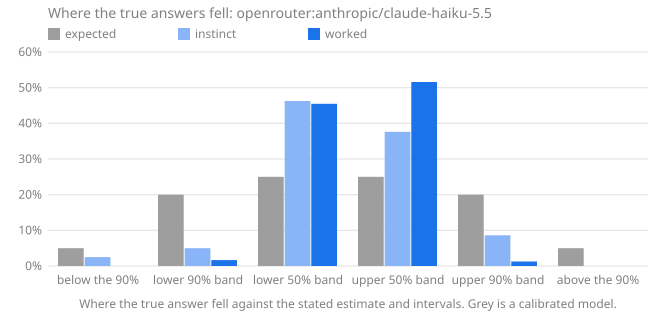

# Calibench report: openrouter:anthropic/claude-haiku-5.5

Seed `calibench-calc1`, 40 questions, Calibench 2.2.0, Python 3.13.16 (Unicode 15.1.0), started 2026-10-17T04:26:45+00:00. Scored with Calibench 2.3.2 (log-wis-1).

**Standard suite calc1.**

Served by: anthropic/claude-haiku-5.5 via Claude Platform on AWS.

Tokens: input 19,320, output 197,018, reasoning 166,890.

Cost reported by the API: 0.1004 (US dollars on OpenRouter).

## Summary

| | Instinct | Worked |
|---|---|---|
| Answered | 40 of 40 | 40 of 40 |
| **Score**, mean [90% interval] | **0.019** [0.009, 0.031] | **0.000** [0.000, 0.000] |
| Score, median | 0.000 | 0.000 |
| Interval score, 50% / 90% intervals | 0.092 / 0.311 | 0.001 / 0.006 |
| 50% intervals containing the answer [90% interval] | 34 of 40 (85%) [74%, 92%] | 40 of 40 (100%) [94%, 100%] |
| … leaving out single numbers | 34 of 40 (85%): too wide (underconfident) | 39 of 39 (100%): too wide (underconfident) |
| 90% intervals containing the answer [90% interval] | 39 of 40 (98%) [90%, 99%] | 40 of 40 (100%) [94%, 100%] |
| … leaving out single numbers | 39 of 40 (98%): consistent with calibrated | 40 of 40 (100%): too wide (underconfident) |
| Answers given as certain (a single number) | 0, 0 exactly right | 0, 0 exactly right |
| Median error of the estimate | 0.0% | 0.0% |
| Output tokens per answer | 540 (493 reasoning) | 4,385 (3,679 reasoning) |
| Estimate closer to the answer | 1 | 33 |

Working it out lowered the score on 39 of 40 questions answered both ways, from 0.019 to 0.000 on average (improvement [0.008, 0.031]).

The score is the weighted interval score (Bracher et al., 2021) on a log scale: it combines the estimate and both intervals, is lowest when the stated intervals are the ones the model believes, and treats a miss by a factor in either direction alike. Lower is better; 0.1 is roughly a 10% miss. Intervals in brackets are 90% intervals over questions. Coverage verdicts leave out single-number intervals, which say "I know this exactly" and are counted on their own line.

## Where the true answers fell

The estimate and the two intervals are five quantiles of the model's belief, so they split it into six bins, and a calibrated model's true answers land in each bin in the expected share. Too many in the outer bins means intervals too narrow; too many on one side of the estimate means a lean in that direction. Single-number answers are left out, and an answer on a boundary is shared between the bins it touches.

| The true answer was | Expected | Instinct | Worked |
|---|---|---|---|
| below the 90% interval | 5% | 2% (1) | 0% (0) |
| in the 90% interval, below the 50% | 20% | 5% (2) | 2% (0.6667) |
| in the 50% interval, below the estimate | 25% | 46% (18.5) | 45% (18.19) |
| in the 50% interval, above the estimate | 25% | 38% (15.06) | 52% (20.63) |
| in the 90% interval, above the 50% | 20% | 9% (3.444) | 1% (0.5079) |
| above the 90% interval | 5% | 0% (0) | 0% (0) |
| **above the estimate**, with 90% interval | 50% | 46% [33%, 58%] | 52% [40%, 65%] |

## Where the score comes from

A few large misses can carry a mean. This shows how much of each score its largest questions carry, and the worked answers whose 90% interval missed, costliest first.

| | Instinct | Worked |
|---|---|---|
| Share of the score from the largest question | 35% | 34% |
| Share from the five largest | 73% | 77% |
| Mean score without the largest question | 0.013 | 0.000 |

## By kind of question

Knowledge questions ask what is known (the Python standard library, the Unicode database); statistical ones need noise or irregularity modelled; exact ones have a closed-form answer that must be evaluated; calculation ones have an exact answer that takes long, careful arithmetic.

| Kind | Phase | Questions | Score | 50% hits | 90% hits |
|---|---|---|---|---|---|
| calculation | instinct | 40 | 0.019 | 34 of 40 (85%) | 39 of 40 (98%) |
| calculation | worked | 40 | 0.000 | 40 of 40 (100%) | 40 of 40 (100%) |

## By family

| Family | Kind | Questions | Score, worked | Score, instinct | Worked 90% hits | Worked answers above the estimate |
|---|---|---|---|---|---|---|
| `days_between_far` | calculation | 10 | 0.000 | 0.000 | 10 of 10 (100%) | 45% |
| `factorial_digits_big` | calculation | 10 | 0.000 | 0.000 | 10 of 10 (100%) | 50% |
| `multiply_big` | calculation | 10 | 0.000 | 0.004 | 10 of 10 (100%) | 45% |
| `partitions_big` | calculation | 10 | 0.001 | 0.071 | 10 of 10 (100%) | 70% |

## Questions

Each answer is shown as estimate [90% interval], ✓ or ✗ for whether the 50% and 90% intervals contain the true answer, and its score.

| # | Question | True answer | Instinct | Worked |
|---|---|---|---|---|
| 1 | digits of 167,185,710! | 1,302,193,563 | 1,302,193,605 [1,302,000,000, 1,302,400,000] 50✓ 90✓ · 0.000 | 1,302,193,563 [1,302,193,553, 1,302,193,572] 50✓ 90✓ · 0.000 |
| 2 | days from 0456-12-28 to 1030-03-20 | 209,365 | 209,730 [209,600, 209,850] 50✗ 90✗ · 0.001 | 209,365 [209,340, 209,390] 50✓ 90✓ · 0.000 |
| 3 | 713,084,725 × 3,768,541,855 | 2,687,289,632,323,664,875 | 2,687,289,658,000,000,000 [2,400,000,000,000,000,000, 3,000,000,000,000,000,000] 50✓ 90✓ · 0.011 | 2,687,289,632,323,664,875 [2,680,000,000,000,000,000, 2,694,000,000,000,000,000] 50✓ 90✓ · 0.000 |
| 4 | partitions of 1,116 | 2,094,902,753,439,183,950,276,117,590,000,925 | 2.1e+33 [1.2e+33, 3.8e+33] 50✓ 90✓ · 0.047 | 2.095e+33 [2.088e+33, 2.101e+33] 50✓ 90✓ · 0.000 |
| 5 | 572,060,307 × 27,074,580 | 15,488,292,546,696,060 | 15,488,292,550,000,000 [15,000,000,000,000,000, 16,000,000,000,000,000] 50✓ 90✓ · 0.002 | 15,488,292,546,696,060 [15,488,000,000,000,000, 15,488,600,000,000,000] 50✓ 90✓ · 0.000 |
| 6 | days from 0457-09-05 to 1319-10-29 | 314,892 | 314,892 [314,800, 314,990] 50✓ 90✓ · 0.000 | 314,892 [314,860, 314,925] 50✓ 90✓ · 0.000 |
| 7 | partitions of 789 | 3,523,527,577,258,789,108,163,787,100 | 3.3e+27 [2.5e+27, 4.3e+27] 50✗ 90✓ · 0.039 | 3.525e+27 [3.505e+27, 3.545e+27] 50✓ 90✓ · 0.001 |
| 8 | digits of 4,673,662! | 29,141,982 | 29,141,798 [29,141,600, 29,142,000] 50✗ 90✓ · 0.000 | 29,141,982 [29,141,970, 29,141,995] 50✓ 90✓ · 0.000 |
| 9 | digits of 279,555! | 1,401,182 | 1,401,171 [1,401,100, 1,401,240] 50✓ 90✓ · 0.000 | 1,401,182 [1,401,179, 1,401,185] 50✓ 90✓ · 0.000 |
| 10 | partitions of 2,856 | 17,154,138,971,402,239,702,344,322,970,918,807,628,851,636,631,855,206,215 | 1.67e+55 [1.35e+55, 2e+55] 50✓ 90✓ · 0.028 | 1.715e+55 [1.71e+55, 1.72e+55] 50✓ 90✓ · 0.000 |
| 11 | 3,723,202 × 173,868,257 | 647,346,642,198,914 | 647,346,600,000,000 [600,000,000,000,000, 690,000,000,000,000] 50✓ 90✓ · 0.005 | 647,346,642,198,914 [647,346,642,000,000, 647,346,642,400,000] 50✓ 90✓ · 0.000 |
| 12 | days from 2692-10-03 to 3280-12-11 | 214,832 | 214,832 [214,700, 214,960] 50✓ 90✓ · 0.000 | 214,832 [214,805, 214,860] 50✓ 90✓ · 0.000 |
| 13 | 120,325,733,182 × 1,223,588,048 | 147,229,128,988,332,208,736 | 1.472e+20 [1.3e+20, 1.65e+20] 50✓ 90✓ · 0.005 | 147,229,128,988,332,208,736 [1.47e+20, 1.475e+20] 50✓ 90✓ · 0.000 |
| 14 | days from 0712-10-15 to 1174-07-21 | 168,656 | 168,655 [168,500, 168,800] 50✓ 90✓ · 0.000 | 168,656 [168,640, 168,670] 50✓ 90✓ · 0.000 |
| 15 | digits of 467,864! | 2,449,658 | 2,449,653 [2,449,400, 2,449,900] 50✓ 90✓ · 0.000 | 2,449,658 [2,449,654, 2,449,662] 50✓ 90✓ · 0.000 |
| 16 | partitions of 2,363 | 86,037,204,799,060,994,583,504,133,500,298,291,142,599,767,525,961 | 8.9e+49 [5e+49, 1.4e+50] 50✓ 90✓ · 0.061 | 8.604e+49 [8.56e+49, 8.65e+49] 50✓ 90✓ · 0.000 |
| 17 | days from 0947-09-27 to 1997-08-13 | 383,460 | 383,459 [383,300, 383,600] 50✓ 90✓ · 0.000 | 383,460 [383,400, 383,520] 50✓ 90✓ · 0.000 |
| 18 | digits of 4,800,202! | 29,986,698 | 29,986,700 [29,986,600, 29,986,800] 50✓ 90✓ · 0.000 | 29,986,698 [29,986,694, 29,986,702] 50✓ 90✓ · 0.000 |
| 19 | partitions of 1,263 | 439,519,180,314,644,983,035,319,377,172,158,032 | 4.4e+35 [1.5e+35, 1.2e+36] 50✓ 90✓ · 0.087 | 4.395e+35 [4.37e+35, 4.42e+35] 50✓ 90✓ · 0.000 |
| 20 | 8,212,263 × 5,018,745 | 41,215,253,869,935 | 41,215,254,870,000 [40,500,000,000,000, 41,900,000,000,000] 50✓ 90✓ · 0.002 | 41,215,253,869,935 [41,200,000,000,000, 41,230,000,000,000] 50✓ 90✓ · 0.000 |
| 21 | digits of 11,357,052! | 75,194,718 | 75,195,387 [75,193,500, 75,197,300] 50✗ 90✓ · 0.000 | 75,194,718 [75,194,716, 75,194,720] 50✓ 90✓ · 0.000 |
| 22 | 175,491,463 × 1,368,547,974 | 240,168,486,142,945,962 | 2.402e+17 [2.2e+17, 2.6e+17] 50✓ 90✓ · 0.008 | 240,168,486,142,945,962 [240,160,000,000,000,000, 240,177,000,000,000,000] 50✓ 90✓ · 0.000 |
| 23 | days from 0980-08-26 to 4921-08-13 | 1,439,407 | 1,439,407 [1,439,000, 1,439,800] 50✓ 90✓ · 0.000 | 1,439,407 [1,439,370, 1,439,450] 50✓ 90✓ · 0.000 |
| 24 | partitions of 1,749 | 3,169,458,542,208,911,724,615,579,730,356,050,273,697,000 | 3.2e+42 [1.5e+42, 7e+42] 50✓ 90✓ · 0.080 | 3.17e+42 [3.1e+42, 3.24e+42] 50✓ 90✓ · 0.001 |
| 25 | partitions of 682 | 25,744,258,930,034,131,533,263,392 | 2.5e+25 [2e+25, 3e+25] 50✓ 90✓ · 0.030 | 2.57e+25 [2.48e+25, 2.67e+25] 50✓ 90✓ · 0.004 |
| 26 | digits of 450,563! | 2,351,700 | 2,351,689 [2,351,300, 2,352,100] 50✓ 90✓ · 0.000 | 2,351,700 [2,351,690, 2,351,710] 50✓ 90✓ · 0.000 |
| 27 | 333,810,293,178 × 1,900,590 | 634,436,505,111,175,020 | 634,436,500,000,000,000 [600,000,000,000,000,000, 670,000,000,000,000,000] 50✓ 90✓ · 0.003 | 634,436,505,111,175,020 [634,000,000,000,000,000, 635,000,000,000,000,000] 50✓ 90✓ · 0.000 |
| 28 | days from 1703-07-25 to 2077-05-08 | 136,524 | 136,525 [136,400, 136,650] 50✓ 90✓ · 0.000 | 136,524 [136,500, 136,550] 50✓ 90✓ · 0.000 |
| 29 | days from 1006-01-21 to 2029-11-07 | 373,934 | 373,934 [373,850, 374,020] 50✓ 90✓ · 0.000 | 373,934 [373,850, 374,020] 50✓ 90✓ · 0.000 |
| 30 | 3,655,489,107 × 2,463,411,911 | 9,004,975,406,714,553,477 | 9.005e+18 [8.5e+18, 9.5e+18] 50✓ 90✓ · 0.003 | 9,004,975,406,714,553,477 [9,004,900,000,000,000,000, 9,005,100,000,000,000,000] 50✓ 90✓ · 0.000 |
| 31 | partitions of 3,947 | 353,027,000,364,262,881,227,812,119,247,460,821,586,403,326,543,022,806,746,808,032,364 | 2.2e+65 [5e+64, 7e+65] 50✗ 90✓ · 0.262 | 3.53e+65 [3.48e+65, 3.58e+65] 50✓ 90✓ · 0.001 |
| 32 | digits of 18,848,744! | 128,944,035 | 128,944,036 [128,943,950, 128,944,120] 50✓ 90✓ · 0.000 | 128,944,035 [128,944,020, 128,944,050] 50✓ 90✓ · 0.000 |
| 33 | digits of 278,273! | 1,394,200 | 1,394,200 [1,394,000, 1,394,400] 50✓ 90✓ · 0.000 | 1,394,200 [1,394,190, 1,394,210] 50✓ 90✓ · 0.000 |
| 34 | days from 0158-11-05 to 3449-08-04 | 1,201,920 | 1,201,920 [1,201,800, 1,202,050] 50✓ 90✓ · 0.000 | 1,201,920 [1,201,900, 1,201,940] 50✓ 90✓ · 0.000 |
| 35 | partitions of 2,217 | 1,830,826,552,374,771,058,174,587,388,568,897,962,322,872,702,465 | 1.9e+48 [1e+48, 3.5e+48] 50✓ 90✓ · 0.064 | 1.83e+48 [1.8e+48, 1.86e+48] 50✓ 90✓ · 0.002 |
| 36 | 298,168,204,490 × 27,147,301,085 | 8,094,462,021,263,878,871,650 | 8.095e+21 [8e+21, 8.2e+21] 50✓ 90✓ · 0.001 | 8.094e+21 [8.094e+21, 8.095e+21] 50✓ 90✓ · 0.000 |
| 37 | digits of 5,063,616! | 31,749,719 | 31,749,793 [31,749,700, 31,749,880] 50✗ 90✓ · 0.000 | 31,749,719 [31,749,712, 31,749,725] 50✓ 90✓ · 0.000 |
| 38 | days from 1834-01-10 to 2320-07-21 | 177,700 | 177,700 [177,450, 177,950] 50✓ 90✓ · 0.000 | 177,701 [177,690, 177,712] 50✓ 90✓ · 0.000 |
| 39 | partitions of 1,100 | 1,147,240,591,519,695,580,043,346,988,281,283 | 1.16e+33 [1e+33, 1.3e+33] 50✓ 90✓ · 0.014 | 1.147e+33 [1.142e+33, 1.153e+33] 50✓ 90✓ · 0.001 |
| 40 | 187,795,187,996 × 100,691,899 | 18,909,454,102,379,244,404 | 1.891e+19 [1.885e+19, 1.897e+19] 50✓ 90✓ · 0.000 | 18,909,454,102,379,244,404 [1.885e+19, 1.9e+19] 50✓ 90✓ · 0.000 |
