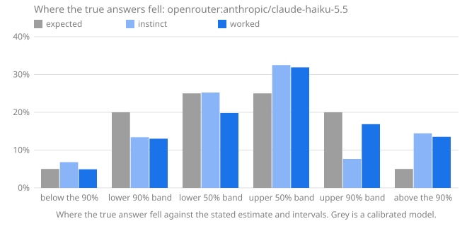

# Calibench report: openrouter:anthropic/claude-haiku-5.5

Seed `calibench-v1`, 104 questions, Calibench 2.0.0, Python 3.13.16 (Unicode 15.1.0), started 2026-10-17T03:18:44+00:00. Scored with Calibench 2.2.1 (log-wis-1).

**Standard suite v1.**

Served by: anthropic/claude-haiku-5.5 via Claude Platform on AWS.

Tokens: prompt tokens 51,704, completion tokens 439,622, reasoning tokens 364,489.

Cost reported by the API: 0.2250 (US dollars on OpenRouter).

## Summary

| | Instinct | Worked |
|---|---|---|
| Answered | 104 of 104 | 104 of 104 |
| **Score**, mean [90% interval] | **0.177** [0.126, 0.235] | **0.056** [0.035, 0.082] |
| Score, median | 0.045 | 0.007 |
| Interval score, 50% / 90% intervals | 0.859 / 2.384 | 0.261 / 0.835 |
| 50% intervals containing the answer [90% interval] | 63 of 104 (61%) [53%, 68%] | 62 of 104 (60%) [52%, 67%] |
| … leaving out single numbers | 62 of 103 (60%): too wide (underconfident) | 48 of 88 (55%): consistent with calibrated |
| 90% intervals containing the answer [90% interval] | 82 of 104 (79%) [72%, 85%] | 85 of 104 (82%) [75%, 87%] |
| … leaving out single numbers | 82 of 104 (79%): too narrow (overconfident) | 85 of 104 (82%): too narrow (overconfident) |
| Answers given as certain (a single number) | 0, 0 exactly right | 0, 0 exactly right |
| Median error of the estimate | 3.1% | 0.7% |
| Estimate closer to the answer | 20 | 60 |

Working it out lowered the score on 83 of 104 questions answered both ways, from 0.177 to 0.056 on average (improvement [0.068, 0.180]).

The score is the weighted interval score (Bracher et al., 2021) on a log scale: it combines the estimate and both intervals, is lowest when the stated intervals are the ones the model believes, and treats a miss by a factor in either direction alike. Lower is better; 0.1 is roughly a 10% miss. Intervals in brackets are 90% intervals over questions. Coverage verdicts leave out single-number intervals, which say "I know this exactly" and are counted on their own line.

## Where the true answers fell

The estimate and the two intervals are five quantiles of the model's belief, so they split it into six bins, and a calibrated model's true answers land in each bin in the expected share. Too many in the outer bins means intervals too narrow; too many on one side of the estimate means a lean in that direction. Single-number answers are left out, and an answer on a boundary is shared between the bins it touches.

| The true answer was | Expected | Instinct | Worked |
|---|---|---|---|
| below the 90% interval | 5% | 7% (7.067) | 5% (5.105) |
| in the 90% interval, below the 50% | 20% | 13% (13.93) | 13% (13.52) |
| in the 50% interval, below the estimate | 25% | 25% (26.24) | 20% (20.61) |
| in the 50% interval, above the estimate | 25% | 32% (33.79) | 32% (33.17) |
| in the 90% interval, above the 50% | 20% | 8% (7.968) | 17% (17.54) |
| above the 90% interval | 5% | 14% (15) | 14% (14.05) |
| **above the estimate**, with 90% interval | 50% | 54% [46%, 62%] | 62% [53%, 69%] |

## Where the score comes from

A few large misses can carry a mean. This shows how much of each score its largest questions carry, and the worked answers whose 90% interval missed, costliest first.

| | Instinct | Worked |
|---|---|---|
| Share of the score from the largest question | 12% | 20% |
| Share from the five largest | 37% | 48% |
| Mean score without the largest question | 0.157 | 0.045 |

**Worked answers outside their 90% interval.** *Outside by* is the factor between the true answer and the nearer end of the interval; *width* is the ratio of the interval's ends, so a narrow interval that misses by a wide factor is a confident miss.

| # | Question | True answer | Estimate [90% interval] | Width | Outside by | Score | Share of score |
|---|---|---|---|---|---|---|---|
| 16 | Unicode names with the word FRACTION | 98 | 28 [26, 31] | ×1.19 | ×3.09 above | 1.192 | 20% |
| 53 | lines in `glob` | 572 | 300 [240, 400] | ×1.66 | ×1.43 above | 0.519 | 9% |
| 75 | lines in `statistics` | 1,817 | 1,050 [880, 1,260] | ×1.43 | ×1.44 above | 0.469 | 8% |
| 95 | names in `mailbox.__all__` | 17 | 12 [11, 13] | ×1.17 | ×1.29 above | 0.299 | 5% |
| 28 | assigned in the Playing Cards block | 82 | 60 [56, 62] | ×1.11 | ×1.32 above | 0.299 | 5% |
| 102 | lines in `reprlib` | 230 | 169 [154, 186] | ×1.21 | ×1.24 above | 0.267 | 5% |
| 68 | Unicode names with the word FACE | 179 | 135 [124, 146] | ×1.18 | ×1.22 above | 0.247 | 4% |
| 83 | function definitions in `weakref` | 65 | 90 [72, 110] | ×1.52 | ×1.11 below | 0.226 | 4% |
| 89 | Unicode names with the word DIGIT | 898 | 770 [735, 820] | ×1.12 | ×1.1 above | 0.125 | 2% |
| 31 | Unicode names with the word CAPITAL | 2,032 | 1,730 [1,600, 1,880] | ×1.17 | ×1.08 above | 0.123 | 2% |
| | 9 more | | | | | | |

## By kind of question

Knowledge questions ask what is known (the Python standard library, the Unicode database); statistical ones need noise or irregularity modelled; exact ones have a closed-form answer that must be evaluated; calculation ones have an exact answer that takes long, careful arithmetic.

| Kind | Phase | Questions | Score | 50% hits | 90% hits |
|---|---|---|---|---|---|
| exact | instinct | 8 | 0.112 | 8 of 8 (100%) | 8 of 8 (100%) |
| exact | worked | 8 | 0.030 | 8 of 8 (100%) | 8 of 8 (100%) |
| knowledge | instinct | 48 | 0.280 | 26 of 48 (54%) | 34 of 48 (71%) |
| knowledge | worked | 48 | 0.095 | 31 of 48 (65%) | 35 of 48 (73%) |
| statistical | instinct | 48 | 0.084 | 29 of 48 (60%) | 40 of 48 (83%) |
| statistical | worked | 48 | 0.022 | 23 of 48 (48%) | 42 of 48 (88%) |

## By family

| Family | Kind | Questions | Score, worked | Score, instinct | Worked 90% hits | Worked answers above the estimate |
|---|---|---|---|---|---|---|
| `birthday` | exact | 8 | 0.030 | 0.112 | 8 of 8 (100%) | 62% |
| `collatz_steps` | statistical | 8 | 0.092 | 0.319 | 8 of 8 (100%) | 62% |
| `digit_sum_pow2` | statistical | 8 | 0.013 | 0.038 | 7 of 8 (88%) | 25% |
| `lis` | statistical | 8 | 0.008 | 0.012 | 6 of 8 (75%) | 100% |
| `module_all` | knowledge | 8 | 0.045 | 0.152 | 7 of 8 (88%) | 62% |
| `primes_in_range` | statistical | 8 | 0.006 | 0.006 | 8 of 8 (100%) | 62% |
| `rect_distance` | statistical | 8 | 0.001 | 0.041 | 8 of 8 (100%) | 62% |
| `stdlib_defs` | knowledge | 8 | 0.066 | 0.391 | 7 of 8 (88%) | 50% |
| `stdlib_lines` | knowledge | 8 | 0.172 | 0.244 | 5 of 8 (62%) | 88% |
| `unicode_block` | knowledge | 8 | 0.052 | 0.007 | 6 of 8 (75%) | 62% |
| `unicode_category` | knowledge | 8 | 0.005 | 0.301 | 8 of 8 (100%) | 50% |
| `unicode_word` | knowledge | 8 | 0.228 | 0.586 | 2 of 8 (25%) | 81% |
| `walk_max` | statistical | 8 | 0.011 | 0.088 | 5 of 8 (62%) | 38% |

## Questions

Each answer is shown as estimate [90% interval], ✓ or ✗ for whether the 50% and 90% intervals contain the true answer, and its score.

| # | Question | True answer | Instinct | Worked |
|---|---|---|---|---|
| 1 | Unicode names with the word MUSICAL | 518 | 40 [18, 85] 50✗ 90✗ · 2.213 | 468 [450, 482] 50✗ 90✗ · 0.088 |
| 2 | lines in `smtplib` | 1,123 | 1,600 [1,100, 2,200] 50✗ 90✓ · 0.187 | 1,170 [1,080, 1,270] 50✗ 90✓ · 0.023 |
| 3 | highest point of a 426-step walk | 15.8 | 16.4 [1.3, 40.5] 50✓ 90✓ · 0.204 | 16.46 [15.95, 16.97] 50✗ 90✗ · 0.028 |
| 4 | draws until a repeat, d = 35,930 | 238.2 | 238 [61, 464] 50✓ 90✓ · 0.119 | 238.2 [237.8, 238.7] 50✓ 90✓ · 0.000 |
| 5 | digit sum of 2^1269 | 1,736 | 1,365 [1,260, 1,470] 50✗ 90✗ · 0.209 | 1,718 [1,626, 1,810] 50✓ 90✓ · 0.009 |
| 6 | names in `timeit.__all__` | 4 | 3 [1, 6] 50✓ 90✓ · 0.121 | 4 [4, 5] 50✓ 90✓ · 0.004 |
| 7 | mean distance in a 1 × 2.52 rectangle | 0.9621 | 0.89 [0.82, 0.96] 50✗ 90✗ · 0.045 | 0.9625 [0.958, 0.967] 50✓ 90✓ · 0.001 |
| 8 | code points in category Po | 628 | 630 [560, 720] 50✓ 90✓ · 0.016 | 640 [610, 672] 50✓ 90✓ · 0.009 |
| 9 | assigned in the Thaana block | 50 | 50 [50, 52] 50✓ 90✓ · 0.003 | 50 [49, 52] 50✓ 90✓ · 0.001 |
| 10 | function definitions in `optparse` | 122 | 280 [195, 390] 50✗ 90✗ · 0.663 | 105 [86, 132] 50✗ 90✓ · 0.077 |
| 11 | primes in [3,164,661, 3,229,443] | 4,399 | 4,320 [4,220, 4,420] 50✗ 90✓ · 0.010 | 4,325 [4,205, 4,445] 50✗ 90✓ · 0.009 |
| 12 | Collatz steps from 87,974,385,043 | 246 | 120 [60, 200] 50✗ 90✗ · 0.491 | 262 [150, 430] 50✓ 90✓ · 0.070 |
| 13 | longest increasing subsequence, n = 112 | 17.81 | 17.4 [15.8, 19] 50✓ 90✓ · 0.016 | 17.35 [17.05, 17.65] 50✗ 90✗ · 0.019 |
| 14 | mean distance in a 1 × 9.91 rectangle | 3.359 | 3.34 [0.25, 7.1] 50✓ 90✓ · 0.111 | 3.356 [3.351, 3.36] 50✗ 90✓ · 0.000 |
| 15 | assigned in the Thai block | 87 | 87 [80, 88] 50✓ 90✓ · 0.005 | 87 [86, 88] 50✓ 90✓ · 0.000 |
| 16 | Unicode names with the word FRACTION | 98 | 130 [85, 190] 50✗ 90✓ · 0.149 | 28 [26, 31] 50✗ 90✗ · 1.192 |
| 17 | code points in category Pc | 10 | 10 [7, 18] 50✓ 90✓ · 0.044 | 10 [9, 11] 50✓ 90✓ · 0.004 |
| 18 | function definitions in `traceback` | 70 | 95 [50, 160] 50✗ 90✓ · 0.157 | 68 [52, 88] 50✓ 90✓ · 0.039 |
| 19 | lines in `shutil` | 1,569 | 1,450 [1,150, 1,800] 50✓ 90✓ · 0.045 | 1,510 [1,330, 1,800] 50✓ 90✓ · 0.024 |
| 20 | longest increasing subsequence, n = 1,643 | 75.54 | 75 [71.5, 78.5] 50✓ 90✓ · 0.007 | 75 [74.2, 75.8] 50✗ 90✓ · 0.004 |
| 21 | highest point of a 1,512-step walk | 31.04 | 31 [24, 38] 50✓ 90✓ · 0.029 | 31.02 [30.4, 31.65] 50✓ 90✓ · 0.003 |
| 22 | primes in [8,284,359, 8,296,430] | 753 | 758 [733, 783] 50✓ 90✓ · 0.005 | 758 [733, 783] 50✓ 90✓ · 0.005 |
| 23 | Collatz steps from 337,264,368,477 | 248 | 380 [190, 650] 50✗ 90✓ · 0.220 | 180 [108, 270] 50✗ 90✓ · 0.179 |
| 24 | names in `weakref.__all__` | 13 | 11 [7, 18] 50✓ 90✓ · 0.082 | 13 [12, 14] 50✓ 90✓ · 0.003 |
| 25 | draws until a repeat, d = 6,620,093 | 3,225 | 3,225 [820, 6,300] 50✓ 90✓ · 0.119 | 3,225 [3,224, 3,228] 50✓ 90✓ · 0.000 |
| 26 | digit sum of 2^1219 | 1,550 | 1,651 [1,561, 1,741] 50✗ 90✗ · 0.038 | 1,650 [1,560, 1,740] 50✗ 90✗ · 0.038 |
| 27 | function definitions in `hmac` | 11 | 35 [16, 65] 50✗ 90✗ · 0.753 | 11 [8, 15] 50✓ 90✓ · 0.028 |
| 28 | assigned in the Playing Cards block | 82 | 82 [70, 96] 50✓ 90✓ · 0.011 | 60 [56, 62] 50✗ 90✗ · 0.299 |
| 29 | longest increasing subsequence, n = 4,365 | 125.4 | 124.2 [122.8, 125.6] 50✗ 90✓ · 0.006 | 125 [123.7, 126.3] 50✓ 90✓ · 0.002 |
| 30 | mean distance in a 1 × 4.45 rectangle | 1.572 | 1.58 [1.32, 1.9] 50✓ 90✓ · 0.023 | 1.572 [1.565, 1.579] 50✓ 90✓ · 0.001 |
| 31 | Unicode names with the word CAPITAL | 2,032 | 1,800 [700, 4,000] 50✓ 90✓ · 0.132 | 1,730 [1,600, 1,880] 50✗ 90✗ · 0.123 |
| 32 | Collatz steps from 904,534,976,486 | 239 | 107 [55, 180] 50✗ 90✗ · 0.580 | 239 [230, 250] 50✓ 90✓ · 0.003 |
| 33 | code points in category So | 6,639 | 6,300 [5,000, 7,800] 50✓ 90✓ · 0.035 | 6,620 [6,400, 6,900] 50✓ 90✓ · 0.005 |
| 34 | digit sum of 2^2531 | 3,353 | 3,429 [3,300, 3,560] 50✗ 90✓ · 0.012 | 3,434 [3,300, 3,560] 50✗ 90✓ · 0.012 |
| 35 | lines in `functools` | 1,036 | 1,000 [750, 1,300] 50✓ 90✓ · 0.041 | 1,000 [870, 1,150] 50✓ 90✓ · 0.022 |
| 36 | draws until a repeat, d = 46,781 | 271.7 | 271.7 [69, 530] 50✓ 90✓ · 0.119 | 271.8 [266, 278] 50✓ 90✓ · 0.002 |
| 37 | highest point of a 869-step walk | 22.92 | 23.5 [1.9, 48.5] 50✓ 90✓ · 0.198 | 23.53 [23, 24.1] 50✗ 90✗ · 0.017 |
| 38 | names in `locale.__all__` | 23 | 60 [25, 110] 50✗ 90✗ · 0.558 | 22 [19, 26] 50✓ 90✓ · 0.023 |
| 39 | primes in [591,475, 604,946] | 1,020 | 1,013 [965, 1,061] 50✓ 90✓ · 0.006 | 1,013 [975, 1,050] 50✓ 90✓ · 0.005 |
| 40 | longest increasing subsequence, n = 2,201 | 87.91 | 87.5 [82.2, 92.8] 50✓ 90✓ · 0.008 | 87.45 [86.6, 88.3] 50✗ 90✓ · 0.003 |
| 41 | code points in category Me | 13 | 139 [120, 170] 50✗ 90✗ · 2.239 | 13 [12, 15] 50✓ 90✓ · 0.004 |
| 42 | lines in `tabnanny` | 340 | 440 [350, 560] 50✗ 90✗ · 0.157 | 338 [300, 390] 50✓ 90✓ · 0.014 |
| 43 | primes in [310,586, 338,601] | 2,242 | 2,208 [2,150, 2,265] 50✗ 90✓ · 0.008 | 2,205 [2,160, 2,250] 50✗ 90✓ · 0.009 |
| 44 | mean distance in a 1 × 4.51 rectangle | 1.59 | 1.61 [1.52, 1.75] 50✓ 90✓ · 0.010 | 1.59 [1.58, 1.6] 50✓ 90✓ · 0.001 |
| 45 | function definitions in `csv` | 17 | 35 [14, 75] 50✗ 90✓ · 0.382 | 17 [15, 19] 50✓ 90✓ · 0.010 |
| 46 | digit sum of 2^7366 | 10,060 | 9,981 [9,760, 10,200] 50✓ 90✓ · 0.004 | 9,981 [9,759, 10,203] 50✓ 90✓ · 0.004 |
| 47 | Collatz steps from 189,630,655,112 | 291 | 120 [60, 200] 50✗ 90✗ · 0.669 | 265 [120, 420] 50✓ 90✓ · 0.092 |
| 48 | draws until a repeat, d = 2,138 | 58.62 | 55 [15, 113] 50✓ 90✓ · 0.132 | 58.62 [58.2, 59] 50✓ 90✓ · 0.001 |
| 49 | names in `base64.__all__` | 22 | 20 [19, 23] 50✗ 90✓ · 0.044 | 22 [19, 24] 50✓ 90✓ · 0.014 |
| 50 | Unicode names with the word GREEK | 531 | 280 [120, 480] 50✗ 90✗ · 0.426 | 501 [480, 525] 50✗ 90✗ · 0.038 |
| 51 | assigned in the General Punctuation block | 111 | 111 [108, 112] 50✓ 90✓ · 0.002 | 111 [110, 111] 50✓ 90✓ · 0.000 |
| 52 | highest point of a 707-step walk | 20.72 | 21.3 [19.9, 22.7] 50✓ 90✓ · 0.015 | 21.22 [20.8, 21.65] 50✗ 90✗ · 0.015 |
| 53 | lines in `glob` | 572 | 230 [170, 320] 50✗ 90✗ · 0.767 | 300 [240, 400] 50✗ 90✗ · 0.519 |
| 54 | function definitions in `webbrowser` | 25 | 75 [45, 120] 50✗ 90✗ · 0.843 | 30 [23, 39] 50✗ 90✓ · 0.094 |
| 55 | assigned in the Lao block | 83 | 87 [82, 90] 50✗ 90✓ · 0.027 | 73 [66, 76] 50✗ 90✗ · 0.114 |
| 56 | longest increasing subsequence, n = 452 | 38.19 | 37.6 [33.5, 41.7] 50✓ 90✓ · 0.017 | 37.7 [37.1, 38.3] 50✗ 90✓ · 0.007 |
| 57 | highest point of a 1,229-step walk | 27.5 | 27.9 [2.2, 68.7] 50✓ 90✓ · 0.200 | 27.98 [27.42, 28.54] 50✗ 90✓ · 0.009 |
| 58 | digit sum of 2^8596 | 11,455 | 11,646 [11,400, 11,900] 50✗ 90✓ · 0.009 | 11,646 [11,406, 11,886] 50✗ 90✓ · 0.009 |
| 59 | draws until a repeat, d = 6,016 | 97.88 | 98 [25, 190] 50✓ 90✓ · 0.119 | 97.88 [97.3, 98.4] 50✓ 90✓ · 0.001 |
| 60 | names in `gzip.__all__` | 5 | 4 [2, 10] 50✓ 90✓ · 0.118 | 5 [4, 6] 50✓ 90✓ · 0.007 |
| 61 | code points in category Pf | 10 | 10 [8, 13] 50✓ 90✓ · 0.027 | 10 [9, 12] 50✓ 90✓ · 0.005 |
| 62 | primes in [335,112, 371,030] | 2,787 | 2,812 [2,745, 2,880] 50✗ 90✓ · 0.005 | 2,812 [2,780, 2,845] 50✗ 90✓ · 0.005 |
| 63 | Unicode names with the word HEBREW | 134 | 74 [45, 120] 50✗ 90✗ · 0.378 | 134 [127, 142] 50✓ 90✓ · 0.005 |
| 64 | mean distance in a 1 × 2.07 rectangle | 0.826 | 0.74 [0.69, 0.8] 50✗ 90✗ · 0.076 | 0.8257 [0.8225, 0.829] 50✓ 90✓ · 0.001 |
| 65 | Collatz steps from 23,010,656,711 | 195 | 165 [95, 250] 50✓ 90✓ · 0.092 | 160 [100, 225] 50✗ 90✓ · 0.111 |
| 66 | code points in category Sk | 125 | 125 [100, 155] 50✓ 90✓ · 0.025 | 125 [119, 131] 50✓ 90✓ · 0.005 |
| 67 | draws until a repeat, d = 131,706 | 455.5 | 455.5 [116, 889] 50✓ 90✓ · 0.120 | 455.5 [454.4, 456.6] 50✓ 90✓ · 0.000 |
| 68 | Unicode names with the word FACE | 179 | 80 [40, 140] 50✗ 90✗ · 0.564 | 135 [124, 146] 50✗ 90✗ · 0.247 |
| 69 | longest increasing subsequence, n = 827 | 52.6 | 52.1 [50.8, 53.4] 50✓ 90✓ · 0.005 | 52.1 [51.2, 53] 50✗ 90✓ · 0.005 |
| 70 | digit sum of 2^3289 | 4,430 | 4,455 [4,305, 4,605] 50✓ 90✓ · 0.005 | 4,459 [4,311, 4,607] 50✓ 90✓ · 0.005 |
| 71 | assigned in the Georgian block | 88 | 88 [84, 90] 50✓ 90✓ · 0.002 | 88 [85, 90] 50✓ 90✓ · 0.001 |
| 72 | mean distance in a 1 × 3.1 rectangle | 1.142 | 1.21 [1.05, 1.38] 50✓ 90✓ · 0.029 | 1.143 [1.136, 1.149] 50✓ 90✓ · 0.001 |
| 73 | highest point of a 1,415-step walk | 29.89 | 30 [25, 35] 50✓ 90✓ · 0.017 | 29.52 [28.9, 30.15] 50✗ 90✓ · 0.007 |
| 74 | primes in [188,978, 218,173] | 2,379 | 2,390 [2,340, 2,440] 50✓ 90✓ · 0.003 | 2,388 [2,335, 2,440] 50✓ 90✓ · 0.003 |
| 75 | lines in `statistics` | 1,817 | 940 [700, 1,250] 50✗ 90✗ · 0.534 | 1,050 [880, 1,260] 50✗ 90✗ · 0.469 |
| 76 | function definitions in `operator` | 67 | 60 [20, 130] 50✓ 90✓ · 0.132 | 68 [58, 78] 50✓ 90✓ · 0.020 |
| 77 | names in `difflib.__all__` | 12 | 14 [8, 22] 50✓ 90✓ · 0.088 | 12 [11, 13] 50✓ 90✓ · 0.003 |
| 78 | Collatz steps from 360,172,167,088 | 160 | 180 [90, 310] 50✓ 90✓ · 0.105 | 160 [135, 190] 50✓ 90✓ · 0.019 |
| 79 | Collatz steps from 905,376,815,232 | 177 | 108 [60, 170] 50✗ 90✗ · 0.296 | 240 [160, 330] 50✗ 90✓ · 0.173 |
| 80 | names in `tabnanny.__all__` | 3 | 3 [1, 6] 50✓ 90✓ · 0.076 | 3 [3, 4] 50✓ 90✓ · 0.004 |
| 81 | digit sum of 2^706 | 925 | 958 [889, 1,027] 50✗ 90✓ · 0.018 | 957 [890, 1,025] 50✗ 90✓ · 0.018 |
| 82 | draws until a repeat, d = 944,525 | 1,219 | 1,219 [830, 1,800] 50✓ 90✓ · 0.045 | 1,219 [311, 2,379] 50✓ 90✓ · 0.119 |
| 83 | function definitions in `weakref` | 65 | 75 [40, 130] 50✓ 90✓ · 0.097 | 90 [72, 110] 50✗ 90✗ · 0.226 |
| 84 | primes in [865,988, 892,619] | 1,952 | 1,946 [1,895, 1,997] 50✓ 90✓ · 0.003 | 1,945 [1,876, 2,014] 50✓ 90✓ · 0.005 |
| 85 | code points in category Nd | 680 | 680 [630, 730] 50✓ 90✓ · 0.009 | 680 [650, 700] 50✓ 90✓ · 0.004 |
| 86 | longest increasing subsequence, n = 121 | 18.59 | 18 [16.4, 19.6] 50✓ 90✓ · 0.017 | 18.55 [18.15, 18.95] 50✓ 90✓ · 0.003 |
| 87 | highest point of a 853-step walk | 22.61 | 23.3 [22.3, 24.3] 50✗ 90✓ · 0.016 | 22.81 [22.3, 23.3] 50✓ 90✓ · 0.004 |
| 88 | mean distance in a 1 × 7.13 rectangle | 2.442 | 2.5 [2.2, 2.85] 50✓ 90✓ · 0.021 | 2.446 [2.442, 2.45] 50✗ 90✓ · 0.001 |
| 89 | Unicode names with the word DIGIT | 898 | 630 [500, 800] 50✗ 90✗ · 0.248 | 770 [735, 820] 50✗ 90✗ · 0.125 |
| 90 | assigned in the Gothic block | 27 | 27 [26, 28] 50✓ 90✓ · 0.001 | 27 [26, 28] 50✓ 90✓ · 0.001 |
| 91 | lines in `string` | 314 | 300 [220, 420] 50✓ 90✓ · 0.049 | 292 [265, 325] 50✗ 90✓ · 0.041 |
| 92 | draws until a repeat, d = 4,022 | 80.15 | 80.2 [20, 155] 50✓ 90✓ · 0.120 | 80.15 [20, 155] 50✓ 90✓ · 0.120 |
| 93 | primes in [1,135,630, 1,167,274] | 2,277 | 2,266 [2,200, 2,330] 50✓ 90✓ · 0.004 | 2,266 [2,233, 2,300] 50✓ 90✓ · 0.003 |
| 94 | assigned in the Greek and Coptic block | 135 | 135 [131, 136] 50✓ 90✓ · 0.001 | 135 [134, 136] 50✓ 90✓ · 0.000 |
| 95 | names in `mailbox.__all__` | 17 | 22 [12, 35] 50✗ 90✓ · 0.126 | 12 [11, 13] 50✗ 90✗ · 0.299 |
| 96 | mean distance in a 1 × 1.09 rectangle | 0.5454 | 0.53 [0.515, 0.55] 50✗ 90✓ · 0.015 | 0.5451 [0.541, 0.549] 50✓ 90✓ · 0.001 |
| 97 | code points in category Cf | 170 | 170 [150, 195] 50✓ 90✓ · 0.015 | 170 [164, 177] 50✓ 90✓ · 0.004 |
| 98 | Collatz steps from 70,587,310,865 | 194 | 170 [90, 290] 50✓ 90✓ · 0.097 | 166 [115, 230] 50✗ 90✓ · 0.088 |
| 99 | digit sum of 2^5606 | 7,438 | 7,596 [7,400, 7,792] 50✗ 90✓ · 0.012 | 7,596 [7,402, 7,790] 50✗ 90✓ · 0.012 |
| 100 | Unicode names with the word CYRILLIC | 507 | 256 [200, 330] 50✗ 90✗ · 0.574 | 510 [494, 526] 50✓ 90✓ · 0.005 |
| 101 | longest increasing subsequence, n = 104 | 17.15 | 16.6 [14.9, 18.3] 50✓ 90✓ · 0.019 | 16.6 [16, 17.1] 50✗ 90✗ · 0.019 |
| 102 | lines in `reprlib` | 230 | 170 [120, 240] 50✗ 90✓ · 0.173 | 169 [154, 186] 50✗ 90✗ · 0.267 |
| 103 | function definitions in `base64` | 28 | 35 [22, 55] 50✓ 90✓ · 0.100 | 26 [23, 31] 50✓ 90✓ · 0.031 |
| 104 | highest point of a 996-step walk | 24.79 | 25.2 [21, 29.5] 50✓ 90✓ · 0.024 | 24.69 [24.18, 25.19] 50✓ 90✓ · 0.003 |
