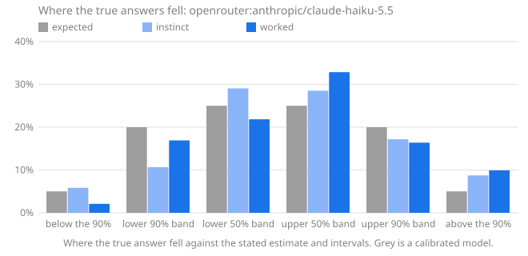

# Calibench report: openrouter:anthropic/claude-haiku-5.5

Seed `calibench-v1`, 104 questions, Calibench 2.0.0, Python 3.13.16 (Unicode 15.1.0), started 2026-10-17T03:46:01+00:00. Scored with Calibench 2.5.0 (log-wis-2).

**Standard suite v1.**

Prompts: **alt** wording (see `prompts.py`).

Served by: anthropic/claude-haiku-5.5 via Claude Platform on AWS.

Tokens: input 48,376, output 424,370, reasoning 369,208.

Cost reported by the API: 0.2170 (US dollars on OpenRouter).

## Summary

| | Instinct | Worked |
|---|---|---|
| Answered | 104 of 104 | 104 of 104 |
| **Score**, mean [90% interval] | **0.097** [0.066, 0.131] | **0.040** [0.027, 0.054] |
| Score, median | 0.023 | 0.009 |
| Interval score, 50% / 90% intervals | 0.464 / 1.347 | 0.191 / 0.495 |
| 50% intervals containing the answer [90% interval] | 65 of 104 (62%) [54%, 70%] | 66 of 104 (63%) [55%, 71%] |
| … leaving out single numbers | 61 of 100 (61%): too wide (underconfident) | 51 of 89 (57%): consistent with calibrated |
| 90% intervals containing the answer [90% interval] | 89 of 104 (86%) [79%, 90%] | 92 of 104 (88%) [82%, 93%] |
| … leaving out single numbers | 88 of 103 (85%): consistent with calibrated | 89 of 101 (88%): consistent with calibrated |
| Answers given as certain (a single number) | 1, 1 exactly right | 3, 3 exactly right |
| Median error of the estimate | 1.7% | 0.8% |
| Output tokens per answer | 453 (410 reasoning) | 3,628 (3,140 reasoning) |
| Estimate closer to the answer | 20 | 54 |

Working it out lowered the score on 76 of 104 questions answered both ways, from 0.097 to 0.040 on average (improvement [0.029, 0.089]).

The score is the weighted interval score (Bracher et al., 2021) on a log scale: it combines the estimate and both intervals, is lowest when the stated intervals are the ones the model believes, and treats a miss by a factor in either direction alike. Lower is better; 0.1 is roughly a 10% miss. Intervals in brackets are 90% intervals over questions. Coverage verdicts leave out single-number intervals, which say "I know this exactly" and are counted on their own line.

## Where the true answers fell

The estimate and the two intervals are five quantiles of the model's belief, so they split it into six bins, and a calibrated model's true answers land in each bin in the expected share. Too many in the outer bins means intervals too narrow; too many on one side of the estimate means a lean in that direction. Single-number answers are left out, and an answer on a boundary is shared between the bins it touches.

| The true answer was | Expected | Instinct | Worked |
|---|---|---|---|
| below the 90% interval | 5% | 6% (6) | 2% (2.105) |
| in the 90% interval, below the 50% | 20% | 11% (11) | 17% (17.09) |
| in the 50% interval, below the estimate | 25% | 29% (29.93) | 22% (22.07) |
| in the 50% interval, above the estimate | 25% | 29% (29.37) | 33% (33.19) |
| in the 90% interval, above the 50% | 20% | 17% (17.7) | 16% (16.55) |
| above the 90% interval | 5% | 9% (9) | 10% (10) |
| **above the estimate**, with 90% interval | 50% | 54% [46%, 62%] | 59% [51%, 67%] |

## Where the score comes from

A few large misses can carry a mean. This shows how much of each score its largest questions carry, and the worked answers whose 90% interval missed, costliest first.

| | Instinct | Worked |
|---|---|---|
| Share of the score from the largest question | 14% | 13% |
| Share from the five largest | 43% | 41% |
| Mean score without the largest question | 0.084 | 0.035 |

**Worked answers outside their 90% interval.** *Outside by* is the factor between the true answer and the nearer end of the interval; *width* is the ratio of the interval's ends, so a narrow interval that misses by a wide factor is a confident miss.

| # | Question | True answer | Estimate [90% interval] | Width | Outside by | Score | Share of score |
|---|---|---|---|---|---|---|---|
| 53 | lines in `glob` | 572 | 310 [250, 380] | ×1.52 | ×1.5 above | 0.523 | 13% |
| 75 | lines in `statistics` | 1,817 | 1,050 [900, 1,200] | ×1.33 | ×1.51 above | 0.489 | 12% |
| 68 | Unicode names with the word FACE | 179 | 128 [118, 140] | ×1.18 | ×1.28 above | 0.294 | 7% |
| 103 | function definitions in `base64` | 28 | 21 [18, 24] | ×1.32 | ×1.16 above | 0.222 | 5% |
| 102 | lines in `reprlib` | 230 | 183 [165, 205] | ×1.24 | ×1.12 above | 0.178 | 4% |
| 16 | Unicode names with the word FRACTION | 98 | 74 [56, 96] | ×1.7 | ×1.02 above | 0.165 | 4% |
| 89 | Unicode names with the word DIGIT | 898 | 775 [720, 835] | ×1.16 | ×1.08 above | 0.117 | 3% |
| 1 | Unicode names with the word MUSICAL | 518 | 464 [445, 480] | ×1.08 | ×1.08 above | 0.095 | 2% |
| 26 | digit sum of 2^1219 | 1,550 | 1,650 [1,560, 1,740] | ×1.12 | ×1.01 below | 0.038 | 1% |
| 3 | highest point of a 426-step walk | 15.8 | 16.46 [15.8, 17.1] | ×1.08 | ×1 below | 0.023 | 1% |
| | 2 more | | | | | | |

## By kind of question

Knowledge questions ask what is known (the Python standard library, the Unicode database); statistical ones need noise or irregularity modelled; exact ones have a closed-form answer that must be evaluated; calculation ones have an exact answer that takes long, careful arithmetic.

| Kind | Phase | Questions | Score | 50% hits | 90% hits |
|---|---|---|---|---|---|
| exact | instinct | 8 | 0.102 | 8 of 8 (100%) | 8 of 8 (100%) |
| exact | worked | 8 | 0.015 | 8 of 8 (100%) | 8 of 8 (100%) |
| knowledge | instinct | 48 | 0.159 | 29 of 48 (60%) | 37 of 48 (77%) |
| knowledge | worked | 48 | 0.059 | 35 of 48 (73%) | 40 of 48 (83%) |
| statistical | instinct | 48 | 0.033 | 28 of 48 (58%) | 44 of 48 (92%) |
| statistical | worked | 48 | 0.025 | 23 of 48 (48%) | 44 of 48 (92%) |

## By family

| Family | Kind | Questions | Score, worked | Score, instinct | Worked 90% hits | Worked answers above the estimate |
|---|---|---|---|---|---|---|
| `birthday` | exact | 8 | 0.015 | 0.102 | 8 of 8 (100%) | 50% |
| `collatz_steps` | statistical | 8 | 0.110 | 0.141 | 8 of 8 (100%) | 50% |
| `digit_sum_pow2` | statistical | 8 | 0.013 | 0.013 | 7 of 8 (88%) | 25% |
| `lis` | statistical | 8 | 0.009 | 0.008 | 6 of 8 (75%) | 100% |
| `module_all` | knowledge | 8 | 0.005 | 0.184 | 8 of 8 (100%) | 60% |
| `primes_in_range` | statistical | 8 | 0.005 | 0.006 | 8 of 8 (100%) | 62% |
| `rect_distance` | statistical | 8 | 0.001 | 0.021 | 8 of 8 (100%) | 88% |
| `stdlib_defs` | knowledge | 8 | 0.081 | 0.129 | 7 of 8 (88%) | 50% |
| `stdlib_lines` | knowledge | 8 | 0.165 | 0.146 | 5 of 8 (62%) | 62% |
| `unicode_block` | knowledge | 8 | 0.003 | 0.075 | 8 of 8 (100%) | 56% |
| `unicode_category` | knowledge | 8 | 0.007 | 0.024 | 8 of 8 (100%) | 56% |
| `unicode_word` | knowledge | 8 | 0.095 | 0.400 | 4 of 8 (50%) | 94% |
| `walk_max` | statistical | 8 | 0.010 | 0.011 | 7 of 8 (88%) | 12% |

## Questions

Each answer is shown as estimate [90% interval], ✓ or ✗ for whether the 50% and 90% intervals contain the true answer, and its score.

| # | Question | True answer | Instinct | Worked |
|---|---|---|---|---|
| 1 | Unicode names with the word MUSICAL | 518 | 580 [400, 760] 50✓ 90✓ · 0.063 | 464 [445, 480] 50✗ 90✗ · 0.095 |
| 2 | lines in `smtplib` | 1,123 | 1,200 [950, 1,500] 50✓ 90✓ · 0.039 | 1,200 [1,060, 1,340] 50✗ 90✓ · 0.037 |
| 3 | highest point of a 426-step walk | 15.8 | 16.45 [15.8, 17.1] 50✗ 90✗ · 0.023 | 16.46 [15.8, 17.1] 50✗ 90✗ · 0.023 |
| 4 | draws until a repeat, d = 35,930 | 238.2 | 238 [62, 465] 50✓ 90✓ · 0.118 | 238.2 [237.5, 239] 50✓ 90✓ · 0.000 |
| 5 | digit sum of 2^1269 | 1,736 | 1,719 [1,627, 1,811] 50✓ 90✓ · 0.009 | 1,720 [1,620, 1,820] 50✓ 90✓ · 0.009 |
| 6 | names in `timeit.__all__` | 4 | 3 [1, 6] 50✓ 90✓ · 0.121 | 4 [4, 4] 50✓ 90✓ · 0.000 |
| 7 | mean distance in a 1 × 2.52 rectangle | 0.9621 | 0.97 [0.85, 1.1] 50✓ 90✓ · 0.017 | 0.9616 [0.95, 0.972] 50✓ 90✓ · 0.001 |
| 8 | code points in category Po | 628 | 680 [590, 790] 50✗ 90✓ · 0.041 | 650 [580, 740] 50✓ 90✓ · 0.022 |
| 9 | assigned in the Thaana block | 50 | 50 [48, 52] 50✓ 90✓ · 0.004 | 50 [49, 51] 50✓ 90✓ · 0.001 |
| 10 | function definitions in `optparse` | 122 | 140 [92, 195] 50✓ 90✓ · 0.074 | 105 [82, 130] 50✗ 90✓ · 0.081 |
| 11 | primes in [3,164,661, 3,229,443] | 4,399 | 4,325 [4,270, 4,380] 50✗ 90✗ · 0.011 | 4,325 [4,230, 4,420] 50✗ 90✓ · 0.010 |
| 12 | Collatz steps from 87,974,385,043 | 246 | 180 [70, 400] 50✓ 90✓ · 0.166 | 180 [120, 250] 50✗ 90✓ · 0.177 |
| 13 | longest increasing subsequence, n = 112 | 17.81 | 17.6 [16.6, 18.6] 50✓ 90✓ · 0.009 | 17.3 [16.5, 18.1] 50✗ 90✓ · 0.016 |
| 14 | mean distance in a 1 × 9.91 rectangle | 3.359 | 3.36 [3.28, 3.46] 50✓ 90✓ · 0.003 | 3.356 [3.345, 3.367] 50✓ 90✓ · 0.001 |
| 15 | assigned in the Thai block | 87 | 119 [113, 121] 50✗ 90✗ · 0.287 | 87 [85, 88] 50✓ 90✓ · 0.001 |
| 16 | Unicode names with the word FRACTION | 98 | 21 [19, 25] 50✗ 90✗ · 1.434 | 74 [56, 96] 50✗ 90✗ · 0.165 |
| 17 | code points in category Pc | 10 | 11 [9, 14] 50✓ 90✓ · 0.042 | 10 [10, 11] 50✓ 90✓ · 0.002 |
| 18 | function definitions in `traceback` | 70 | 85 [55, 130] 50✓ 90✓ · 0.095 | 75 [52, 105] 50✓ 90✓ · 0.057 |
| 19 | lines in `shutil` | 1,569 | 1,750 [1,300, 2,300] 50✓ 90✓ · 0.059 | 1,600 [1,300, 1,950] 50✓ 90✓ · 0.031 |
| 20 | longest increasing subsequence, n = 1,643 | 75.54 | 75 [72.8, 77.2] 50✓ 90✓ · 0.005 | 75 [74.2, 75.8] 50✗ 90✓ · 0.004 |
| 21 | highest point of a 1,512-step walk | 31.04 | 30.5 [28.9, 32.1] 50✓ 90✓ · 0.010 | 30.5 [29, 32.1] 50✓ 90✓ · 0.010 |
| 22 | primes in [8,284,359, 8,296,430] | 753 | 758 [722, 795] 50✓ 90✓ · 0.007 | 758 [738, 778] 50✓ 90✓ · 0.004 |
| 23 | Collatz steps from 337,264,368,477 | 248 | 240 [110, 430] 50✓ 90✓ · 0.089 | 280 [195, 390] 50✓ 90✓ · 0.065 |
| 24 | names in `weakref.__all__` | 13 | 13 [12, 14] 50✓ 90✓ · 0.003 | 13 [12, 15] 50✓ 90✓ · 0.004 |
| 25 | draws until a repeat, d = 6,620,093 | 3,225 | 3,225 [3,050, 3,400] 50✓ 90✓ · 0.007 | 3,225 [3,224, 3,226] 50✓ 90✓ · 0.000 |
| 26 | digit sum of 2^1219 | 1,550 | 1,650 [1,560, 1,740] 50✗ 90✗ · 0.038 | 1,650 [1,560, 1,740] 50✗ 90✗ · 0.038 |
| 27 | function definitions in `hmac` | 11 | 16 [8, 27] 50✗ 90✓ · 0.172 | 14 [8, 22] 50✓ 90✓ · 0.104 |
| 28 | assigned in the Playing Cards block | 82 | 59 [55, 64] 50✗ 90✗ · 0.292 | 82 [78, 83] 50✓ 90✓ · 0.002 |
| 29 | longest increasing subsequence, n = 4,365 | 125.4 | 125 [124.2, 125.8] 50✗ 90✓ · 0.002 | 125 [124.2, 125.8] 50✗ 90✓ · 0.002 |
| 30 | mean distance in a 1 × 4.45 rectangle | 1.572 | 1.53 [1.46, 1.61] 50✗ 90✓ · 0.015 | 1.568 [1.545, 1.59] 50✓ 90✓ · 0.002 |
| 31 | Unicode names with the word CAPITAL | 2,032 | 1,300 [700, 2,000] 50✗ 90✗ · 0.278 | 1,850 [1,600, 2,100] 50✗ 90✓ · 0.051 |
| 32 | Collatz steps from 904,534,976,486 | 239 | 200 [90, 380] 50✓ 90✓ · 0.119 | 190 [120, 270] 50✗ 90✓ · 0.130 |
| 33 | code points in category So | 6,639 | 6,400 [5,900, 6,900] 50✓ 90✓ · 0.017 | 6,630 [6,500, 6,760] 50✓ 90✓ · 0.002 |
| 34 | digit sum of 2^2531 | 3,353 | 3,429 [3,299, 3,559] 50✗ 90✓ · 0.012 | 3,429 [3,300, 3,560] 50✗ 90✓ · 0.012 |
| 35 | lines in `functools` | 1,036 | 1,150 [700, 1,900] 50✓ 90✓ · 0.076 | 1,000 [900, 1,120] 50✓ 90✓ · 0.020 |
| 36 | draws until a repeat, d = 46,781 | 271.7 | 272 [69, 529] 50✓ 90✓ · 0.120 | 271.8 [265, 278] 50✓ 90✓ · 0.002 |
| 37 | highest point of a 869-step walk | 22.92 | 23 [22.1, 23.9] 50✓ 90✓ · 0.005 | 23 [22.1, 24] 50✓ 90✓ · 0.005 |
| 38 | names in `locale.__all__` | 23 | 100 [65, 140] 50✗ 90✗ · 1.248 | 22 [20, 24] 50✓ 90✓ · 0.021 |
| 39 | primes in [591,475, 604,946] | 1,020 | 1,013 [985, 1,040] 50✓ 90✓ · 0.004 | 1,013 [985, 1,040] 50✓ 90✓ · 0.004 |
| 40 | longest increasing subsequence, n = 2,201 | 87.91 | 87.5 [85.5, 89.5] 50✓ 90✓ · 0.003 | 87.4 [86.6, 88.2] 50✗ 90✓ · 0.003 |
| 41 | code points in category Me | 13 | 13 [11, 17] 50✓ 90✓ · 0.022 | 13 [12, 15] 50✓ 90✓ · 0.004 |
| 42 | lines in `tabnanny` | 340 | 340 [260, 450] 50✓ 90✓ · 0.033 | 335 [295, 385] 50✓ 90✓ · 0.017 |
| 43 | primes in [310,586, 338,601] | 2,242 | 2,208 [2,165, 2,250] 50✗ 90✓ · 0.008 | 2,208 [2,170, 2,245] 50✗ 90✓ · 0.009 |
| 44 | mean distance in a 1 × 4.51 rectangle | 1.59 | 1.77 [1.68, 1.86] 50✗ 90✗ · 0.085 | 1.59 [1.586, 1.594] 50✓ 90✓ · 0.000 |
| 45 | function definitions in `csv` | 17 | 22 [15, 31] 50✗ 90✓ · 0.131 | 16 [13, 20] 50✓ 90✓ · 0.031 |
| 46 | digit sum of 2^7366 | 10,060 | 9,980 [9,760, 10,200] 50✗ 90✓ · 0.005 | 9,981 [9,740, 10,220] 50✓ 90✓ · 0.004 |
| 47 | Collatz steps from 189,630,655,112 | 291 | 170 [70, 400] 50✗ 90✓ · 0.296 | 265 [150, 390] 50✓ 90✓ · 0.076 |
| 48 | draws until a repeat, d = 2,138 | 58.62 | 58.6 [17, 114] 50✓ 90✓ · 0.093 | 58.6 [57.8, 59.5] 50✓ 90✓ · 0.002 |
| 49 | names in `base64.__all__` | 22 | 21 [18, 24] 50✓ 90✓ · 0.023 | 22 [19, 23] 50✓ 90✓ · 0.013 |
| 50 | Unicode names with the word GREEK | 531 | 450 [360, 560] 50✗ 90✓ · 0.092 | 508 [480, 540] 50✗ 90✓ · 0.024 |
| 51 | assigned in the General Punctuation block | 111 | 111 [108, 112] 50✓ 90✓ · 0.002 | 111 [110, 112] 50✓ 90✓ · 0.000 |
| 52 | highest point of a 707-step walk | 20.72 | 20.7 [19.9, 21.5] 50✓ 90✓ · 0.005 | 21.22 [20.3, 22.2] 50✗ 90✓ · 0.013 |
| 53 | lines in `glob` | 572 | 450 [220, 750] 50✗ 90✓ · 0.156 | 310 [250, 380] 50✗ 90✗ · 0.523 |
| 54 | function definitions in `webbrowser` | 25 | 45 [28, 68] 50✗ 90✗ · 0.356 | 30 [20, 46] 50✗ 90✓ · 0.095 |
| 55 | assigned in the Lao block | 83 | 84 [76, 90] 50✓ 90✓ · 0.014 | 80 [68, 85] 50✓ 90✓ · 0.020 |
| 56 | longest increasing subsequence, n = 452 | 38.19 | 37.6 [37, 38.2] 50✗ 90✓ · 0.008 | 37.6 [37.1, 38.1] 50✗ 90✗ · 0.010 |
| 57 | highest point of a 1,229-step walk | 27.5 | 27.97 [27.4, 28.5] 50✗ 90✓ · 0.009 | 27.98 [27.2, 28.8] 50✗ 90✓ · 0.010 |
| 58 | digit sum of 2^8596 | 11,455 | 11,650 [11,400, 11,900] 50✗ 90✓ · 0.009 | 11,646 [11,400, 11,890] 50✗ 90✓ · 0.009 |
| 59 | draws until a repeat, d = 6,016 | 97.88 | 98 [25, 190] 50✓ 90✓ · 0.119 | 97.9 [25, 189] 50✓ 90✓ · 0.117 |
| 60 | names in `gzip.__all__` | 5 | 5 [4, 6] 50✓ 90✓ · 0.007 | 5 [5, 5] 50✓ 90✓ · 0.000 |
| 61 | code points in category Pf | 10 | 10 [8, 13] 50✓ 90✓ · 0.027 | 10 [10, 11] 50✓ 90✓ · 0.002 |
| 62 | primes in [335,112, 371,030] | 2,787 | 2,813 [2,760, 2,860] 50✗ 90✓ · 0.005 | 2,810 [2,760, 2,860] 50✗ 90✓ · 0.005 |
| 63 | Unicode names with the word HEBREW | 134 | 110 [88, 140] 50✗ 90✓ · 0.098 | 133 [126, 140] 50✓ 90✓ · 0.007 |
| 64 | mean distance in a 1 × 2.07 rectangle | 0.826 | 0.79 [0.74, 0.84] 50✗ 90✓ · 0.024 | 0.826 [0.812, 0.84] 50✓ 90✓ · 0.002 |
| 65 | Collatz steps from 23,010,656,711 | 195 | 170 [85, 290] 50✓ 90✓ · 0.096 | 245 [145, 370] 50✗ 90✓ · 0.119 |
| 66 | code points in category Sk | 125 | 125 [100, 145] 50✓ 90✓ · 0.020 | 125 [118, 135] 50✓ 90✓ · 0.007 |
| 67 | draws until a repeat, d = 131,706 | 455.5 | 456 [120, 890] 50✓ 90✓ · 0.117 | 455.5 [454, 457] 50✓ 90✓ · 0.000 |
| 68 | Unicode names with the word FACE | 179 | 90 [60, 130] 50✗ 90✗ · 0.524 | 128 [118, 140] 50✗ 90✗ · 0.294 |
| 69 | longest increasing subsequence, n = 827 | 52.6 | 53 [49.5, 57] 50✓ 90✓ · 0.010 | 52.1 [50.9, 53.3] 50✓ 90✓ · 0.005 |
| 70 | digit sum of 2^3289 | 4,430 | 4,460 [4,300, 4,620] 50✓ 90✓ · 0.005 | 4,455 [4,290, 4,620] 50✓ 90✓ · 0.004 |
| 71 | assigned in the Georgian block | 88 | 88 [85, 90] 50✓ 90✓ · 0.002 | 88 [85, 90] 50✓ 90✓ · 0.001 |
| 72 | mean distance in a 1 × 3.1 rectangle | 1.142 | 1.12 [1.07, 1.18] 50✗ 90✓ · 0.010 | 1.143 [1.12, 1.165] 50✓ 90✓ · 0.002 |
| 73 | highest point of a 1,415-step walk | 29.89 | 29.5 [28.6, 30.4] 50✗ 90✓ · 0.007 | 30.02 [29.4, 30.65] 50✓ 90✓ · 0.003 |
| 74 | primes in [188,978, 218,173] | 2,379 | 2,389 [2,345, 2,435] 50✓ 90✓ · 0.003 | 2,387 [2,360, 2,415] 50✗ 90✓ · 0.002 |
| 75 | lines in `statistics` | 1,817 | 960 [820, 1,150] 50✗ 90✗ · 0.559 | 1,050 [900, 1,200] 50✗ 90✗ · 0.489 |
| 76 | function definitions in `operator` | 67 | 55 [40, 75] 50✗ 90✓ · 0.107 | 67 [56, 80] 50✓ 90✓ · 0.022 |
| 77 | names in `difflib.__all__` | 12 | 13 [10, 17] 50✓ 90✓ · 0.039 | 12 [11, 13] 50✓ 90✓ · 0.003 |
| 78 | Collatz steps from 360,172,167,088 | 160 | 200 [70, 450] 50✓ 90✓ · 0.147 | 188 [125, 265] 50✗ 90✓ · 0.086 |
| 79 | Collatz steps from 905,376,815,232 | 177 | 190 [100, 300] 50✓ 90✓ · 0.078 | 238 [165, 315] 50✗ 90✓ · 0.162 |
| 80 | names in `tabnanny.__all__` | 3 | 3 [2, 4] 50✓ 90✓ · 0.010 | 3 [3, 3] 50✓ 90✓ · 0.000 |
| 81 | digit sum of 2^706 | 925 | 958 [889, 1,027] 50✗ 90✓ · 0.018 | 958 [889, 1,027] 50✗ 90✓ · 0.018 |
| 82 | draws until a repeat, d = 944,525 | 1,219 | 1,219 [310, 2,380] 50✓ 90✓ · 0.119 | 1,219 [1,218, 1,220] 50✓ 90✓ · 0.000 |
| 83 | function definitions in `weakref` | 65 | 65 [42, 92] 50✓ 90✓ · 0.046 | 65 [48, 88] 50✓ 90✓ · 0.033 |
| 84 | primes in [865,988, 892,619] | 1,952 | 1,944 [1,885, 2,005] 50✓ 90✓ · 0.004 | 1,946 [1,880, 2,010] 50✓ 90✓ · 0.004 |
| 85 | code points in category Nd | 680 | 680 [650, 710] 50✓ 90✓ · 0.005 | 680 [665, 690] 50✓ 90✓ · 0.002 |
| 86 | longest increasing subsequence, n = 121 | 18.59 | 18.1 [17.6, 18.6] 50✗ 90✓ · 0.015 | 18.05 [17.6, 18.5] 50✗ 90✗ · 0.019 |
| 87 | highest point of a 853-step walk | 22.61 | 23.3 [21, 25.6] 50✓ 90✓ · 0.018 | 22.8 [21.9, 23.7] 50✓ 90✓ · 0.007 |
| 88 | mean distance in a 1 × 7.13 rectangle | 2.442 | 2.42 [2.31, 2.55] 50✓ 90✓ · 0.008 | 2.441 [2.42, 2.46] 50✓ 90✓ · 0.001 |
| 89 | Unicode names with the word DIGIT | 898 | 450 [330, 600] 50✗ 90✗ · 0.567 | 775 [720, 835] 50✗ 90✗ · 0.117 |
| 90 | assigned in the Gothic block | 27 | 27 [27, 27] 50✓ 90✓ · 0.000 | 27 [26, 28] 50✓ 90✓ · 0.001 |
| 91 | lines in `string` | 314 | 290 [240, 340] 50✗ 90✓ · 0.042 | 330 [290, 390] 50✓ 90✓ · 0.029 |
| 92 | draws until a repeat, d = 4,022 | 80.15 | 80 [20, 155] 50✓ 90✓ · 0.121 | 80.15 [79.3, 81] 50✓ 90✓ · 0.001 |
| 93 | primes in [1,135,630, 1,167,274] | 2,277 | 2,270 [2,210, 2,330] 50✓ 90✓ · 0.003 | 2,267 [2,190, 2,345] 50✓ 90✓ · 0.005 |
| 94 | assigned in the Greek and Coptic block | 135 | 135 [131, 137] 50✓ 90✓ · 0.002 | 135 [134, 136] 50✓ 90✓ · 0.000 |
| 95 | names in `mailbox.__all__` | 17 | 17 [14, 21] 50✓ 90✓ · 0.019 | 17 [16, 18] 50✓ 90✓ · 0.002 |
| 96 | mean distance in a 1 × 1.09 rectangle | 0.5454 | 0.548 [0.535, 0.562] 50✓ 90✓ · 0.003 | 0.5452 [0.543, 0.547] 50✓ 90✓ · 0.000 |
| 97 | code points in category Cf | 170 | 170 [150, 195] 50✓ 90✓ · 0.017 | 167 [150, 182] 50✓ 90✓ · 0.015 |
| 98 | Collatz steps from 70,587,310,865 | 194 | 175 [60, 420] 50✓ 90✓ · 0.136 | 172 [120, 225] 50✓ 90✓ · 0.063 |
| 99 | digit sum of 2^5606 | 7,438 | 7,596 [7,402, 7,790] 50✗ 90✓ · 0.012 | 7,596 [7,402, 7,790] 50✗ 90✓ · 0.012 |
| 100 | Unicode names with the word CYRILLIC | 507 | 420 [385, 465] 50✗ 90✗ · 0.142 | 507 [480, 535] 50✓ 90✓ · 0.005 |
| 101 | longest increasing subsequence, n = 104 | 17.15 | 16.9 [15.8, 18] 50✓ 90✓ · 0.010 | 16.7 [16, 17.4] 50✗ 90✓ · 0.014 |
| 102 | lines in `reprlib` | 230 | 170 [135, 215] 50✗ 90✗ · 0.201 | 183 [165, 205] 50✗ 90✗ · 0.178 |
| 103 | function definitions in `base64` | 28 | 27 [19, 36] 50✓ 90✓ · 0.048 | 21 [18, 24] 50✗ 90✗ · 0.222 |
| 104 | highest point of a 996-step walk | 24.79 | 25.2 [24.2, 26.2] 50✓ 90✓ · 0.009 | 25.18 [24.4, 26] 50✗ 90✓ · 0.009 |
