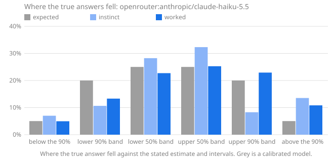

# Calibench report: openrouter:anthropic/claude-haiku-5.5

Seed `calibench-v1`, 104 questions, Calibench 2.2.1, Python 3.13.16 (Unicode 15.1.0), started 2026-10-17T04:58:42+00:00. Scored with Calibench 2.7.0 (log-wis-3).

**Standard suite v1.**

Served by: anthropic/claude-haiku-5.5 via Claude Platform on AWS.

Tokens: input 51,704, output 455,306, reasoning 382,860.

Cost reported by the API: 0.2328 (US dollars on OpenRouter).

## Summary

| | Instinct | Worked |
|---|---|---|
| Answered | 104 of 104 | 104 of 104 |
| **Score**, mean [90% interval] | **0.188** [0.134, 0.248] | **0.051** [0.034, 0.069] |
| Score, median | 0.049 | 0.006 |
| Interval score, 50% / 90% intervals | 0.920 / 2.545 | 0.242 / 0.655 |
| 50% intervals containing the answer [90% interval] | 66 of 104 (63%) [55%, 71%] | 58 of 104 (56%) [48%, 64%] |
| … leaving out single numbers | 66 of 104 (63%): too wide (underconfident) | 45 of 90 (50%): consistent with calibrated |
| 90% intervals containing the answer [90% interval] | 83 of 104 (80%) [73%, 85%] | 88 of 104 (85%) [78%, 90%] |
| … leaving out single numbers | 83 of 104 (80%): too narrow (overconfident) | 88 of 104 (85%): consistent with calibrated |
| Answers given as certain (a single number) | 0, 0 exactly right | 0, 0 exactly right |
| Median error of the estimate | 2.5% | 0.8% |
| Output tokens per answer | 268 (218 reasoning) | 4,109 (3,463 reasoning) |
| Estimate closer to the answer | 18 | 62 |

Working it out lowered the score on 89 of 104 questions answered both ways, from 0.188 to 0.051 on average (improvement [0.087, 0.194]).

The score is the weighted interval score (Bracher et al., 2021) on a log scale: it combines the estimate and both intervals, is lowest when the stated intervals are the ones the model believes, and treats a miss by a factor in either direction alike. Lower is better; 0.1 is roughly a 10% miss. Intervals in brackets are 90% intervals over questions. Coverage verdicts leave out single-number intervals, which say "I know this exactly" and are counted on their own line.

## Where the true answers fell

The estimate and the two intervals are five quantiles of the model's belief, so they split it into six bins, and a calibrated model's true answers land in each bin in the expected share. Too many in the outer bins means intervals too narrow; too many on one side of the estimate means a lean in that direction. Single-number answers are left out, and an answer on a boundary is shared between the bins it touches.

| The true answer was | Expected | Instinct | Worked |
|---|---|---|---|
| below the 90% interval | 5% | 7% (7.267) | 5% (5.158) |
| in the 90% interval, below the 50% | 20% | 11% (11.07) | 13% (13.84) |
| in the 50% interval, below the estimate | 25% | 28% (29.38) | 23% (23.62) |
| in the 50% interval, above the estimate | 25% | 32% (33.6) | 25% (26.29) |
| in the 90% interval, above the 50% | 20% | 8% (8.616) | 23% (23.83) |
| above the 90% interval | 5% | 14% (14.07) | 11% (11.25) |
| **above the estimate**, with 90% interval | 50% | 54% [46%, 62%] | 59% [51%, 66%] |

## Where the score comes from

A few large misses can carry a mean. This shows how much of each score its largest questions carry, and the worked answers whose 90% interval missed, costliest first.

| | Instinct | Worked |
|---|---|---|
| Share of the score from the largest question | 11% | 12% |
| Share from the five largest | 38% | 42% |
| Mean score without the largest question | 0.168 | 0.045 |

**Worked answers outside their 90% interval.** *Outside by* is the factor between the true answer and the nearer end of the interval; *width* is the ratio of the interval's ends, so a narrow interval that misses by a wide factor is a confident miss.

| # | Question | True answer | Estimate [90% interval] | Width | Outside by | Score | Share of score |
|---|---|---|---|---|---|---|---|
| 53 | lines in `glob` | 572 | 280 [240, 325] | ×1.35 | ×1.76 above | 0.649 | 12% |
| 75 | lines in `statistics` | 1,817 | 1,000 [820, 1,200] | ×1.46 | ×1.51 above | 0.518 | 10% |
| 78 | Collatz steps from 360,172,167,088 | 160 | 278 [180, 395] | ×2.19 | ×1.12 below | 0.358 | 7% |
| 47 | Collatz steps from 189,630,655,112 | 291 | 170 [100, 265] | ×2.63 | ×1.1 above | 0.344 | 7% |
| 83 | function definitions in `weakref` | 65 | 105 [78, 135] | ×1.72 | ×1.2 below | 0.339 | 6% |
| 16 | Unicode names with the word FRACTION | 98 | 60 [42, 85] | ×2 | ×1.15 above | 0.338 | 6% |
| 102 | lines in `reprlib` | 230 | 168 [155, 185] | ×1.19 | ×1.24 above | 0.271 | 5% |
| 68 | Unicode names with the word FACE | 179 | 133 [119, 150] | ×1.26 | ×1.19 above | 0.243 | 5% |
| 55 | assigned in the Lao block | 83 | 68 [63, 72] | ×1.14 | ×1.15 above | 0.171 | 3% |
| 1 | Unicode names with the word MUSICAL | 518 | 444 [420, 456] | ×1.09 | ×1.14 above | 0.143 | 3% |
| | 6 more | | | | | | |

## By kind of question

Knowledge questions ask what is known (the Python standard library, the Unicode database); statistical ones need noise or irregularity modelled; exact ones have a closed-form answer that must be evaluated; calculation ones have an exact answer that takes long, careful arithmetic.

| Kind | Phase | Questions | Score | 50% hits | 90% hits |
|---|---|---|---|---|---|
| exact | instinct | 8 | 0.121 | 8 of 8 (100%) | 8 of 8 (100%) |
| exact | worked | 8 | 0.032 | 8 of 8 (100%) | 8 of 8 (100%) |
| knowledge | instinct | 48 | 0.301 | 25 of 48 (52%) | 33 of 48 (69%) |
| knowledge | worked | 48 | 0.074 | 31 of 48 (65%) | 39 of 48 (81%) |
| statistical | instinct | 48 | 0.085 | 33 of 48 (69%) | 42 of 48 (88%) |
| statistical | worked | 48 | 0.030 | 19 of 48 (40%) | 41 of 48 (85%) |

## By family

| Family | Kind | Questions | Score, worked | Score, instinct | Worked 90% hits | Worked answers above the estimate |
|---|---|---|---|---|---|---|
| `birthday` | exact | 8 | 0.032 | 0.121 | 8 of 8 (100%) | 62% |
| `collatz_steps` | statistical | 8 | 0.145 | 0.317 | 6 of 8 (75%) | 62% |
| `digit_sum_pow2` | statistical | 8 | 0.014 | 0.038 | 7 of 8 (88%) | 25% |
| `lis` | statistical | 8 | 0.008 | 0.011 | 7 of 8 (88%) | 100% |
| `module_all` | knowledge | 8 | 0.013 | 0.137 | 8 of 8 (100%) | 62% |
| `primes_in_range` | statistical | 8 | 0.005 | 0.006 | 7 of 8 (88%) | 62% |
| `rect_distance` | statistical | 8 | 0.001 | 0.013 | 8 of 8 (100%) | 62% |
| `stdlib_defs` | knowledge | 8 | 0.094 | 0.361 | 7 of 8 (88%) | 38% |
| `stdlib_lines` | knowledge | 8 | 0.192 | 0.246 | 5 of 8 (62%) | 81% |
| `unicode_block` | knowledge | 8 | 0.023 | 0.016 | 7 of 8 (88%) | 62% |
| `unicode_category` | knowledge | 8 | 0.006 | 0.303 | 8 of 8 (100%) | 44% |
| `unicode_word` | knowledge | 8 | 0.116 | 0.744 | 4 of 8 (50%) | 75% |
| `walk_max` | statistical | 8 | 0.009 | 0.128 | 6 of 8 (75%) | 25% |

## Questions

Each answer is shown as estimate [90% interval], ✓ or ✗ for whether the 50% and 90% intervals contain the true answer, and its score.

| # | Question | True answer | Instinct | Worked |
|---|---|---|---|---|
| 1 | Unicode names with the word MUSICAL | 518 | 40 [20, 80] 50✗ 90✗ · 2.227 | 444 [420, 456] 50✗ 90✗ · 0.143 |
| 2 | lines in `smtplib` | 1,123 | 1,600 [1,100, 2,300] 50✗ 90✓ · 0.191 | 1,150 [1,020, 1,280] 50✓ 90✓ · 0.016 |
| 3 | highest point of a 426-step walk | 15.8 | 16.5 [1.3, 40.5] 50✓ 90✓ · 0.205 | 15.98 [15.65, 16.31] 50✗ 90✓ · 0.006 |
| 4 | draws until a repeat, d = 35,930 | 238.2 | 238 [61, 464] 50✓ 90✓ · 0.119 | 224 [61, 465] 50✓ 90✓ · 0.132 |
| 5 | digit sum of 2^1269 | 1,736 | 1,370 [1,260, 1,480] 50✗ 90✗ · 0.203 | 1,718 [1,620, 1,815] 50✓ 90✓ · 0.009 |
| 6 | names in `timeit.__all__` | 4 | 3 [1, 6] 50✓ 90✓ · 0.121 | 4 [4, 5] 50✓ 90✓ · 0.004 |
| 7 | mean distance in a 1 × 2.52 rectangle | 0.9621 | 1 [0.9, 1.1] 50✓ 90✓ · 0.022 | 0.9624 [0.957, 0.968] 50✓ 90✓ · 0.001 |
| 8 | code points in category Po | 628 | 630 [560, 720] 50✓ 90✓ · 0.017 | 630 [600, 660] 50✓ 90✓ · 0.006 |
| 9 | assigned in the Thaana block | 50 | 50 [50, 51] 50✓ 90✓ · 0.002 | 50 [49, 52] 50✓ 90✓ · 0.001 |
| 10 | function definitions in `optparse` | 122 | 280 [195, 390] 50✗ 90✗ · 0.663 | 105 [82, 130] 50✗ 90✓ · 0.079 |
| 11 | primes in [3,164,661, 3,229,443] | 4,399 | 4,320 [4,180, 4,460] 50✗ 90✓ · 0.011 | 4,325 [4,260, 4,392] 50✗ 90✗ · 0.010 |
| 12 | Collatz steps from 87,974,385,043 | 246 | 120 [60, 200] 50✗ 90✗ · 0.501 | 170 [85, 290] 50✗ 90✓ · 0.202 |
| 13 | longest increasing subsequence, n = 112 | 17.81 | 17.3 [16, 18.6] 50✓ 90✓ · 0.016 | 17.4 [16.85, 17.95] 50✗ 90✓ · 0.013 |
| 14 | mean distance in a 1 × 9.91 rectangle | 3.359 | 3.36 [3.25, 3.47] 50✓ 90✓ · 0.004 | 3.356 [3.348, 3.363] 50✗ 90✓ · 0.000 |
| 15 | assigned in the Thai block | 87 | 87 [80, 88] 50✓ 90✓ · 0.005 | 87 [86, 88] 50✓ 90✓ · 0.000 |
| 16 | Unicode names with the word FRACTION | 98 | 80 [55, 120] 50✗ 90✓ · 0.101 | 60 [42, 85] 50✗ 90✗ · 0.338 |
| 17 | code points in category Pc | 10 | 10 [7, 18] 50✓ 90✓ · 0.044 | 10 [9, 11] 50✓ 90✓ · 0.004 |
| 18 | function definitions in `traceback` | 70 | 95 [55, 150] 50✗ 90✓ · 0.150 | 70 [52, 95] 50✓ 90✓ · 0.037 |
| 19 | lines in `shutil` | 1,569 | 1,600 [1,200, 2,100] 50✓ 90✓ · 0.040 | 1,480 [1,330, 1,700] 50✗ 90✓ · 0.028 |
| 20 | longest increasing subsequence, n = 1,643 | 75.54 | 75 [71.5, 78] 50✓ 90✓ · 0.007 | 75 [73.9, 76.1] 50✗ 90✓ · 0.004 |
| 21 | highest point of a 1,512-step walk | 31.04 | 31 [4.9, 64] 50✓ 90✓ · 0.180 | 31.02 [30.4, 31.65] 50✓ 90✓ · 0.003 |
| 22 | primes in [8,284,359, 8,296,430] | 753 | 758 [728, 788] 50✓ 90✓ · 0.006 | 758 [738, 778] 50✓ 90✓ · 0.004 |
| 23 | Collatz steps from 337,264,368,477 | 248 | 380 [200, 600] 50✗ 90✓ · 0.223 | 248 [240, 256] 50✓ 90✓ · 0.003 |
| 24 | names in `weakref.__all__` | 13 | 11 [7, 18] 50✓ 90✓ · 0.082 | 13 [12, 14] 50✓ 90✓ · 0.003 |
| 25 | draws until a repeat, d = 6,620,093 | 3,225 | 3,225 [820, 6,300] 50✓ 90✓ · 0.120 | 3,225 [3,222, 3,228] 50✓ 90✓ · 0.000 |
| 26 | digit sum of 2^1219 | 1,550 | 1,651 [1,560, 1,742] 50✗ 90✗ · 0.038 | 1,651 [1,561, 1,741] 50✗ 90✗ · 0.038 |
| 27 | function definitions in `hmac` | 11 | 30 [14, 60] 50✗ 90✗ · 0.625 | 15 [10, 22] 50✗ 90✓ · 0.159 |
| 28 | assigned in the Playing Cards block | 82 | 82 [70, 88] 50✓ 90✓ · 0.008 | 81 [77, 83] 50✓ 90✓ · 0.006 |
| 29 | longest increasing subsequence, n = 4,365 | 125.4 | 125 [121.5, 128] 50✓ 90✓ · 0.004 | 125 [124.2, 125.8] 50✗ 90✓ · 0.002 |
| 30 | mean distance in a 1 × 4.45 rectangle | 1.572 | 1.58 [1.5, 1.68] 50✓ 90✓ · 0.008 | 1.571 [1.567, 1.575] 50✗ 90✓ · 0.001 |
| 31 | Unicode names with the word CAPITAL | 2,032 | 1,400 [800, 2,300] 50✗ 90✓ · 0.210 | 1,890 [1,760, 2,040] 50✗ 90✓ · 0.041 |
| 32 | Collatz steps from 904,534,976,486 | 239 | 108 [45, 200] 50✗ 90✗ · 0.529 | 283 [170, 400] 50✗ 90✓ · 0.084 |
| 33 | code points in category So | 6,639 | 6,700 [5,200, 8,500] 50✓ 90✓ · 0.033 | 6,500 [6,100, 6,900] 50✓ 90✓ · 0.011 |
| 34 | digit sum of 2^2531 | 3,353 | 3,429 [3,300, 3,560] 50✗ 90✓ · 0.012 | 3,429 [3,300, 3,560] 50✗ 90✓ · 0.013 |
| 35 | lines in `functools` | 1,036 | 1,000 [700, 1,400] 50✓ 90✓ · 0.049 | 1,030 [910, 1,180] 50✓ 90✓ · 0.017 |
| 36 | draws until a repeat, d = 46,781 | 271.7 | 255 [69, 529] 50✓ 90✓ · 0.132 | 271.8 [269.5, 274] 50✓ 90✓ · 0.001 |
| 37 | highest point of a 869-step walk | 22.92 | 23.5 [3.7, 48.5] 50✓ 90✓ · 0.187 | 23.53 [23.07, 23.99] 50✗ 90✗ · 0.017 |
| 38 | names in `locale.__all__` | 23 | 60 [25, 110] 50✗ 90✗ · 0.558 | 22 [19, 26] 50✓ 90✓ · 0.023 |
| 39 | primes in [591,475, 604,946] | 1,020 | 1,013 [980, 1,047] 50✓ 90✓ · 0.005 | 1,013 [982, 1,044] 50✓ 90✓ · 0.004 |
| 40 | longest increasing subsequence, n = 2,201 | 87.91 | 88.9 [84.8, 93] 50✓ 90✓ · 0.008 | 87.4 [86.6, 88.2] 50✗ 90✓ · 0.003 |
| 41 | code points in category Me | 13 | 143 [115, 190] 50✗ 90✗ · 2.237 | 13 [12, 14] 50✓ 90✓ · 0.003 |
| 42 | lines in `tabnanny` | 340 | 440 [340, 560] 50✗ 90✓ · 0.144 | 340 [310, 380] 50✓ 90✓ · 0.013 |
| 43 | primes in [310,586, 338,601] | 2,242 | 2,208 [2,158, 2,258] 50✗ 90✓ · 0.009 | 2,206 [2,150, 2,262] 50✗ 90✓ · 0.009 |
| 44 | mean distance in a 1 × 4.51 rectangle | 1.59 | 1.55 [1.42, 1.72] 50✓ 90✓ · 0.015 | 1.591 [1.58, 1.6] 50✓ 90✓ · 0.001 |
| 45 | function definitions in `csv` | 17 | 40 [18, 85] 50✗ 90✗ · 0.473 | 17 [14, 21] 50✓ 90✓ · 0.019 |
| 46 | digit sum of 2^7366 | 10,060 | 9,981 [9,760, 10,200] 50✓ 90✓ · 0.004 | 9,981 [9,750, 10,210] 50✓ 90✓ · 0.004 |
| 47 | Collatz steps from 189,630,655,112 | 291 | 120 [60, 200] 50✗ 90✗ · 0.669 | 170 [100, 265] 50✗ 90✗ · 0.344 |
| 48 | draws until a repeat, d = 2,138 | 58.62 | 58.6 [15, 113] 50✓ 90✓ · 0.119 | 58.62 [15, 113] 50✓ 90✓ · 0.119 |
| 49 | names in `base64.__all__` | 22 | 20 [17, 24] 50✓ 90✓ · 0.039 | 20 [18, 22] 50✗ 90✓ · 0.058 |
| 50 | Unicode names with the word GREEK | 531 | 130 [70, 220] 50✗ 90✗ · 1.179 | 512 [482, 545] 50✗ 90✓ · 0.021 |
| 51 | assigned in the General Punctuation block | 111 | 105 [102, 107] 50✗ 90✗ · 0.049 | 111 [110, 111] 50✓ 90✓ · 0.000 |
| 52 | highest point of a 707-step walk | 20.72 | 21.2 [1.7, 52.1] 50✓ 90✓ · 0.201 | 21.22 [20.8, 21.65] 50✗ 90✗ · 0.015 |
| 53 | lines in `glob` | 572 | 220 [160, 300] 50✗ 90✗ · 0.818 | 280 [240, 325] 50✗ 90✗ · 0.649 |
| 54 | function definitions in `webbrowser` | 25 | 60 [30, 120] 50✗ 90✗ · 0.553 | 27 [18, 38] 50✓ 90✓ · 0.058 |
| 55 | assigned in the Lao block | 83 | 89 [80, 96] 50✗ 90✓ · 0.036 | 68 [63, 72] 50✗ 90✗ · 0.171 |
| 56 | longest increasing subsequence, n = 452 | 38.19 | 37.7 [35.5, 39.8] 50✓ 90✓ · 0.009 | 37.8 [37, 38.6] 50✗ 90✓ · 0.005 |
| 57 | highest point of a 1,229-step walk | 27.5 | 28 [2, 58] 50✓ 90✓ · 0.191 | 27.98 [27.4, 28.55] 50✗ 90✓ · 0.009 |
| 58 | digit sum of 2^8596 | 11,455 | 11,646 [11,404, 11,888] 50✗ 90✓ · 0.009 | 11,646 [11,406, 11,886] 50✗ 90✓ · 0.009 |
| 59 | draws until a repeat, d = 6,016 | 97.88 | 98 [25, 190] 50✓ 90✓ · 0.119 | 97.88 [96.5, 99.5] 50✓ 90✓ · 0.001 |
| 60 | names in `gzip.__all__` | 5 | 4 [2, 10] 50✓ 90✓ · 0.118 | 5 [5, 6] 50✓ 90✓ · 0.003 |
| 61 | code points in category Pf | 10 | 10 [8, 13] 50✓ 90✓ · 0.027 | 10 [9, 11] 50✓ 90✓ · 0.004 |
| 62 | primes in [335,112, 371,030] | 2,787 | 2,812 [2,770, 2,855] 50✗ 90✓ · 0.005 | 2,810 [2,770, 2,852] 50✗ 90✓ · 0.005 |
| 63 | Unicode names with the word HEBREW | 134 | 88 [60, 130] 50✗ 90✗ · 0.255 | 135 [128, 142] 50✓ 90✓ · 0.006 |
| 64 | mean distance in a 1 × 2.07 rectangle | 0.826 | 0.84 [0.69, 0.99] 50✓ 90✓ · 0.025 | 0.8242 [0.82, 0.8285] 50✗ 90✓ · 0.001 |
| 65 | Collatz steps from 23,010,656,711 | 195 | 170 [95, 280] 50✓ 90✓ · 0.099 | 165 [85, 265] 50✓ 90✓ · 0.092 |
| 66 | code points in category Sk | 125 | 130 [105, 160] 50✓ 90✓ · 0.029 | 128 [121, 136] 50✗ 90✓ · 0.013 |
| 67 | draws until a repeat, d = 131,706 | 455.5 | 455.5 [116, 889] 50✓ 90✓ · 0.120 | 455.5 [454.5, 456.5] 50✓ 90✓ · 0.000 |
| 68 | Unicode names with the word FACE | 179 | 80 [40, 170] 50✗ 90✗ · 0.462 | 133 [119, 150] 50✗ 90✗ · 0.243 |
| 69 | longest increasing subsequence, n = 827 | 52.6 | 52.1 [48.3, 55.9] 50✓ 90✓ · 0.010 | 52.2 [51.4, 52.9] 50✗ 90✓ · 0.004 |
| 70 | digit sum of 2^3289 | 4,430 | 4,455 [4,305, 4,605] 50✓ 90✓ · 0.005 | 4,454 [4,305, 4,603] 50✓ 90✓ · 0.005 |
| 71 | assigned in the Georgian block | 88 | 88 [84, 89] 50✓ 90✓ · 0.002 | 88 [85, 90] 50✓ 90✓ · 0.002 |
| 72 | mean distance in a 1 × 3.1 rectangle | 1.142 | 1.12 [1, 1.25] 50✓ 90✓ · 0.019 | 1.142 [1.13, 1.156] 50✓ 90✓ · 0.001 |
| 73 | highest point of a 1,415-step walk | 29.89 | 30 [24, 36.5] 50✓ 90✓ · 0.026 | 29.52 [28.9, 30.15] 50✗ 90✓ · 0.007 |
| 74 | primes in [188,978, 218,173] | 2,379 | 2,392 [2,335, 2,450] 50✓ 90✓ · 0.004 | 2,388 [2,340, 2,437] 50✓ 90✓ · 0.003 |
| 75 | lines in `statistics` | 1,817 | 938 [700, 1,250] 50✗ 90✗ · 0.534 | 1,000 [820, 1,200] 50✗ 90✗ · 0.518 |
| 76 | function definitions in `operator` | 67 | 60 [20, 130] 50✓ 90✓ · 0.132 | 68 [60, 77] 50✓ 90✓ · 0.017 |
| 77 | names in `difflib.__all__` | 12 | 14 [8, 22] 50✓ 90✓ · 0.088 | 12 [11, 13] 50✓ 90✓ · 0.003 |
| 78 | Collatz steps from 360,172,167,088 | 160 | 130 [70, 220] 50✓ 90✓ · 0.111 | 278 [180, 395] 50✗ 90✗ · 0.358 |
| 79 | Collatz steps from 905,376,815,232 | 177 | 108 [60, 170] 50✗ 90✗ · 0.296 | 160 [95, 235] 50✓ 90✓ · 0.074 |
| 80 | names in `tabnanny.__all__` | 3 | 3 [1, 6] 50✓ 90✓ · 0.076 | 3 [3, 4] 50✓ 90✓ · 0.004 |
| 81 | digit sum of 2^706 | 925 | 958 [889, 1,027] 50✗ 90✓ · 0.018 | 961 [891, 1,030] 50✗ 90✓ · 0.020 |
| 82 | draws until a repeat, d = 944,525 | 1,219 | 1,219 [311, 2,380] 50✓ 90✓ · 0.119 | 1,219 [1,212, 1,226] 50✓ 90✓ · 0.000 |
| 83 | function definitions in `weakref` | 65 | 95 [55, 150] 50✗ 90✓ · 0.193 | 105 [78, 135] 50✗ 90✗ · 0.339 |
| 84 | primes in [865,988, 892,619] | 1,952 | 1,946 [1,906, 1,987] 50✓ 90✓ · 0.003 | 1,946 [1,895, 1,997] 50✓ 90✓ · 0.004 |
| 85 | code points in category Nd | 680 | 680 [630, 730] 50✓ 90✓ · 0.007 | 680 [650, 700] 50✓ 90✓ · 0.003 |
| 86 | longest increasing subsequence, n = 121 | 18.59 | 18.1 [16.9, 19.3] 50✓ 90✓ · 0.014 | 18.2 [17.5, 18.9] 50✗ 90✓ · 0.012 |
| 87 | highest point of a 853-step walk | 22.61 | 23.3 [20.5, 26.5] 50✓ 90✓ · 0.018 | 22.8 [22.4, 23.2] 50✓ 90✓ · 0.004 |
| 88 | mean distance in a 1 × 7.13 rectangle | 2.442 | 2.41 [2.31, 2.55] 50✓ 90✓ · 0.008 | 2.442 [2.436, 2.448] 50✓ 90✓ · 0.000 |
| 89 | Unicode names with the word DIGIT | 898 | 320 [240, 430] 50✗ 90✗ · 0.898 | 760 [715, 820] 50✗ 90✗ · 0.134 |
| 90 | assigned in the Gothic block | 27 | 27 [25, 27] 50✓ 90✓ · 0.005 | 27 [26, 28] 50✓ 90✓ · 0.001 |
| 91 | lines in `string` | 314 | 300 [200, 450] 50✓ 90✓ · 0.052 | 298 [262, 345] 50✓ 90✓ · 0.026 |
| 92 | draws until a repeat, d = 4,022 | 80.15 | 80 [20, 155] 50✓ 90✓ · 0.121 | 80.15 [80, 80.3] 50✓ 90✓ · 0.000 |
| 93 | primes in [1,135,630, 1,167,274] | 2,277 | 2,266 [2,180, 2,350] 50✓ 90✓ · 0.005 | 2,266 [2,224, 2,309] 50✓ 90✓ · 0.003 |
| 94 | assigned in the Greek and Coptic block | 135 | 135 [112, 143] 50✓ 90✓ · 0.017 | 135 [131, 136] 50✓ 90✓ · 0.001 |
| 95 | names in `mailbox.__all__` | 17 | 17 [14, 19] 50✓ 90✓ · 0.011 | 17 [16, 18] 50✓ 90✓ · 0.002 |
| 96 | mean distance in a 1 × 1.09 rectangle | 0.5454 | 0.546 [0.53, 0.562] 50✓ 90✓ · 0.004 | 0.5452 [0.5435, 0.547] 50✓ 90✓ · 0.000 |
| 97 | code points in category Cf | 170 | 170 [130, 220] 50✓ 90✓ · 0.034 | 170 [161, 173] 50✓ 90✓ · 0.004 |
| 98 | Collatz steps from 70,587,310,865 | 194 | 170 [70, 300] 50✓ 90✓ · 0.109 | 194 [190, 198] 50✓ 90✓ · 0.002 |
| 99 | digit sum of 2^5606 | 7,438 | 7,596 [7,400, 7,792] 50✗ 90✓ · 0.011 | 7,595 [7,400, 7,790] 50✗ 90✓ · 0.011 |
| 100 | Unicode names with the word CYRILLIC | 507 | 256 [205, 300] 50✗ 90✗ · 0.616 | 508 [486, 526] 50✓ 90✓ · 0.005 |
| 101 | longest increasing subsequence, n = 104 | 17.15 | 16.6 [15.5, 17.7] 50✗ 90✓ · 0.017 | 16.55 [16.1, 17] 50✗ 90✗ · 0.024 |
| 102 | lines in `reprlib` | 230 | 180 [130, 250] 50✗ 90✓ · 0.140 | 168 [155, 185] 50✗ 90✗ · 0.271 |
| 103 | function definitions in `base64` | 28 | 30 [14, 60] 50✓ 90✓ · 0.099 | 26 [23, 30] 50✗ 90✓ · 0.041 |
| 104 | highest point of a 996-step walk | 24.79 | 25.2 [23, 27.5] 50✓ 90✓ · 0.013 | 25.17 [24.4, 25.9] 50✗ 90✓ · 0.008 |
