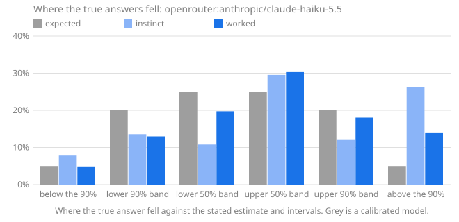

# Calibench report: openrouter:anthropic/claude-haiku-5.5

Seed `calibench-v1`, 104 questions, Calibench 2.3.0, Python 3.13.16 (Unicode 15.1.0), started 2026-10-17T10:37:19+00:00. Scored with Calibench 2.5.0 (log-wis-2).

**Standard suite v1.**

Prompts: **quantiles** wording (see `prompts.py`).

Served by: anthropic/claude-haiku-5.5 via Claude Platform on AWS.

Tokens: input 58,776, output 446,994, reasoning 372,182.

Cost reported by the API: 0.2294 (US dollars on OpenRouter).

## Summary

| | Instinct | Worked |
|---|---|---|
| Answered | 104 of 104 | 104 of 104 |
| **Score**, mean [90% interval] | **0.249** [0.181, 0.322] | **0.047** [0.033, 0.063] |
| Score, median | 0.097 | 0.007 |
| Interval score, 50% / 90% intervals | 1.137 / 3.730 | 0.227 / 0.588 |
| 50% intervals containing the answer [90% interval] | 47 of 104 (45%) [37%, 53%] | 61 of 104 (59%) [51%, 66%] |
| … leaving out single numbers | 44 of 101 (44%): consistent with calibrated | 44 of 86 (51%): consistent with calibrated |
| 90% intervals containing the answer [90% interval] | 69 of 104 (66%) [58%, 73%] | 85 of 104 (82%) [75%, 87%] |
| … leaving out single numbers | 68 of 103 (66%): too narrow (overconfident) | 84 of 103 (82%): too narrow (overconfident) |
| Answers given as certain (a single number) | 1, 1 exactly right | 1, 1 exactly right |
| Median error of the estimate | 11.1% | 0.8% |
| Output tokens per answer | 226 (167 reasoning) | 4,072 (3,412 reasoning) |
| Estimate closer to the answer | 12 | 80 |

Working it out lowered the score on 85 of 104 questions answered both ways, from 0.249 to 0.047 on average (improvement [0.138, 0.273]).

The score is the weighted interval score (Bracher et al., 2021) on a log scale: it combines the estimate and both intervals, is lowest when the stated intervals are the ones the model believes, and treats a miss by a factor in either direction alike. Lower is better; 0.1 is roughly a 10% miss. Intervals in brackets are 90% intervals over questions. Coverage verdicts leave out single-number intervals, which say "I know this exactly" and are counted on their own line.

## Where the true answers fell

The estimate and the two intervals are five quantiles of the model's belief, so they split it into six bins, and a calibrated model's true answers land in each bin in the expected share. Too many in the outer bins means intervals too narrow; too many on one side of the estimate means a lean in that direction. Single-number answers are left out, and an answer on a boundary is shared between the bins it touches.

| The true answer was | Expected | Instinct | Worked |
|---|---|---|---|
| below the 90% interval | 5% | 8% (8.053) | 5% (5.053) |
| in the 90% interval, below the 50% | 20% | 14% (14) | 13% (13.37) |
| in the 50% interval, below the estimate | 25% | 11% (11.11) | 20% (20.32) |
| in the 50% interval, above the estimate | 25% | 30% (30.45) | 30% (31.21) |
| in the 90% interval, above the 50% | 20% | 12% (12.39) | 18% (18.57) |
| above the 90% interval | 5% | 26% (27) | 14% (14.46) |
| **above the estimate**, with 90% interval | 50% | 68% [60%, 75%] | 62% [54%, 70%] |

## Where the score comes from

A few large misses can carry a mean. This shows how much of each score its largest questions carry, and the worked answers whose 90% interval missed, costliest first.

| | Instinct | Worked |
|---|---|---|
| Share of the score from the largest question | 10% | 11% |
| Share from the five largest | 36% | 39% |
| Mean score without the largest question | 0.227 | 0.042 |

**Worked answers outside their 90% interval.** *Outside by* is the factor between the true answer and the nearer end of the interval; *width* is the ratio of the interval's ends, so a narrow interval that misses by a wide factor is a confident miss.

| # | Question | True answer | Estimate [90% interval] | Width | Outside by | Score | Share of score |
|---|---|---|---|---|---|---|---|
| 53 | lines in `glob` | 572 | 305 [255, 355] | ×1.39 | ×1.61 above | 0.561 | 11% |
| 75 | lines in `statistics` | 1,817 | 1,020 [830, 1,250] | ×1.51 | ×1.45 above | 0.489 | 10% |
| 47 | Collatz steps from 189,630,655,112 | 291 | 170 [95, 285] | ×2.98 | ×1.02 above | 0.308 | 6% |
| 102 | lines in `reprlib` | 230 | 165 [150, 182] | ×1.21 | ×1.26 above | 0.288 | 6% |
| 16 | Unicode names with the word FRACTION | 98 | 66 [42, 88] | ×2.07 | ×1.11 above | 0.270 | 6% |
| 68 | Unicode names with the word FACE | 179 | 132 [120, 147] | ×1.22 | ×1.22 above | 0.256 | 5% |
| 8 | code points in category Po | 628 | 783 [745, 822] | ×1.1 | ×1.19 below | 0.199 | 4% |
| 12 | Collatz steps from 87,974,385,043 | 246 | 175 [108, 245] | ×2.26 | ×1 above | 0.194 | 4% |
| 45 | function definitions in `csv` | 17 | 22 [18, 26] | ×1.42 | ×1.06 below | 0.153 | 3% |
| 89 | Unicode names with the word DIGIT | 898 | 780 [725, 830] | ×1.14 | ×1.08 above | 0.115 | 2% |
| | 9 more | | | | | | |

## By kind of question

Knowledge questions ask what is known (the Python standard library, the Unicode database); statistical ones need noise or irregularity modelled; exact ones have a closed-form answer that must be evaluated; calculation ones have an exact answer that takes long, careful arithmetic.

| Kind | Phase | Questions | Score | 50% hits | 90% hits |
|---|---|---|---|---|---|
| exact | instinct | 8 | 0.125 | 8 of 8 (100%) | 8 of 8 (100%) |
| exact | worked | 8 | 0.033 | 8 of 8 (100%) | 8 of 8 (100%) |
| knowledge | instinct | 48 | 0.332 | 19 of 48 (40%) | 29 of 48 (60%) |
| knowledge | worked | 48 | 0.071 | 28 of 48 (58%) | 38 of 48 (79%) |
| statistical | instinct | 48 | 0.186 | 20 of 48 (42%) | 32 of 48 (67%) |
| statistical | worked | 48 | 0.026 | 25 of 48 (52%) | 39 of 48 (81%) |

## By family

| Family | Kind | Questions | Score, worked | Score, instinct | Worked 90% hits | Worked answers above the estimate |
|---|---|---|---|---|---|---|
| `birthday` | exact | 8 | 0.033 | 0.125 | 8 of 8 (100%) | 62% |
| `collatz_steps` | statistical | 8 | 0.111 | 0.365 | 6 of 8 (75%) | 44% |
| `digit_sum_pow2` | statistical | 8 | 0.014 | 0.586 | 7 of 8 (88%) | 25% |
| `lis` | statistical | 8 | 0.013 | 0.047 | 6 of 8 (75%) | 100% |
| `module_all` | knowledge | 8 | 0.013 | 0.186 | 8 of 8 (100%) | 64% |
| `primes_in_range` | statistical | 8 | 0.006 | 0.005 | 6 of 8 (75%) | 62% |
| `rect_distance` | statistical | 8 | 0.000 | 0.026 | 8 of 8 (100%) | 62% |
| `stdlib_defs` | knowledge | 8 | 0.091 | 0.198 | 7 of 8 (88%) | 50% |
| `stdlib_lines` | knowledge | 8 | 0.183 | 0.204 | 5 of 8 (62%) | 88% |
| `unicode_block` | knowledge | 8 | 0.001 | 0.092 | 8 of 8 (100%) | 50% |
| `unicode_category` | knowledge | 8 | 0.029 | 0.302 | 7 of 8 (88%) | 50% |
| `unicode_word` | knowledge | 8 | 0.109 | 1.008 | 3 of 8 (38%) | 100% |
| `walk_max` | statistical | 8 | 0.009 | 0.089 | 6 of 8 (75%) | 50% |

## Questions

Each answer is shown as estimate [90% interval], ✓ or ✗ for whether the 50% and 90% intervals contain the true answer, and its score.

| # | Question | True answer | Instinct | Worked |
|---|---|---|---|---|
| 1 | Unicode names with the word MUSICAL | 518 | 30 [12, 60] 50✗ 90✗ · 2.519 | 466 [450, 476] 50✗ 90✗ · 0.097 |
| 2 | lines in `smtplib` | 1,123 | 1,400 [1,100, 1,700] 50✗ 90✓ · 0.114 | 1,195 [1,080, 1,320] 50✗ 90✓ · 0.034 |
| 3 | highest point of a 426-step walk | 15.8 | 16.4 [15.8, 17] 50✗ 90✗ · 0.020 | 16.46 [16.1, 16.83] 50✗ 90✗ · 0.032 |
| 4 | draws until a repeat, d = 35,930 | 238.2 | 223 [61, 464] 50✓ 90✓ · 0.132 | 238.2 [237.9, 238.6] 50✓ 90✓ · 0.000 |
| 5 | digit sum of 2^1269 | 1,736 | 1,900 [1,500, 2,300] 50✓ 90✓ · 0.043 | 1,720 [1,628, 1,812] 50✓ 90✓ · 0.008 |
| 6 | names in `timeit.__all__` | 4 | 3 [2, 5] 50✓ 90✓ · 0.081 | 4 [3, 4] 50✓ 90✓ · 0.004 |
| 7 | mean distance in a 1 × 2.52 rectangle | 0.9621 | 0.96 [0.86, 1.08] 50✓ 90✓ · 0.013 | 0.9624 [0.96, 0.9648] 50✓ 90✓ · 0.000 |
| 8 | code points in category Po | 628 | 700 [580, 850] 50✗ 90✓ · 0.059 | 783 [745, 822] 50✗ 90✗ · 0.199 |
| 9 | assigned in the Thaana block | 50 | 50 [50, 50] 50✓ 90✓ · 0.000 | 50 [48, 50] 50✓ 90✓ · 0.001 |
| 10 | function definitions in `optparse` | 122 | 135 [90, 185] 50✓ 90✓ · 0.060 | 110 [90, 131] 50✗ 90✓ · 0.057 |
| 11 | primes in [3,164,661, 3,229,443] | 4,399 | 4,325 [4,270, 4,380] 50✗ 90✗ · 0.012 | 4,324 [4,275, 4,375] 50✗ 90✗ · 0.012 |
| 12 | Collatz steps from 87,974,385,043 | 246 | 145 [75, 215] 50✗ 90✗ · 0.361 | 175 [108, 245] 50✗ 90✗ · 0.194 |
| 13 | longest increasing subsequence, n = 112 | 17.81 | 21 [19, 23.5] 50✗ 90✗ · 0.119 | 17 [16.4, 17.6] 50✗ 90✗ · 0.031 |
| 14 | mean distance in a 1 × 9.91 rectangle | 3.359 | 3.34 [3.3, 3.38] 50✓ 90✓ · 0.003 | 3.356 [3.35, 3.362] 50✗ 90✓ · 0.000 |
| 15 | assigned in the Thai block | 87 | 80 [75, 83] 50✗ 90✗ · 0.068 | 87 [86, 87] 50✓ 90✓ · 0.000 |
| 16 | Unicode names with the word FRACTION | 98 | 38 [20, 66] 50✗ 90✗ · 0.693 | 66 [42, 88] 50✗ 90✗ · 0.270 |
| 17 | code points in category Pc | 10 | 10 [9, 12] 50✓ 90✓ · 0.014 | 10 [9, 11] 50✓ 90✓ · 0.004 |
| 18 | function definitions in `traceback` | 70 | 98 [60, 145] 50✗ 90✓ · 0.173 | 58 [42, 78] 50✗ 90✓ · 0.102 |
| 19 | lines in `shutil` | 1,569 | 1,750 [1,500, 2,050] 50✗ 90✓ · 0.060 | 1,540 [1,330, 1,800] 50✓ 90✓ · 0.021 |
| 20 | longest increasing subsequence, n = 1,643 | 75.54 | 73.8 [72.5, 75.1] 50✗ 90✗ · 0.016 | 75 [74.2, 75.8] 50✗ 90✓ · 0.004 |
| 21 | highest point of a 1,512-step walk | 31.04 | 31 [29.5, 32.8] 50✓ 90✓ · 0.007 | 31.02 [30.4, 31.63] 50✓ 90✓ · 0.003 |
| 22 | primes in [8,284,359, 8,296,430] | 753 | 758 [732, 784] 50✓ 90✓ · 0.006 | 758 [716, 800] 50✓ 90✓ · 0.008 |
| 23 | Collatz steps from 337,264,368,477 | 248 | 135 [90, 190] 50✗ 90✗ · 0.460 | 260 [160, 385] 50✓ 90✓ · 0.059 |
| 24 | names in `weakref.__all__` | 13 | 7 [3, 11] 50✗ 90✗ · 0.413 | 13 [12, 14] 50✓ 90✓ · 0.003 |
| 25 | draws until a repeat, d = 6,620,093 | 3,225 | 3,030 [824, 6,299] 50✓ 90✓ · 0.132 | 3,225 [3,225, 3,226] 50✓ 90✓ · 0.000 |
| 26 | digit sum of 2^1219 | 1,550 | 1,850 [1,500, 2,250] 50✗ 90✓ · 0.097 | 1,651 [1,555, 1,748] 50✗ 90✗ · 0.037 |
| 27 | function definitions in `hmac` | 11 | 16 [8, 28] 50✗ 90✓ · 0.173 | 14 [9, 20] 50✗ 90✓ · 0.118 |
| 28 | assigned in the Playing Cards block | 82 | 81 [70, 84] 50✓ 90✓ · 0.011 | 82 [80, 82] 50✓ 90✓ · 0.000 |
| 29 | longest increasing subsequence, n = 4,365 | 125.4 | 124.8 [123.5, 126.1] 50✗ 90✓ · 0.003 | 125 [124.2, 125.8] 50✗ 90✓ · 0.002 |
| 30 | mean distance in a 1 × 4.45 rectangle | 1.572 | 1.53 [1.47, 1.62] 50✗ 90✓ · 0.015 | 1.571 [1.568, 1.575] 50✗ 90✓ · 0.000 |
| 31 | Unicode names with the word CAPITAL | 2,032 | 1,400 [700, 2,300] 50✗ 90✓ · 0.213 | 1,770 [1,600, 1,950] 50✗ 90✗ · 0.096 |
| 32 | Collatz steps from 904,534,976,486 | 239 | 100 [60, 150] 50✗ 90✗ · 0.690 | 275 [150, 420] 50✓ 90✓ · 0.085 |
| 33 | code points in category So | 6,639 | 6,500 [5,800, 7,300] 50✓ 90✓ · 0.018 | 6,600 [6,250, 6,950] 50✓ 90✓ · 0.007 |
| 34 | digit sum of 2^2531 | 3,353 | 1,270 [1,100, 1,440] 50✗ 90✗ · 0.918 | 3,435 [3,303, 3,567] 50✗ 90✓ · 0.013 |
| 35 | lines in `functools` | 1,036 | 1,020 [850, 1,220] 50✓ 90✓ · 0.023 | 1,000 [850, 1,160] 50✓ 90✓ · 0.025 |
| 36 | draws until a repeat, d = 46,781 | 271.7 | 270 [100, 480] 50✓ 90✓ · 0.082 | 271.8 [271.2, 272.3] 50✓ 90✓ · 0.000 |
| 37 | highest point of a 869-step walk | 22.92 | 19.9 [2, 57.5] 50✓ 90✓ · 0.222 | 23.02 [22.55, 23.5] 50✓ 90✓ · 0.003 |
| 38 | names in `locale.__all__` | 23 | 12 [6, 40] 50✗ 90✓ · 0.349 | 22 [19, 32] 50✓ 90✓ · 0.027 |
| 39 | primes in [591,475, 604,946] | 1,020 | 1,013 [978, 1,048] 50✓ 90✓ · 0.005 | 1,013 [970, 1,057] 50✓ 90✓ · 0.006 |
| 40 | longest increasing subsequence, n = 2,201 | 87.91 | 87.4 [85.8, 88.9] 50✗ 90✓ · 0.003 | 87.2 [85.4, 89] 50✗ 90✓ · 0.004 |
| 41 | code points in category Me | 13 | 139 [128, 151] 50✗ 90✗ · 2.267 | 13 [11, 14] 50✓ 90✓ · 0.004 |
| 42 | lines in `tabnanny` | 340 | 415 [280, 560] 50✗ 90✓ · 0.095 | 336 [303, 375] 50✓ 90✓ · 0.014 |
| 43 | primes in [310,586, 338,601] | 2,242 | 2,208 [2,165, 2,251] 50✗ 90✓ · 0.009 | 2,208 [2,180, 2,236] 50✗ 90✗ · 0.010 |
| 44 | mean distance in a 1 × 4.51 rectangle | 1.59 | 1.52 [1.49, 1.55] 50✗ 90✗ · 0.037 | 1.591 [1.589, 1.594] 50✓ 90✓ · 0.000 |
| 45 | function definitions in `csv` | 17 | 25 [12, 45] 50✗ 90✓ · 0.176 | 22 [18, 26] 50✗ 90✗ · 0.153 |
| 46 | digit sum of 2^7366 | 10,060 | 11,100 [9,000, 11,700] 50✗ 90✓ · 0.063 | 9,981 [9,750, 10,212] 50✓ 90✓ · 0.004 |
| 47 | Collatz steps from 189,630,655,112 | 291 | 145 [80, 215] 50✗ 90✗ · 0.527 | 170 [95, 285] 50✗ 90✗ · 0.308 |
| 48 | draws until a repeat, d = 2,138 | 58.62 | 56 [15, 115] 50✓ 90✓ · 0.126 | 58.62 [58.58, 58.66] 50✓ 90✓ · 0.000 |
| 49 | names in `base64.__all__` | 22 | 22 [19, 25] 50✓ 90✓ · 0.014 | 20 [19, 22] 50✗ 90✓ · 0.057 |
| 50 | Unicode names with the word GREEK | 531 | 260 [120, 420] 50✗ 90✗ · 0.501 | 505 [458, 545] 50✗ 90✓ · 0.028 |
| 51 | assigned in the General Punctuation block | 111 | 105 [100, 108] 50✗ 90✗ · 0.045 | 111 [109, 112] 50✓ 90✓ · 0.001 |
| 52 | highest point of a 707-step walk | 20.72 | 18 [2, 51] 50✓ 90✓ · 0.208 | 21.22 [20.8, 21.65] 50✗ 90✗ · 0.015 |
| 53 | lines in `glob` | 572 | 225 [180, 300] 50✗ 90✗ · 0.806 | 305 [255, 355] 50✗ 90✗ · 0.561 |
| 54 | function definitions in `webbrowser` | 25 | 66 [40, 98] 50✗ 90✗ · 0.730 | 35 [24, 49] 50✗ 90✓ · 0.177 |
| 55 | assigned in the Lao block | 83 | 64 [58, 67] 50✗ 90✗ · 0.240 | 83 [80, 85] 50✓ 90✓ · 0.002 |
| 56 | longest increasing subsequence, n = 452 | 38.19 | 38 [36.4, 39.6] 50✓ 90✓ · 0.006 | 37.65 [36.9, 38.5] 50✗ 90✓ · 0.008 |
| 57 | highest point of a 1,229-step walk | 27.5 | 23.5 [2.5, 68] 50✓ 90✓ · 0.222 | 27.48 [26.9, 28.05] 50✓ 90✓ · 0.003 |
| 58 | digit sum of 2^8596 | 11,455 | 3,870 [3,000, 4,800] 50✗ 90✗ · 1.002 | 11,646 [11,406, 11,886] 50✗ 90✓ · 0.009 |
| 59 | draws until a repeat, d = 6,016 | 97.88 | 92 [25, 190] 50✓ 90✓ · 0.132 | 92 [25, 190] 50✓ 90✓ · 0.132 |
| 60 | names in `gzip.__all__` | 5 | 4 [2, 7] 50✓ 90✓ · 0.097 | 5 [5, 5] 50✓ 90✓ · 0.000 |
| 61 | code points in category Pf | 10 | 10 [10, 11] 50✓ 90✓ · 0.002 | 10 [9, 11] 50✓ 90✓ · 0.004 |
| 62 | primes in [335,112, 371,030] | 2,787 | 2,813 [2,770, 2,857] 50✗ 90✓ · 0.005 | 2,810 [2,785, 2,836] 50✗ 90✓ · 0.005 |
| 63 | Unicode names with the word HEBREW | 134 | 84 [60, 115] 50✗ 90✗ · 0.326 | 133 [128, 136] 50✗ 90✓ · 0.006 |
| 64 | mean distance in a 1 × 2.07 rectangle | 0.826 | 0.96 [0.88, 1.04] 50✗ 90✗ · 0.112 | 0.8257 [0.8235, 0.828] 50✓ 90✓ · 0.000 |
| 65 | Collatz steps from 23,010,656,711 | 195 | 130 [60, 230] 50✗ 90✓ · 0.223 | 240 [135, 370] 50✓ 90✓ · 0.100 |
| 66 | code points in category Sk | 125 | 121 [100, 150] 50✓ 90✓ · 0.027 | 125 [117, 132] 50✓ 90✓ · 0.006 |
| 67 | draws until a repeat, d = 131,706 | 455.5 | 427 [116, 889] 50✓ 90✓ · 0.132 | 455.5 [455.3, 455.7] 50✓ 90✓ · 0.000 |
| 68 | Unicode names with the word FACE | 179 | 38 [20, 60] 50✗ 90✗ · 1.339 | 132 [120, 147] 50✗ 90✗ · 0.256 |
| 69 | longest increasing subsequence, n = 827 | 52.6 | 61.1 [59, 63.2] 50✗ 90✗ · 0.135 | 52.08 [51.5, 52.6] 50✗ 90✓ · 0.006 |
| 70 | digit sum of 2^3289 | 4,430 | 1,480 [1,300, 1,680] 50✗ 90✗ · 1.042 | 4,457 [4,309, 4,605] 50✓ 90✓ · 0.005 |
| 71 | assigned in the Georgian block | 88 | 118 [105, 122] 50✗ 90✗ · 0.228 | 88 [86, 89] 50✓ 90✓ · 0.001 |
| 72 | mean distance in a 1 × 3.1 rectangle | 1.142 | 1.12 [1.02, 1.23] 50✓ 90✓ · 0.015 | 1.143 [1.141, 1.145] 50✓ 90✓ · 0.000 |
| 73 | highest point of a 1,415-step walk | 29.89 | 30 [29.2, 30.8] 50✓ 90✓ · 0.004 | 29.52 [28.9, 30.15] 50✗ 90✓ · 0.007 |
| 74 | primes in [188,978, 218,173] | 2,379 | 2,390 [2,350, 2,430] 50✓ 90✓ · 0.003 | 2,385 [2,369, 2,402] 50✓ 90✓ · 0.001 |
| 75 | lines in `statistics` | 1,817 | 1,100 [850, 1,500] 50✗ 90✗ · 0.360 | 1,020 [830, 1,250] 50✗ 90✗ · 0.489 |
| 76 | function definitions in `operator` | 67 | 75 [40, 125] 50✓ 90✓ · 0.087 | 66 [58, 75] 50✓ 90✓ · 0.017 |
| 77 | names in `difflib.__all__` | 12 | 9 [6, 13] 50✗ 90✓ · 0.153 | 12 [11, 12] 50✓ 90✓ · 0.002 |
| 78 | Collatz steps from 360,172,167,088 | 160 | 135 [60, 250] 50✓ 90✓ · 0.110 | 180 [115, 260] 50✓ 90✓ · 0.073 |
| 79 | Collatz steps from 905,376,815,232 | 177 | 105 [60, 180] 50✗ 90✓ · 0.290 | 177 [174, 181] 50✓ 90✓ · 0.002 |
| 80 | names in `tabnanny.__all__` | 3 | 3 [2, 6] 50✓ 90✓ · 0.039 | 3 [2, 4] 50✓ 90✓ · 0.010 |
| 81 | digit sum of 2^706 | 925 | 1,200 [1,000, 1,420] 50✗ 90✗ · 0.175 | 961 [893, 1,029] 50✗ 90✓ · 0.020 |
| 82 | draws until a repeat, d = 944,525 | 1,219 | 1,144 [311, 2,379] 50✓ 90✓ · 0.132 | 1,219 [1,218, 1,219] 50✓ 90✓ · 0.000 |
| 83 | function definitions in `weakref` | 65 | 75 [45, 115] 50✓ 90✓ · 0.083 | 68 [52, 86] 50✓ 90✓ · 0.039 |
| 84 | primes in [865,988, 892,619] | 1,952 | 1,946 [1,915, 1,977] 50✓ 90✓ · 0.002 | 1,946 [1,870, 2,022] 50✓ 90✓ · 0.005 |
| 85 | code points in category Nd | 680 | 680 [620, 720] 50✓ 90✓ · 0.007 | 680 [664, 692] 50✓ 90✓ · 0.001 |
| 86 | longest increasing subsequence, n = 121 | 18.59 | 20 [18, 22.5] 50✗ 90✓ · 0.038 | 18.2 [15.2, 21.2] 50✓ 90✓ · 0.024 |
| 87 | highest point of a 853-step walk | 22.61 | 23.3 [21.5, 25.3] 50✓ 90✓ · 0.015 | 22.81 [22.35, 23.27] 50✗ 90✓ · 0.005 |
| 88 | mean distance in a 1 × 7.13 rectangle | 2.442 | 2.44 [2.38, 2.53] 50✓ 90✓ · 0.004 | 2.442 [2.436, 2.449] 50✓ 90✓ · 0.000 |
| 89 | Unicode names with the word DIGIT | 898 | 105 [60, 180] 50✗ 90✗ · 1.909 | 780 [725, 830] 50✗ 90✗ · 0.115 |
| 90 | assigned in the Gothic block | 27 | 27 [26, 28] 50✓ 90✓ · 0.001 | 27 [27, 28] 50✓ 90✓ · 0.001 |
| 91 | lines in `string` | 314 | 300 [260, 360] 50✓ 90✓ · 0.029 | 295 [262, 332] 50✗ 90✓ · 0.034 |
| 92 | draws until a repeat, d = 4,022 | 80.15 | 75 [20.5, 155.5] 50✓ 90✓ · 0.132 | 75 [21, 155] 50✓ 90✓ · 0.130 |
| 93 | primes in [1,135,630, 1,167,274] | 2,277 | 2,268 [2,240, 2,296] 50✓ 90✓ · 0.002 | 2,266 [2,219, 2,312] 50✓ 90✓ · 0.003 |
| 94 | assigned in the Greek and Coptic block | 135 | 112 [105, 121] 50✗ 90✗ · 0.146 | 135 [133, 136] 50✓ 90✓ · 0.000 |
| 95 | names in `mailbox.__all__` | 17 | 10 [7, 14] 50✗ 90✗ · 0.340 | 17 [16, 18] 50✓ 90✓ · 0.002 |
| 96 | mean distance in a 1 × 1.09 rectangle | 0.5454 | 0.545 [0.52, 0.57] 50✓ 90✓ · 0.006 | 0.5452 [0.544, 0.5465] 50✓ 90✓ · 0.000 |
| 97 | code points in category Cf | 170 | 165 [140, 185] 50✓ 90✓ · 0.021 | 170 [163, 175] 50✓ 90✓ · 0.003 |
| 98 | Collatz steps from 70,587,310,865 | 194 | 300 [150, 470] 50✗ 90✓ · 0.254 | 172 [110, 240] 50✓ 90✓ · 0.066 |
| 99 | digit sum of 2^5606 | 7,438 | 1,800 [1,500, 2,100] 50✗ 90✗ · 1.353 | 7,596 [7,402, 7,790] 50✗ 90✓ · 0.012 |
| 100 | Unicode names with the word CYRILLIC | 507 | 255 [180, 340] 50✗ 90✗ · 0.566 | 505 [480, 532] 50✓ 90✓ · 0.006 |
| 101 | longest increasing subsequence, n = 104 | 17.15 | 19 [16, 22] 50✗ 90✓ · 0.057 | 16.55 [16.2, 16.9] 50✗ 90✗ · 0.026 |
| 102 | lines in `reprlib` | 230 | 180 [150, 225] 50✗ 90✗ · 0.148 | 165 [150, 182] 50✗ 90✗ · 0.288 |
| 103 | function definitions in `base64` | 28 | 23 [13, 38] 50✓ 90✓ · 0.101 | 25 [21, 29] 50✗ 90✓ · 0.068 |
| 104 | highest point of a 996-step walk | 24.79 | 25.2 [23.8, 26.6] 50✓ 90✓ · 0.011 | 24.69 [24.17, 25.22] 50✓ 90✓ · 0.003 |
