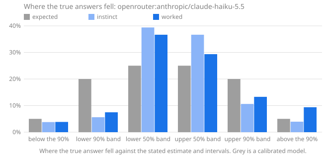

# Calibench report: openrouter:anthropic/claude-haiku-5.5

Seed `calibench-v2`, 108 questions, Calibench 2.1.0, Python 3.13.16 (Unicode 15.1.0), started 2026-10-17T04:02:15+00:00. Scored with Calibench 2.5.0 (log-wis-2).

**Standard suite v2.**

Served by: anthropic/claude-haiku-5.5 via Claude Platform on AWS.

Tokens: input 53,574, output 558,735, reasoning 485,585.

Cost reported by the API: 0.2847 (US dollars on OpenRouter).

## Summary

| | Instinct | Worked |
|---|---|---|
| Answered | 108 of 108 | 108 of 108 |
| **Score**, mean [90% interval] | **0.098** [0.063, 0.140] | **0.068** [0.035, 0.111] |
| Score, median | 0.020 | 0.007 |
| Interval score, 50% / 90% intervals | 0.483 / 1.389 | 0.313 / 1.120 |
| 50% intervals containing the answer [90% interval] | 85 of 108 (79%) [72%, 84%] | 80 of 108 (74%) [67%, 80%] |
| … leaving out single numbers | 84 of 107 (79%): too wide (underconfident) | 66 of 94 (70%): too wide (underconfident) |
| 90% intervals containing the answer [90% interval] | 100 of 108 (93%) [87%, 96%] | 94 of 108 (87%) [81%, 91%] |
| … leaving out single numbers | 100 of 108 (93%): consistent with calibrated | 94 of 108 (87%): consistent with calibrated |
| Answers given as certain (a single number) | 0, 0 exactly right | 0, 0 exactly right |
| Median error of the estimate | 1.1% | 0.1% |
| Output tokens per answer | 285 (244 reasoning) | 4,889 (4,253 reasoning) |
| Estimate closer to the answer | 22 | 51 |

Working it out lowered the score on 88 of 108 questions answered both ways, from 0.098 to 0.068 on average (improvement [0.012, 0.050]).

The score is the weighted interval score (Bracher et al., 2021) on a log scale: it combines the estimate and both intervals, is lowest when the stated intervals are the ones the model believes, and treats a miss by a factor in either direction alike. Lower is better; 0.1 is roughly a 10% miss. Intervals in brackets are 90% intervals over questions. Coverage verdicts leave out single-number intervals, which say "I know this exactly" and are counted on their own line.

## Where the true answers fell

The estimate and the two intervals are five quantiles of the model's belief, so they split it into six bins, and a calibrated model's true answers land in each bin in the expected share. Too many in the outer bins means intervals too narrow; too many on one side of the estimate means a lean in that direction. Single-number answers are left out, and an answer on a boundary is shared between the bins it touches.

| The true answer was | Expected | Instinct | Worked |
|---|---|---|---|
| below the 90% interval | 5% | 4% (4.1) | 4% (4.158) |
| in the 90% interval, below the 50% | 20% | 6% (6.067) | 7% (8.076) |
| in the 50% interval, below the estimate | 25% | 39% (42.52) | 37% (39.58) |
| in the 50% interval, above the estimate | 25% | 37% (39.58) | 29% (31.69) |
| in the 90% interval, above the 50% | 20% | 11% (11.46) | 13% (14.36) |
| above the 90% interval | 5% | 4% (4.267) | 9% (10.13) |
| **above the estimate**, with 90% interval | 50% | 51% [43%, 59%] | 51% [44%, 60%] |

## Where the score comes from

A few large misses can carry a mean. This shows how much of each score its largest questions carry, and the worked answers whose 90% interval missed, costliest first.

| | Instinct | Worked |
|---|---|---|
| Share of the score from the largest question | 21% | 31% |
| Share from the five largest | 49% | 61% |
| Mean score without the largest question | 0.079 | 0.047 |

**Worked answers outside their 90% interval.** *Outside by* is the factor between the true answer and the nearer end of the interval; *width* is the ratio of the interval's ends, so a narrow interval that misses by a wide factor is a confident miss.

| # | Question | True answer | Estimate [90% interval] | Width | Outside by | Score | Share of score |
|---|---|---|---|---|---|---|---|
| 95 | partitions of 507 | 3,384,893,356,244,349,844,341 | 3.385e+22 [3.33e+22, 3.44e+22] | ×1.03 | ×9.84 below | 2.296 | 31% |
| 71 | Unicode names with the word FRACTION | 98 | 48 [41, 55] | ×1.33 | ×1.77 above | 0.644 | 9% |
| 3 | lines in `statistics` | 1,817 | 980 [860, 1,120] | ×1.3 | ×1.62 above | 0.556 | 8% |
| 29 | Unicode names with the word SIGN | 3,393 | 1,950 [1,700, 2,220] | ×1.31 | ×1.53 above | 0.497 | 7% |
| 37 | Unicode names with the word STAR | 61 | 30 [20, 50] | ×2.43 | ×1.22 above | 0.460 | 6% |
| 73 | Unicode names with the word SMALL | 3,296 | 2,280 [2,120, 2,460] | ×1.16 | ×1.34 above | 0.335 | 5% |
| 94 | lines in `warnings` | 735 | 565 [490, 660] | ×1.35 | ×1.11 above | 0.194 | 3% |
| 107 | Unicode names with the word DIGIT | 898 | 750 [735, 785] | ×1.07 | ×1.14 above | 0.160 | 2% |
| 7 | Unicode names with the word LATIN | 1,567 | 1,365 [1,290, 1,450] | ×1.12 | ×1.08 above | 0.111 | 2% |
| 101 | highest point of a 1,174-step walk | 26.55 | 27.33 [26.8, 27.9] | ×1.04 | ×1.01 below | 0.020 | 0% |
| | 4 more | | | | | | |

## By kind of question

Knowledge questions ask what is known (the Python standard library, the Unicode database); statistical ones need noise or irregularity modelled; exact ones have a closed-form answer that must be evaluated; calculation ones have an exact answer that takes long, careful arithmetic.

| Kind | Phase | Questions | Score | 50% hits | 90% hits |
|---|---|---|---|---|---|
| calculation | instinct | 30 | 0.082 | 29 of 30 (97%) | 29 of 30 (97%) |
| calculation | worked | 30 | 0.078 | 29 of 30 (97%) | 29 of 30 (97%) |
| exact | instinct | 6 | 0.118 | 6 of 6 (100%) | 6 of 6 (100%) |
| exact | worked | 6 | 0.118 | 6 of 6 (100%) | 6 of 6 (100%) |
| knowledge | instinct | 36 | 0.161 | 23 of 36 (64%) | 30 of 36 (83%) |
| knowledge | worked | 36 | 0.096 | 24 of 36 (67%) | 28 of 36 (78%) |
| statistical | instinct | 36 | 0.045 | 27 of 36 (75%) | 35 of 36 (97%) |
| statistical | worked | 36 | 0.024 | 21 of 36 (58%) | 31 of 36 (86%) |

## By family

| Family | Kind | Questions | Score, worked | Score, instinct | Worked 90% hits | Worked answers above the estimate |
|---|---|---|---|---|---|---|
| `birthday` | exact | 6 | 0.118 | 0.118 | 6 of 6 (100%) | 17% |
| `collatz_steps` | statistical | 6 | 0.095 | 0.130 | 6 of 6 (100%) | 42% |
| `days_between` | calculation | 6 | 0.000 | 0.002 | 6 of 6 (100%) | 50% |
| `digit_sum_pow2` | statistical | 6 | 0.008 | 0.008 | 5 of 6 (83%) | 33% |
| `factorial_digits` | calculation | 6 | 0.000 | 0.000 | 6 of 6 (100%) | 50% |
| `friday13` | calculation | 6 | 0.005 | 0.011 | 6 of 6 (100%) | 50% |
| `lis` | statistical | 6 | 0.011 | 0.012 | 4 of 6 (67%) | 100% |
| `module_all` | knowledge | 6 | 0.009 | 0.115 | 6 of 6 (100%) | 58% |
| `multiply` | calculation | 6 | 0.000 | 0.008 | 6 of 6 (100%) | 50% |
| `partitions` | calculation | 6 | 0.383 | 0.386 | 5 of 6 (83%) | 50% |
| `primes_in_range` | statistical | 6 | 0.017 | 0.018 | 6 of 6 (100%) | 33% |
| `rect_distance` | statistical | 6 | 0.001 | 0.025 | 6 of 6 (100%) | 50% |
| `stdlib_defs` | knowledge | 6 | 0.051 | 0.199 | 6 of 6 (100%) | 58% |
| `stdlib_lines` | knowledge | 6 | 0.139 | 0.162 | 4 of 6 (67%) | 67% |
| `unicode_block` | knowledge | 6 | 0.001 | 0.006 | 6 of 6 (100%) | 58% |
| `unicode_category` | knowledge | 6 | 0.009 | 0.014 | 6 of 6 (100%) | 42% |
| `unicode_word` | knowledge | 6 | 0.368 | 0.471 | 0 of 6 (0%) | 100% |
| `walk_max` | statistical | 6 | 0.011 | 0.078 | 4 of 6 (67%) | 17% |

## Questions

Each answer is shown as estimate [90% interval], ✓ or ✗ for whether the 50% and 90% intervals contain the true answer, and its score.

| # | Question | True answer | Instinct | Worked |
|---|---|---|---|---|
| 1 | Friday the 13ths in 1607–1713 | 185 | 184 [174, 194] 50✓ 90✓ · 0.008 | 185 [181, 189] 50✓ 90✓ · 0.002 |
| 2 | primes in [3,218,046, 3,219,109] | 68 | 71 [58, 85] 50✓ 90✓ · 0.030 | 71 [60, 82] 50✓ 90✓ · 0.026 |
| 3 | lines in `statistics` | 1,817 | 1,000 [700, 1,500] 50✗ 90✗ · 0.424 | 980 [860, 1,120] 50✗ 90✗ · 0.556 |
| 4 | function definitions in `tabnanny` | 17 | 24 [12, 45] 50✗ 90✓ · 0.162 | 15 [12, 19] 50✗ 90✓ · 0.068 |
| 5 | digits of 246! | 483 | 483 [480, 486] 50✓ 90✓ · 0.001 | 483 [483, 484] 50✓ 90✓ · 0.000 |
| 6 | mean distance in a 1 × 1.33 rectangle | 0.6103 | 0.63 [0.56, 0.71] 50✓ 90✓ · 0.021 | 0.6105 [0.6083, 0.6127] 50✓ 90✓ · 0.000 |
| 7 | Unicode names with the word LATIN | 1,567 | 1,400 [1,100, 1,800] 50✗ 90✓ · 0.058 | 1,365 [1,290, 1,450] 50✗ 90✗ · 0.111 |
| 8 | draws until a repeat, d = 303 | 22.49 | 22.5 [8, 42] 50✓ 90✓ · 0.103 | 22.5 [6.5, 43] 50✓ 90✓ · 0.114 |
| 9 | names in `random.__all__` | 26 | 30 [20, 42] 50✓ 90✓ · 0.072 | 26 [24, 28] 50✓ 90✓ · 0.007 |
| 10 | assigned in the Cherokee block | 92 | 92 [85, 92] 50✓ 90✓ · 0.006 | 92 [90, 93] 50✓ 90✓ · 0.001 |
| 11 | Collatz steps from 611,221,186,107 | 378 | 280 [120, 520] 50✗ 90✓ · 0.167 | 280 [135, 470] 50✗ 90✓ · 0.168 |
| 12 | longest increasing subsequence, n = 600 | 44.3 | 43.9 [42.8, 45] 50✗ 90✓ · 0.005 | 43.4 [42.8, 44] 50✗ 90✗ · 0.014 |
| 13 | highest point of a 901-step walk | 23.33 | 23.9 [21.6, 26.2] 50✓ 90✓ · 0.016 | 23.46 [22.97, 23.95] 50✓ 90✓ · 0.004 |
| 14 | 6,787 × 2,142 | 14,537,754 | 14,537,754 [13,900,000, 15,200,000] 50✓ 90✓ · 0.005 | 14,537,754 [14,537,000, 14,538,500] 50✓ 90✓ · 0.000 |
| 15 | days from 2381-11-09 to 2400-03-01 | 6,687 | 6,687 [6,680, 6,694] 50✓ 90✓ · 0.000 | 6,687 [6,680, 6,695] 50✓ 90✓ · 0.000 |
| 16 | code points in category Nd | 680 | 680 [630, 730] 50✓ 90✓ · 0.007 | 680 [655, 700] 50✓ 90✓ · 0.003 |
| 17 | digit sum of 2^2579 | 3,479 | 3,496 [3,365, 3,630] 50✓ 90✓ · 0.006 | 3,497 [3,365, 3,630] 50✓ 90✓ · 0.006 |
| 18 | partitions of 246 | 169,296,722,391,554 | 170,000,000,000,000 [140,000,000,000,000, 200,000,000,000,000] 50✓ 90✓ · 0.020 | 1.692e+14 [1.672e+14, 1.712e+14] 50✓ 90✓ · 0.001 |
| 19 | Collatz steps from 273,342,000,302 | 201 | 130 [60, 230] 50✗ 90✓ · 0.247 | 270 [150, 400] 50✗ 90✓ · 0.157 |
| 20 | days from 2367-07-04 to 2367-08-26 | 53 | 53 [50, 56] 50✓ 90✓ · 0.006 | 53 [52, 54] 50✓ 90✓ · 0.001 |
| 21 | longest increasing subsequence, n = 880 | 54.39 | 54 [51.5, 56.3] 50✓ 90✓ · 0.006 | 53.8 [52.4, 55.2] 50✓ 90✓ · 0.005 |
| 22 | digits of 10,938! | 39,431 | 39,431 [39,425, 39,437] 50✓ 90✓ · 0.000 | 39,431 [39,430, 39,432] 50✓ 90✓ · 0.000 |
| 23 | draws until a repeat, d = 3,428 | 74.05 | 74 [19, 143] 50✓ 90✓ · 0.121 | 74.05 [19, 144] 50✓ 90✓ · 0.118 |
| 24 | assigned in the Arabic Presentation Forms-B block | 141 | 139 [135, 141] 50✗ 90✓ · 0.008 | 141 [139, 141] 50✓ 90✓ · 0.001 |
| 25 | 21,339 × 2,935 | 62,629,965 | 62,629,965 [58,000,000, 67,000,000] 50✓ 90✓ · 0.008 | 62,629,965 [62,000,000, 63,200,000] 50✓ 90✓ · 0.000 |
| 26 | code points in category Lm | 397 | 397 [330, 470] 50✓ 90✓ · 0.020 | 370 [320, 420] 50✗ 90✓ · 0.034 |
| 27 | mean distance in a 1 × 6.93 rectangle | 2.377 | 2.37 [0.9, 4.4] 50✓ 90✓ · 0.071 | 2.377 [2.37, 2.384] 50✓ 90✓ · 0.000 |
| 28 | lines in `base64` | 628 | 535 [420, 700] 50✗ 90✓ · 0.083 | 610 [510, 730] 50✓ 90✓ · 0.028 |
| 29 | Unicode names with the word SIGN | 3,393 | 1,100 [600, 2,000] 50✗ 90✗ · 0.864 | 1,950 [1,700, 2,220] 50✗ 90✗ · 0.497 |
| 30 | partitions of 256 | 365,749,566,870,782 | 360,000,000,000,000 [300,000,000,000,000, 430,000,000,000,000] 50✓ 90✓ · 0.021 | 365,650,000,000,000 [363,000,000,000,000, 368,000,000,000,000] 50✓ 90✓ · 0.001 |
| 31 | primes in [3,705,675, 3,741,104] | 2,356 | 2,342 [2,265, 2,420] 50✓ 90✓ · 0.005 | 2,342 [2,293, 2,391] 50✓ 90✓ · 0.004 |
| 32 | Friday the 13ths in 2120–2204 | 147 | 146 [138, 154] 50✓ 90✓ · 0.008 | 147 [143, 151] 50✓ 90✓ · 0.002 |
| 33 | names in `fractions.__all__` | 1 | 2 [1, 5] 50✓ 90✓ · 0.172 | 1 [1, 2] 50✓ 90✓ · 0.008 |
| 34 | highest point of a 608-step walk | 19.36 | 19.7 [17, 22.5] 50✓ 90✓ · 0.022 | 19.66 [19.27, 20.06] 50✗ 90✓ · 0.009 |
| 35 | function definitions in `inspect` | 148 | 200 [120, 330] 50✗ 90✓ · 0.153 | 185 [143, 232] 50✗ 90✓ · 0.122 |
| 36 | digit sum of 2^4112 | 5,575 | 5,571 [5,405, 5,737] 50✓ 90✓ · 0.004 | 5,570 [5,400, 5,740] 50✓ 90✓ · 0.004 |
| 37 | Unicode names with the word STAR | 61 | 60 [15, 160] 50✓ 90✓ · 0.142 | 30 [20, 50] 50✗ 90✗ · 0.460 |
| 38 | highest point of a 400-step walk | 15.36 | 16 [2, 33] 50✓ 90✓ · 0.191 | 15.47 [15.1, 15.85] 50✓ 90✓ · 0.005 |
| 39 | digit sum of 2^4557 | 6,011 | 6,174 [6,000, 6,350] 50✗ 90✓ · 0.015 | 6,175 [6,001, 6,349] 50✗ 90✓ · 0.015 |
| 40 | names in `bdb.__all__` | 3 | 4 [2, 10] 50✓ 90✓ · 0.127 | 3 [2, 4] 50✓ 90✓ · 0.010 |
| 41 | days from 2360-02-08 to 2360-03-27 | 48 | 48 [45, 51] 50✓ 90✓ · 0.007 | 48 [47, 49] 50✓ 90✓ · 0.001 |
| 42 | code points in category Ps | 79 | 75 [65, 90] 50✓ 90✓ · 0.027 | 79 [74, 85] 50✓ 90✓ · 0.008 |
| 43 | digits of 395! | 856 | 856 [850, 862] 50✓ 90✓ · 0.001 | 856 [855, 857] 50✓ 90✓ · 0.000 |
| 44 | Collatz steps from 257,793,746,753 | 170 | 170 [80, 330] 50✓ 90✓ · 0.093 | 182 [115, 260] 50✓ 90✓ · 0.058 |
| 45 | lines in `subprocess` | 2,259 | 2,200 [1,500, 3,100] 50✓ 90✓ · 0.047 | 2,150 [1,990, 2,330] 50✗ 90✓ · 0.025 |
| 46 | assigned in the Georgian block | 88 | 88 [84, 90] 50✓ 90✓ · 0.002 | 88 [85, 89] 50✓ 90✓ · 0.002 |
| 47 | partitions of 229 | 44,132,934,884,255 | 44,000,000,000,000 [33,000,000,000,000, 56,000,000,000,000] 50✓ 90✓ · 0.029 | 44,133,000,000,000 [43,900,000,000,000, 44,400,000,000,000] 50✓ 90✓ · 0.000 |
| 48 | longest increasing subsequence, n = 156 | 21.48 | 20.9 [19.3, 22.5] 50✓ 90✓ · 0.015 | 20.9 [20.1, 21.7] 50✗ 90✓ · 0.015 |
| 49 | primes in [203,866, 205,144] | 103 | 105 [90, 120] 50✓ 90✓ · 0.021 | 104 [90, 118] 50✓ 90✓ · 0.018 |
| 50 | 156,899 × 30,667 | 4,811,621,633 | 4,811,601,833 [4,300,000,000, 5,300,000,000] 50✓ 90✓ · 0.008 | 4,811,621,633 [4,811,600,000, 4,811,650,000] 50✓ 90✓ · 0.000 |
| 51 | Friday the 13ths in 2295–2567 | 469 | 470 [452, 488] 50✓ 90✓ · 0.005 | 469 [463, 475] 50✓ 90✓ · 0.001 |
| 52 | mean distance in a 1 × 2.74 rectangle | 1.029 | 0.99 [0.9, 1.09] 50✓ 90✓ · 0.020 | 1.03 [1.026, 1.035] 50✓ 90✓ · 0.001 |
| 53 | draws until a repeat, d = 9,424 | 122.3 | 122 [31, 238] 50✓ 90✓ · 0.120 | 122.3 [32, 240] 50✓ 90✓ · 0.118 |
| 54 | function definitions in `uuid` | 47 | 60 [30, 100] 50✓ 90✓ · 0.122 | 47 [36, 64] 50✓ 90✓ · 0.034 |
| 55 | draws until a repeat, d = 1,449,835 | 1,510 | 1,417 [386, 2,948] 50✓ 90✓ · 0.132 | 1,510 [386, 2,947] 50✓ 90✓ · 0.119 |
| 56 | names in `zipapp.__all__` | 3 | 3 [1, 6] 50✓ 90✓ · 0.076 | 3 [2, 4] 50✓ 90✓ · 0.010 |
| 57 | digit sum of 2^2312 | 3,136 | 3,132 [3,065, 3,200] 50✓ 90✓ · 0.003 | 3,138 [3,013, 3,263] 50✓ 90✓ · 0.005 |
| 58 | primes in [2,973,871, 2,977,273] | 227 | 228 [206, 250] 50✓ 90✓ · 0.013 | 228 [208, 248] 50✓ 90✓ · 0.010 |
| 59 | Friday the 13ths in 2041–2047 | 13 | 13 [10, 16] 50✓ 90✓ · 0.023 | 13 [11, 15] 50✓ 90✓ · 0.020 |
| 60 | 34,718 × 1,419 | 49,264,842 | 49,264,842 [47,000,000, 51,500,000] 50✓ 90✓ · 0.005 | 49,264,842 [49,200,000, 49,330,000] 50✓ 90✓ · 0.000 |
| 61 | mean distance in a 1 × 3.73 rectangle | 1.34 | 1.3 [1.18, 1.45] 50✓ 90✓ · 0.019 | 1.341 [1.337, 1.347] 50✓ 90✓ · 0.001 |
| 62 | Collatz steps from 720,780,470,611 | 249 | 280 [150, 450] 50✓ 90✓ · 0.089 | 215 [140, 320] 50✓ 90✓ · 0.076 |
| 63 | digits of 206! | 389 | 389 [388, 390] 50✓ 90✓ · 0.000 | 389 [388, 390] 50✓ 90✓ · 0.000 |
| 64 | highest point of a 1,243-step walk | 27.4 | 28 [22, 35] 50✓ 90✓ · 0.035 | 28.14 [27.55, 28.75] 50✗ 90✗ · 0.017 |
| 65 | lines in `configparser` | 1,398 | 1,400 [1,000, 1,900] 50✓ 90✓ · 0.035 | 1,420 [1,290, 1,600] 50✓ 90✓ · 0.015 |
| 66 | days from 1748-02-09 to 1752-09-26 | 1,691 | 1,691 [1,685, 1,697] 50✓ 90✓ · 0.000 | 1,691 [1,688, 1,694] 50✓ 90✓ · 0.000 |
| 67 | function definitions in `mailbox` | 191 | 170 [90, 290] 50✓ 90✓ · 0.096 | 190 [145, 240] 50✓ 90✓ · 0.032 |
| 68 | code points in category Lt | 31 | 31 [28, 36] 50✓ 90✓ · 0.011 | 31 [29, 34] 50✓ 90✓ · 0.003 |
| 69 | longest increasing subsequence, n = 406 | 36.11 | 35.5 [31.4, 39.6] 50✓ 90✓ · 0.018 | 35.5 [34.6, 36.4] 50✗ 90✓ · 0.009 |
| 70 | partitions of 387 | 2,998,964,447,736,452,194 | 3,050,000,000,000,000,000 [2,500,000,000,000,000,000, 3,700,000,000,000,000,000] 50✓ 90✓ · 0.021 | 2,999,000,000,000,000,000 [2,985,000,000,000,000,000, 3,013,000,000,000,000,000] 50✓ 90✓ · 0.000 |
| 71 | Unicode names with the word FRACTION | 98 | 130 [90, 200] 50✗ 90✓ · 0.152 | 48 [41, 55] 50✗ 90✗ · 0.644 |
| 72 | assigned in the Egyptian Hieroglyphs block | 1,072 | 1,071 [1,000, 1,080] 50✓ 90✓ · 0.002 | 1,071 [1,066, 1,073] 50✓ 90✓ · 0.001 |
| 73 | Unicode names with the word SMALL | 3,296 | 1,400 [800, 2,200] 50✗ 90✗ · 0.661 | 2,280 [2,120, 2,460] 50✗ 90✗ · 0.335 |
| 74 | mean distance in a 1 × 7.69 rectangle | 2.63 | 2.6 [2.52, 2.68] 50✗ 90✓ · 0.006 | 2.626 [2.612, 2.639] 50✗ 90✓ · 0.001 |
| 75 | digits of 86,588! | 389,923 | 389,929 [389,850, 390,010] 50✓ 90✓ · 0.000 | 389,923 [389,918, 389,928] 50✓ 90✓ · 0.000 |
| 76 | partitions of 134 | 8,149,040,695 | 8,400,000,000 [6,200,000,000, 11,000,000,000] 50✓ 90✓ · 0.040 | 8,149,000,000 [8,130,000,000, 8,170,000,000] 50✓ 90✓ · 0.000 |
| 77 | code points in category Ll | 2,233 | 2,233 [2,100, 2,400] 50✓ 90✓ · 0.008 | 2,236 [2,180, 2,300] 50✓ 90✓ · 0.003 |
| 78 | days from 1735-03-13 to 1738-03-23 | 1,106 | 1,106 [1,100, 1,112] 50✓ 90✓ · 0.000 | 1,106 [1,100, 1,108] 50✓ 90✓ · 0.000 |
| 79 | names in `fnmatch.__all__` | 4 | 4 [2, 8] 50✓ 90✓ · 0.063 | 4 [4, 5] 50✓ 90✓ · 0.004 |
| 80 | highest point of a 1,783-step walk | 34.21 | 33.6 [28, 40] 50✓ 90✓ · 0.020 | 33.68 [32.98, 34.4] 50✗ 90✓ · 0.008 |
| 81 | lines in `timeit` | 381 | 390 [320, 480] 50✓ 90✓ · 0.028 | 385 [335, 440] 50✓ 90✓ · 0.018 |
| 82 | draws until a repeat, d = 6,507,924 | 3,198 | 3,198 [817, 6,245] 50✓ 90✓ · 0.119 | 3,198 [817, 6,245] 50✓ 90✓ · 0.119 |
| 83 | function definitions in `shlex` | 15 | 35 [20, 60] 50✗ 90✗ · 0.574 | 14 [12, 17] 50✓ 90✓ · 0.033 |
| 84 | Friday the 13ths in 2246–2329 | 145 | 144 [138, 150] 50✓ 90✓ · 0.006 | 145 [141, 148] 50✓ 90✓ · 0.002 |
| 85 | primes in [2,647,606, 2,665,661] | 1,242 | 1,221 [1,186, 1,256] 50✗ 90✓ · 0.009 | 1,220 [1,160, 1,282] 50✓ 90✓ · 0.010 |
| 86 | Collatz steps from 823,122,992,864 | 195 | 170 [90, 290] 50✓ 90✓ · 0.098 | 195 [120, 295] 50✓ 90✓ · 0.051 |
| 87 | assigned in the Thai block | 87 | 87 [76, 89] 50✓ 90✓ · 0.008 | 87 [85, 88] 50✓ 90✓ · 0.002 |
| 88 | 2,025 × 311,373 | 630,530,325 | 630,529,325 [500,000,000, 760,000,000] 50✓ 90✓ · 0.018 | 630,530,325 [625,000,000, 636,000,000] 50✓ 90✓ · 0.000 |
| 89 | longest increasing subsequence, n = 803 | 51.71 | 51.3 [50, 52.6] 50✗ 90✓ · 0.004 | 51 [49.9, 52] 50✗ 90✓ · 0.008 |
| 90 | digit sum of 2^9436 | 12,832 | 12,784 [12,530, 13,040] 50✓ 90✓ · 0.003 | 12,785 [12,533, 13,036] 50✓ 90✓ · 0.003 |
| 91 | function definitions in `numbers` | 56 | 60 [30, 110] 50✓ 90✓ · 0.089 | 57 [51, 63] 50✓ 90✓ · 0.015 |
| 92 | 61,640 × 5,178 | 319,171,920 | 319,171,920 [300,000,000, 340,000,000] 50✓ 90✓ · 0.005 | 319,171,920 [319,171,000, 319,173,000] 50✓ 90✓ · 0.000 |
| 93 | longest increasing subsequence, n = 105 | 17.17 | 17.6 [14.6, 20.6] 50✓ 90✓ · 0.027 | 16.7 [16.2, 17.15] 50✗ 90✗ · 0.016 |
| 94 | lines in `warnings` | 735 | 1,200 [900, 1,600] 50✗ 90✗ · 0.358 | 565 [490, 660] 50✗ 90✗ · 0.194 |
| 95 | partitions of 507 | 3,384,893,356,244,349,844,341 | 3.4e+22 [2.6e+22, 4.5e+22] 50✗ 90✗ · 2.184 | 3.385e+22 [3.33e+22, 3.44e+22] 50✗ 90✗ · 2.296 |
| 96 | days from 2193-08-10 to 2194-03-25 | 227 | 227 [224, 230] 50✓ 90✓ · 0.001 | 227 [226, 228] 50✓ 90✓ · 0.000 |
| 97 | primes in [730,012, 731,622] | 112 | 119 [104, 134] 50✗ 90✓ · 0.031 | 119 [107, 131] 50✗ 90✓ · 0.033 |
| 98 | assigned in the Latin Extended-B block | 208 | 205 [185, 209] 50✓ 90✓ · 0.010 | 208 [202, 208] 50✓ 90✓ · 0.001 |
| 99 | digit sum of 2^8194 | 10,843 | 11,100 [10,950, 11,250] 50✗ 90✗ · 0.018 | 11,100 [10,866, 11,336] 50✗ 90✗ · 0.014 |
| 100 | Collatz steps from 142,916,784,243 | 164 | 170 [70, 300] 50✓ 90✓ · 0.086 | 178 [110, 260] 50✓ 90✓ · 0.061 |
| 101 | highest point of a 1,174-step walk | 26.55 | 27.3 [4.3, 56.4] 50✓ 90✓ · 0.185 | 27.33 [26.8, 27.9] 50✗ 90✗ · 0.020 |
| 102 | mean distance in a 1 × 1.22 rectangle | 0.58 | 0.59 [0.553, 0.636] 50✓ 90✓ · 0.011 | 0.5797 [0.5765, 0.583] 50✓ 90✓ · 0.001 |
| 103 | names in `typing.__all__` | 104 | 75 [45, 115] 50✗ 90✓ · 0.180 | 102 [93, 113] 50✓ 90✓ · 0.015 |
| 104 | draws until a repeat, d = 528 | 29.47 | 29.5 [8, 57] 50✓ 90✓ · 0.116 | 29.5 [8, 56] 50✓ 90✓ · 0.116 |
| 105 | Friday the 13ths in 1810–1860 | 87 | 88 [78, 97] 50✓ 90✓ · 0.016 | 87 [84, 90] 50✓ 90✓ · 0.004 |
| 106 | digits of 133! | 227 | 227 [224, 230] 50✓ 90✓ · 0.001 | 227 [226, 228] 50✓ 90✓ · 0.000 |
| 107 | Unicode names with the word DIGIT | 898 | 300 [200, 420] 50✗ 90✗ · 0.951 | 750 [735, 785] 50✗ 90✗ · 0.160 |
| 108 | code points in category Mn | 1,985 | 1,994 [1,800, 2,200] 50✓ 90✓ · 0.013 | 1,996 [1,940, 2,040] 50✓ 90✓ · 0.004 |
