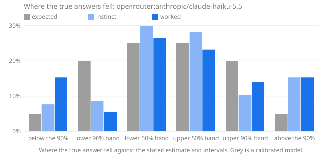

# Calibench report: openrouter:anthropic/claude-haiku-5.5

Seed `2026-10-17`, 26 questions, Calibench 1.0.0, Python 3.13.16 (Unicode 15.1.0), started 2026-10-17T03:01:02+00:00. Scored with Calibench 2.1.0 (log-wis-1).

Served by: anthropic/claude-haiku-5.5 via Claude Platform on AWS.

Tokens: prompt tokens 12,902, completion tokens 141,467, reasoning tokens 122,067.

Cost reported by the API: 0.0720 (US dollars on OpenRouter).

## Summary

| | Instinct | Worked |
|---|---|---|
| Answered | 26 of 26 | 26 of 26 |
| **Score**, mean [90% interval] | **0.185** [0.097, 0.287] | **0.104** [0.044, 0.177] |
| Score, median | 0.096 | 0.017 |
| Interval score, 50% / 90% intervals | 0.924 / 2.434 | 0.501 / 1.376 |
| 50% intervals containing the answer [90% interval] | 16 of 26 (62%) [45%, 75%] | 15 of 26 (58%) [42%, 72%] |
| … leaving out single numbers | 15 of 25 (60%): consistent with calibrated | 13 of 24 (54%): consistent with calibrated |
| 90% intervals containing the answer [90% interval] | 20 of 26 (77%) [61%, 88%] | 18 of 26 (69%) [53%, 82%] |
| … leaving out single numbers | 20 of 26 (77%): too narrow (overconfident) | 18 of 26 (69%): too narrow (overconfident) |
| Answers given as certain (a single number) | 0, 0 exactly right | 0, 0 exactly right |
| Median error of the estimate | 2.7% | 2.4% |
| Estimate closer to the answer | 6 | 15 |

Working it out lowered the score on 19 of 26 questions answered both ways, from 0.185 to 0.104 on average (improvement [0.027, 0.141]).

The score is the weighted interval score (Bracher et al., 2021) on a log scale: it combines the estimate and both intervals, is lowest when the stated intervals are the ones the model believes, and treats a miss by a factor in either direction alike. Lower is better; 0.1 is roughly a 10% miss. Intervals in brackets are 90% intervals over questions. Coverage verdicts leave out single-number intervals, which say "I know this exactly" and are counted on their own line.

## Where the true answers fell

The estimate and the two intervals are five quantiles of the model's belief, so they split it into six bins, and a calibrated model's true answers land in each bin in the expected share. Too many in the outer bins means intervals too narrow; too many on one side of the estimate means a lean in that direction. Single-number answers are left out, and an answer on a boundary is shared between the bins it touches.

| The true answer was | Expected | Instinct | Worked |
|---|---|---|---|
| below the 90% interval | 5% | 8% (2) | 15% (4) |
| in the 90% interval, below the 50% | 20% | 9% (2.222) | 6% (1.444) |
| in the 50% interval, below the estimate | 25% | 30% (7.778) | 27% (6.913) |
| in the 50% interval, above the estimate | 25% | 28% (7.333) | 23% (6.024) |
| in the 90% interval, above the 50% | 20% | 10% (2.667) | 14% (3.619) |
| above the 90% interval | 5% | 15% (4) | 15% (4) |
| **above the estimate**, with 90% interval | 50% | 54% [38%, 69%] | 52% [38%, 69%] |

## Where the score comes from

A few large misses can carry a mean. This shows how much of each score its largest questions carry, and the worked answers whose 90% interval missed, costliest first.

| | Instinct | Worked |
|---|---|---|
| Share of the score from the largest question | 24% | 33% |
| Share from the five largest | 71% | 81% |
| Mean score without the largest question | 0.147 | 0.072 |

**Worked answers outside their 90% interval.** *Outside by* is the factor between the true answer and the nearer end of the interval; *width* is the ratio of the interval's ends, so a narrow interval that misses by a wide factor is a confident miss.

| # | Question | True answer | Estimate [90% interval] | Width | Outside by | Score | Share of score |
|---|---|---|---|---|---|---|---|
| 16 | Unicode names with the word WHITE | 290 | 105 [84, 135] | ×1.6 | ×2.14 above | 0.899 | 33% |
| 6 | Unicode names with the word HAND | 304 | 125 [40, 240] | ×5.88 | ×1.27 above | 0.610 | 23% |
| 5 | Collatz steps from 492,058,289,036 | 150 | 275 [175, 400] | ×2.28 | ×1.17 below | 0.406 | 15% |
| 11 | code points in category No | 915 | 1,050 [960, 1,180] | ×1.23 | ×1.05 below | 0.099 | 4% |
| 14 | assigned in the Lao block | 83 | 76 [68, 81] | ×1.19 | ×1.02 above | 0.062 | 2% |
| 12 | digit sum of 2^3432 | 4,879 | 4,651 [4,500, 4,800] | ×1.07 | ×1.02 above | 0.034 | 1% |
| 20 | highest point of a 427-step walk | 16.12 | 16.5 [16.15, 16.85] | ×1.04 | ×1 below | 0.015 | 1% |
| 7 | highest point of a 508-step walk | 17.56 | 17.97 [17.62, 18.33] | ×1.04 | ×1 below | 0.015 | 1% |

## By kind of question

Knowledge questions ask what is known (the Python standard library, the Unicode database); statistical ones need noise or irregularity modelled; exact ones have a closed-form answer that must be evaluated; calculation ones have an exact answer that takes long, careful arithmetic.

| Kind | Phase | Questions | Score | 50% hits | 90% hits |
|---|---|---|---|---|---|
| exact | instinct | 2 | 0.110 | 2 of 2 (100%) | 2 of 2 (100%) |
| exact | worked | 2 | 0.112 | 2 of 2 (100%) | 2 of 2 (100%) |
| knowledge | instinct | 12 | 0.321 | 5 of 12 (42%) | 7 of 12 (58%) |
| knowledge | worked | 12 | 0.151 | 8 of 12 (67%) | 8 of 12 (67%) |
| statistical | instinct | 12 | 0.063 | 9 of 12 (75%) | 11 of 12 (92%) |
| statistical | worked | 12 | 0.056 | 5 of 12 (42%) | 8 of 12 (67%) |

## By family

| Family | Kind | Questions | Score, worked | Score, instinct | Worked 90% hits | Worked answers above the estimate |
|---|---|---|---|---|---|---|
| `birthday` | exact | 2 | 0.112 | 0.110 | 2 of 2 (100%) | 0% |
| `collatz_steps` | statistical | 2 | 0.281 | 0.135 | 1 of 2 (50%) | 0% |
| `digit_sum_pow2` | statistical | 2 | 0.019 | 0.019 | 1 of 2 (50%) | 50% |
| `lis` | statistical | 2 | 0.011 | 0.013 | 2 of 2 (100%) | 100% |
| `module_all` | knowledge | 2 | 0.013 | 0.448 | 2 of 2 (100%) | 75% |
| `primes_in_range` | statistical | 2 | 0.009 | 0.008 | 2 of 2 (100%) | 50% |
| `rect_distance` | statistical | 2 | 0.001 | 0.017 | 2 of 2 (100%) | 100% |
| `stdlib_defs` | knowledge | 2 | 0.043 | 0.099 | 2 of 2 (100%) | 50% |
| `stdlib_lines` | knowledge | 2 | 0.014 | 0.050 | 2 of 2 (100%) | 50% |
| `unicode_block` | knowledge | 2 | 0.032 | 0.075 | 1 of 2 (50%) | 75% |
| `unicode_category` | knowledge | 2 | 0.051 | 0.158 | 1 of 2 (50%) | 25% |
| `unicode_word` | knowledge | 2 | 0.754 | 1.095 | 0 of 2 (0%) | 100% |
| `walk_max` | statistical | 2 | 0.015 | 0.183 | 0 of 2 (0%) | 0% |

## Questions

Each answer is shown as estimate [90% interval], ✓ or ✗ for whether the 50% and 90% intervals contain the true answer, and its score.

| # | Question | True answer | Instinct | Worked |
|---|---|---|---|---|
| 1 | mean distance in a 1 × 2.39 rectangle | 0.9228 | 0.92 [0.78, 1.08] 50✓ 90✓ · 0.021 | 0.9226 [0.9175, 0.9275] 50✓ 90✓ · 0.001 |
| 2 | longest increasing subsequence, n = 144 | 20.59 | 20 [16.8, 23.2] 50✓ 90✓ · 0.024 | 19.9 [18.9, 21] 50✗ 90✓ · 0.019 |
| 3 | assigned in the Ethiopic block | 358 | 357 [310, 359] 50✓ 90✓ · 0.009 | 358 [342, 362] 50✓ 90✓ · 0.003 |
| 4 | draws until a repeat, d = 141 | 15.56 | 15.5 [4, 30] 50✓ 90✓ · 0.101 | 15.56 [5, 29] 50✓ 90✓ · 0.105 |
| 5 | Collatz steps from 492,058,289,036 | 150 | 170 [90, 290] 50✓ 90✓ · 0.096 | 275 [175, 400] 50✗ 90✗ · 0.406 |
| 6 | Unicode names with the word HAND | 304 | 75 [40, 130] 50✗ 90✗ · 1.147 | 125 [40, 240] 50✗ 90✗ · 0.610 |
| 7 | highest point of a 508-step walk | 17.56 | 18 [2.8, 37] 50✓ 90✓ · 0.185 | 17.97 [17.62, 18.33] 50✗ 90✗ · 0.015 |
| 8 | lines in `queue` | 385 | 330 [250, 430] 50✗ 90✓ · 0.080 | 392 [360, 430] 50✓ 90✓ · 0.013 |
| 9 | function definitions in `pickle` | 127 | 110 [60, 180] 50✓ 90✓ · 0.096 | 118 [94, 140] 50✓ 90✓ · 0.040 |
| 10 | primes in [546,440, 556,877] | 790 | 790 [764, 816] 50✓ 90✓ · 0.003 | 789 [757, 822] 50✓ 90✓ · 0.005 |
| 11 | code points in category No | 915 | 1,400 [1,100, 1,750] 50✗ 90✗ · 0.314 | 1,050 [960, 1,180] 50✗ 90✗ · 0.099 |
| 12 | digit sum of 2^3432 | 4,879 | 4,653 [4,502, 4,804] 50✗ 90✗ · 0.033 | 4,651 [4,500, 4,800] 50✗ 90✗ · 0.034 |
| 13 | names in `pprint.__all__` | 7 | 4 [2, 8] 50✗ 90✓ · 0.272 | 7 [6, 8] 50✓ 90✓ · 0.005 |
| 14 | assigned in the Lao block | 83 | 67 [56, 80] 50✗ 90✗ · 0.141 | 76 [68, 81] 50✗ 90✗ · 0.062 |
| 15 | primes in [1,470,770, 1,476,106] | 367 | 376 [352, 400] 50✗ 90✓ · 0.013 | 376 [354, 398] 50✓ 90✓ · 0.012 |
| 16 | Unicode names with the word WHITE | 290 | 80 [40, 140] 50✗ 90✗ · 1.044 | 105 [84, 135] 50✗ 90✗ · 0.899 |
| 17 | Collatz steps from 752,299,430,991 | 200 | 280 [160, 430] 50✗ 90✓ · 0.173 | 275 [120, 440] 50✗ 90✓ · 0.155 |
| 18 | lines in `textwrap` | 497 | 500 [430, 580] 50✓ 90✓ · 0.019 | 485 [448, 525] 50✓ 90✓ · 0.014 |
| 19 | longest increasing subsequence, n = 3,063 | 104.4 | 103.9 [102.3, 105.5] 50✓ 90✓ · 0.002 | 103.9 [103, 104.9] 50✗ 90✓ · 0.003 |
| 20 | highest point of a 427-step walk | 16.12 | 16.5 [2, 41] 50✓ 90✓ · 0.181 | 16.5 [16.15, 16.85] 50✗ 90✗ · 0.015 |
| 21 | digit sum of 2^8365 | 11,252 | 11,331 [11,094, 11,568] 50✓ 90✓ · 0.004 | 11,335 [11,098, 11,572] 50✓ 90✓ · 0.004 |
| 22 | draws until a repeat, d = 283,156 | 667.6 | 668 [171, 1,303] 50✓ 90✓ · 0.119 | 667.6 [170, 1,303] 50✓ 90✓ · 0.119 |
| 23 | function definitions in `traceback` | 70 | 80 [40, 150] 50✓ 90✓ · 0.103 | 75 [58, 98] 50✓ 90✓ · 0.045 |
| 24 | code points in category Zs | 17 | 17 [16, 18] 50✓ 90✓ · 0.002 | 17 [16, 18] 50✓ 90✓ · 0.002 |
| 25 | names in `locale.__all__` | 23 | 60 [30, 110] 50✗ 90✗ · 0.625 | 22 [20, 24] 50✓ 90✓ · 0.021 |
| 26 | mean distance in a 1 × 3.63 rectangle | 1.311 | 1.31 [1.18, 1.45] 50✓ 90✓ · 0.013 | 1.31 [1.306, 1.313] 50✓ 90✓ · 0.000 |
